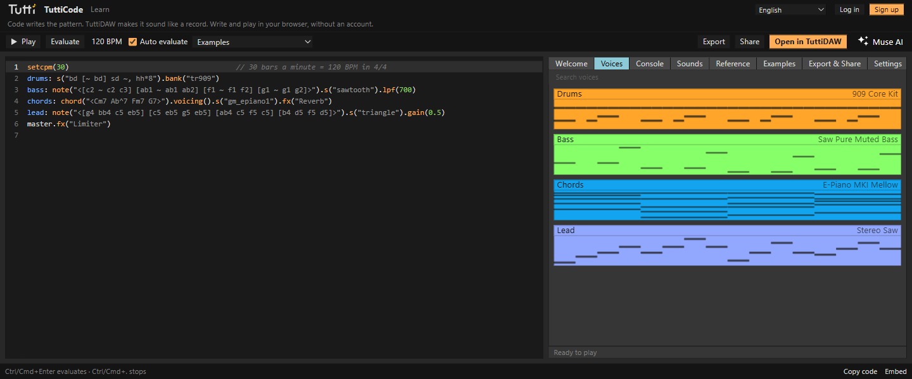
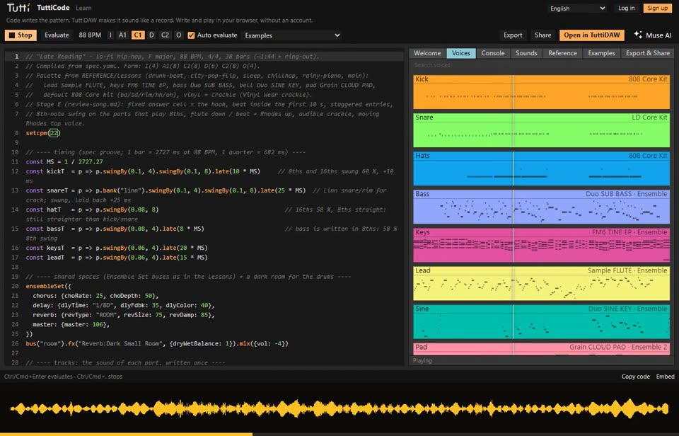
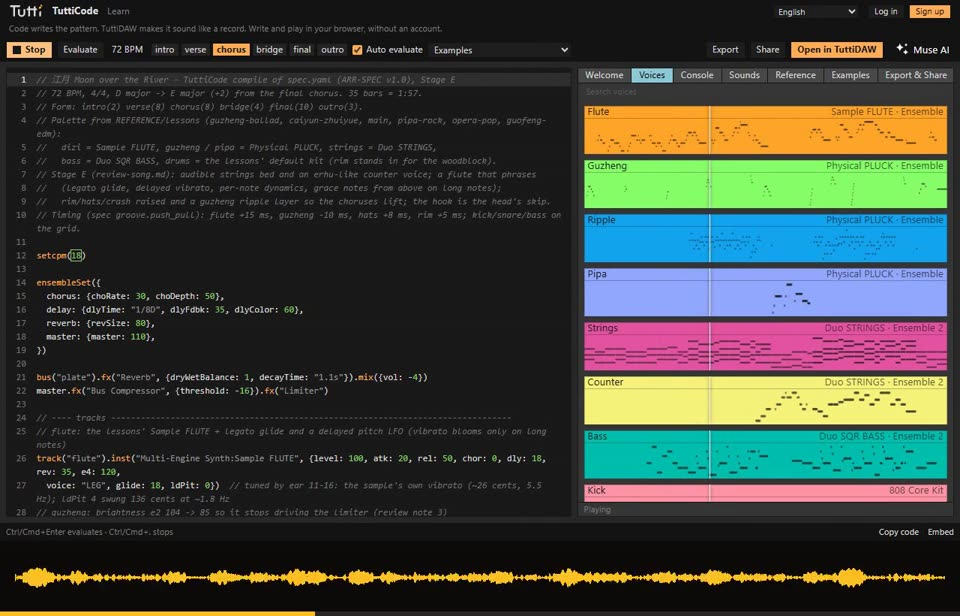
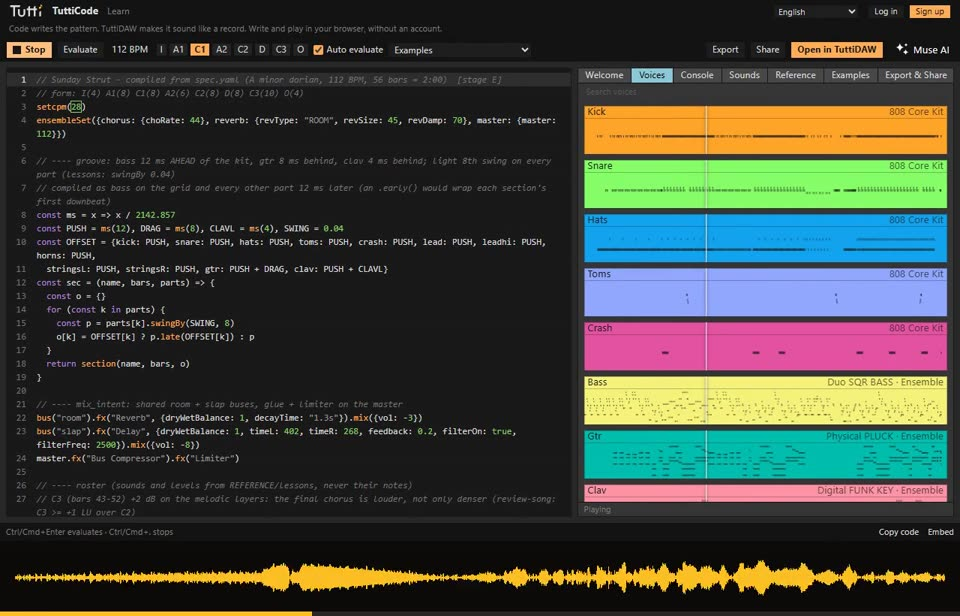
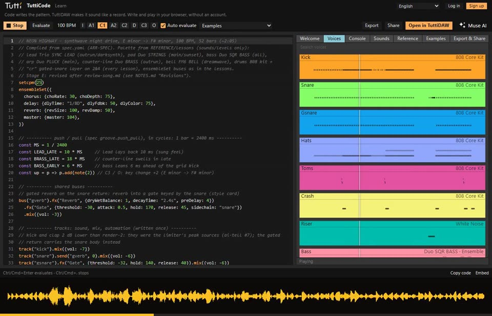
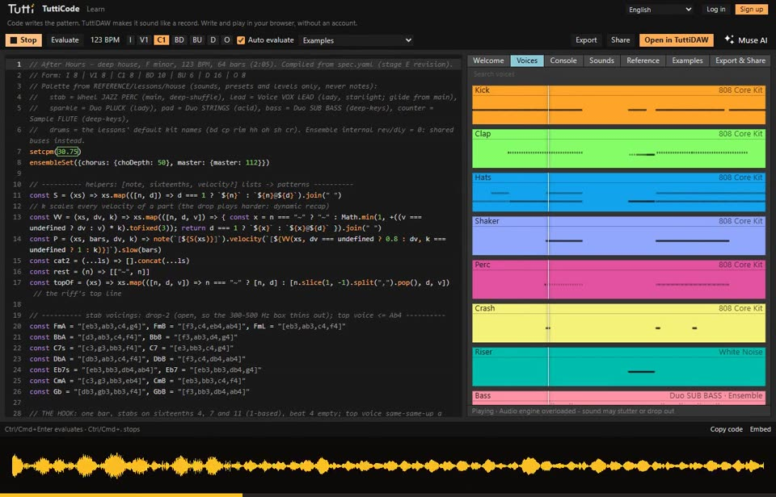

<p align="center">
  
</p>

<h1 align="center">TuttiCode for agents</h1>

<p align="center">
  <a href="README.md">English</a> ·
  <a href="README.zh-CN.md">简体中文</a> ·
  <a href="README.zh-TW.md">繁體中文</a> ·
  <strong>日本語</strong> ·
  <a href="README.ko.md">한국어</a>
</p>

<p align="center">
  <a href="https://www.npmjs.com/package/tutticode"></a>
  <a href="https://github.com/tuttidaw/tutticode/actions/workflows/e2e.yml"></a>
  <a href="LICENSE"></a>
</p>

<p align="center"><strong>エージェントが音楽をコードで書く。あなたは聴いて、DAW で開く。</strong></p>

TuttiCode は音楽のためのパターン言語で、[Strudel](https://strudel.cc) のスーパーセットです。[TuttiDAW](https://tuttidaw.com) のインストゥルメントとエフェクトで鳴ります。このリポジトリは Claude Code、Codex、Copilot CLI、そしてあらゆる MCP クライアントを作曲家・サウンドデザイナーにします。エージェントは短いプログラムを書いてチェックし、正確な長さで **WAV、FLAC、MP3** にレンダリングします。**ステム**、フェード、**ラウドネス目標** にも対応します。レンダリング結果の数値を読んで修正し、ファイルと `editUrl` を渡してくれます。このリンクを開くと TuttiDAW にプログラムが読み込まれ、声部ごとに 1 トラックずつ並ぶので、そのまま手で編集を続けられます。

レンダリングは **あなた自身のブラウザ内** で、[tuttidaw.com/code](https://tuttidaw.com/code) と同じエンジンを使って行われます。サーバーでは何もレンダリングせず、無料です。音声生成モデルは一切使いません。

[](https://tuttidaw.com/code#c2V0Y3BtKDMwKSAgICAgICAgICAgICAgICAgICAgICAgICAgICAgICAgICAgICAgICAvLyAzMCBiYXJzIGEgbWludXRlID0gMTIwIEJQTSBpbiA0LzQKZHJ1bXM6IHMoImJkIFt%2BIGJkXSBzZCB%2BLCBoaCo4IikuYmFuaygidHI5MDkiKQpiYXNzOiBub3RlKCI8W2MyIH4gYzIgYzNdIFthYjEgfiBhYjEgYWIyXSBbZjEgfiBmMSBmMl0gW2cxIH4gZzEgZzJdPiIpLnMoInNhd3Rvb3RoIikubHBmKDcwMCkKY2hvcmRzOiBjaG9yZCgiPENtNyBBYl43IEZtNyBHNz4iKS52b2ljaW5nKCkucygiZ21fZXBpYW5vMSIpLmZ4KCJSZXZlcmIiKQpsZWFkOiBub3RlKCI8W2c0IGJiNCBjNSBlYjVdIFtjNSBlYjUgZzUgZWI1XSBbYWI0IGM1IGY1IGM1XSBbYjQgZDUgZjUgZDVdPiIpLnMoInRyaWFuZ2xlIikuZ2FpbigwLjUpCm1hc3Rlci5meCgiTGltaXRlciIpCg%3D%3D)

## For agents

If you are an AI agent asked to make music or sound with this repository, you do not need to install anything first:

1. `npx -y tutticode doctor` checks Node 20+ and Chrome or Edge. No browser on Linux: install Chrome as a package (`curl -fLO https://dl.google.com/linux/direct/google-chrome-stable_current_amd64.deb && sudo apt install ./google-chrome-stable_current_amd64.deb`); an unpacked or container Chrome also needs `TUTTICODE_BROWSER_ARGS=--no-sandbox`.
2. Read the skill: [`skills/tutticode/SKILL.md`](skills/tutticode/SKILL.md) ([raw](https://raw.githubusercontent.com/tuttidaw/tutticode/main/skills/tutticode/SKILL.md)); for beds, loops and sound effects at a length and loudness, also [`skills/tutticode-sound-for-media/SKILL.md`](skills/tutticode-sound-for-media/SKILL.md) ([raw](https://raw.githubusercontent.com/tuttidaw/tutticode/main/skills/tutticode-sound-for-media/SKILL.md)).
3. Write the program to a `.tc` file, then `npx -y tutticode check song.tc` until it is clean, and `npx -y tutticode render song.tc -o song.mp3 --seconds 20 --lufs -14 --json`. Give the user the file, its loudness and the `editUrl`.

Without sign-in a render is at most 60 s and one over 30 s carries a spoken tag: for longer pieces ask the user to run `npx tutticode login` (free). `npx tutticode skills install` keeps the skills for Claude Code, Copilot CLI and Codex.

## 聴いてみる

<!-- examples:start -->
エージェント（Claude Code + Claude Opus 5.5）が、1 曲あたり 1 段落の依頼から TuttiCode で書いた 5 曲です。曲を計画してメロディを 3 案書き、独立したレビュアーが 1 案を選び、セクション構成で 1 曲を仕上げ、2 人目のレビュアーの指摘を受けて修正しました。動画はどれも TuttiDAW がそのプログラムを実際に再生しているところです。[制作の流れ](examples/README.md)。

| | |
|---|---|
| [](https://assets.tuttidaw.com/showcase/late-reading/late-reading-hq.mp4) | **Late Reading**<br>Lo-fi ヒップホップ · 88 BPM · 1:44<br>[動画](https://assets.tuttidaw.com/showcase/late-reading/late-reading-hq.mp4) · [MP3](https://assets.tuttidaw.com/showcase/late-reading/late-reading.mp3) · [コードとメモ](examples/late-reading) |
| [](https://assets.tuttidaw.com/showcase/moon-over-the-river/moon-over-the-river-hq.mp4) | **江月 Moon over the River**<br>国風バラード · 72 BPM · 1:57<br>[動画](https://assets.tuttidaw.com/showcase/moon-over-the-river/moon-over-the-river-hq.mp4) · [MP3](https://assets.tuttidaw.com/showcase/moon-over-the-river/moon-over-the-river.mp3) · [コードとメモ](examples/moon-over-the-river) |
| [](https://assets.tuttidaw.com/showcase/sunday-strut/sunday-strut-hq.mp4) | **Sunday Strut**<br>ファンク / ディスコ · 112 BPM · 2:00<br>[動画](https://assets.tuttidaw.com/showcase/sunday-strut/sunday-strut-hq.mp4) · [MP3](https://assets.tuttidaw.com/showcase/sunday-strut/sunday-strut.mp3) · [コードとメモ](examples/sunday-strut) |
| [](https://assets.tuttidaw.com/showcase/neon-highway/neon-highway-hq.mp4) | **Neon Highway**<br>シンセウェイヴ · 100 BPM · 2:05<br>[動画](https://assets.tuttidaw.com/showcase/neon-highway/neon-highway-hq.mp4) · [MP3](https://assets.tuttidaw.com/showcase/neon-highway/neon-highway.mp3) · [コードとメモ](examples/neon-highway) |
| [](https://assets.tuttidaw.com/showcase/after-hours/after-hours-hq.mp4) | **After Hours**<br>ディープハウス · 123 BPM · 2:05<br>[動画](https://assets.tuttidaw.com/showcase/after-hours/after-hours-hq.mp4) · [MP3](https://assets.tuttidaw.com/showcase/after-hours/after-hours.mp3) · [コードとメモ](examples/after-hours) |
<!-- examples:end -->

## クイックスタート

1. 使っているエージェントに **インストール** します。

   | エージェント | コマンド |
   | --- | --- |
   | Claude Code | `/plugin marketplace add tuttidaw/tutticode` の後に `/plugin install tutticode@tutticode` |
   | Codex、Cursor など | `npx skills add tuttidaw/tutticode` |
   | Copilot CLI | `copilot plugin marketplace add tuttidaw/tutticode` の後に `copilot plugin install tutticode@tutticode` |
   | 任意の MCP クライアント | `npx -y tutticode mcp` を stdio サーバーとして登録し、`npx tutticode skills install` も実行 |

   Node 20 以上と、Google Chrome または Microsoft Edge が必要です。プラグインは npm から MCP サーバー（[`tutticode`](https://www.npmjs.com/package/tutticode)）を起動するので、ほかに設定するものはありません。

2. 普段の言葉で **頼みます**。

   > 動画用に 12 秒の lo-fi イントロ BGM を作って。-16 LUFS、最後に 1.5 秒のフェードアウト。

3. ファイル、レポート（長さ、秒単位の小節グリッド、ラウドネス、トゥルーピーク、声部ごとのレベル）、そして `editUrl` を **受け取ります**。リンクを開くとプログラムが入った TuttiCode エディターが開き、*Open in TuttiDAW* を押すと声部ごとに 1 トラックのプロジェクトになります。

任意：`npx tutticode login`（無料アカウント）で下記の制限が外れます。

## 得意なこと

- **あなたが作っているものの音楽。** 動画、ポッドキャスト、アプリ、ゲーム向けの BGM やループを、秒・小節・ループ数で正確な長さに、プラットフォームのラウドネス（Web -14 LUFS、ポッドキャスト -16、放送 -23）に合わせて作ります。
- **効果音。** ライザー、インパクト、ウーシュ、UI クリック、確認音、エラー音、通知音。検証済みのレシピが [`tutticode-sound-for-media`](skills/tutticode-sound-for-media/SKILL.md) スキルにあります。
- **曲。** 1 つのプログラムで最大 128 小節の曲をまるごと書けます。各トラックの音色は 1 回だけ、各セクションは 1 ブロックに、曲順は form に書きます。
- **修正。** 1 行変えて、もう一度レンダリング。`code_compare` はレンダリングを目標（またはジャンルのスタイル）や前回のレンダリングと比べるので、エージェントは何が変わったかを把握できます。
- **人への引き継ぎ。** どの結果もエディターと DAW にリンクしています。コードがそのままプロジェクトです。

## なぜ text-to-music モデルではなくコードなのか

| | text-to-music モデル | TuttiCode |
|---|---|---|
| 1 か所だけ変える | 曲全体かセクションを再生成 | 1 行編集して再レンダリング |
| 得られるもの | 音声ファイル | 音声、ステム、プログラム、DAW プロジェクト |
| カットやレベルに合わせる | おおよそ | 小節単位・秒単位で：正確な長さ、ループポイント、秒単位の小節グリッド |
| プラットフォームのラウドネス | 出てきたまま | LUFS 目標とトゥルーピーク上限を指定し、結果を報告 |
| 同じ曲をもう一度 | 別テイクになる | 同じプログラムは同じ音声をレンダリング |
| 実行場所 | クラウドの GPU | あなたのブラウザ、無料 |

エージェントがすでに動画を編集していたりゲームを作っていたりするなら、シーンの長さもカットの位置もステージのループの仕方も分かっています。その数字に合わせて書けますし、編集が変わったら動いた小節だけ書き直せます。

## 言語をちょっと味見

```js
setcpm(30)                                        // 1 分間に 30 小節 = 4/4 拍子で 120 BPM
drums: s("bd [~ bd] sd ~, hh*8").bank("tr909")
bass: note("<[c2 ~ c2 c3] [ab1 ~ ab1 ab2] [f1 ~ f1 f2] [g1 ~ g1 g2]>").s("sawtooth").lpf(700)
chords: chord("<Cm7 Ab^7 Fm7 G7>").voicing().s("gm_epiano1").fx("Reverb")
lead: note("<[g4 bb4 c5 eb5] [c5 eb5 g5 eb5] [ab4 c5 f5 c5] [b4 d5 f5 d5]>").s("triangle").gain(0.5)
master.fx("Limiter")
```

[▶ このプログラムを TuttiCode で再生](https://tuttidaw.com/code#c2V0Y3BtKDMwKSAgICAgICAgICAgICAgICAgICAgICAgICAgICAgICAgICAgICAgICAvLyAzMCBiYXJzIGEgbWludXRlID0gMTIwIEJQTSBpbiA0LzQKZHJ1bXM6IHMoImJkIFt%2BIGJkXSBzZCB%2BLCBoaCo4IikuYmFuaygidHI5MDkiKQpiYXNzOiBub3RlKCI8W2MyIH4gYzIgYzNdIFthYjEgfiBhYjEgYWIyXSBbZjEgfiBmMSBmMl0gW2cxIH4gZzEgZzJdPiIpLnMoInNhd3Rvb3RoIikubHBmKDcwMCkKY2hvcmRzOiBjaG9yZCgiPENtNyBBYl43IEZtNyBHNz4iKS52b2ljaW5nKCkucygiZ21fZXBpYW5vMSIpLmZ4KCJSZXZlcmIiKQpsZWFkOiBub3RlKCI8W2c0IGJiNCBjNSBlYjVdIFtjNSBlYjUgZzUgZWI1XSBbYWI0IGM1IGY1IGM1XSBbYjQgZDUgZjUgZDVdPiIpLnMoInRyaWFuZ2xlIikuZ2FpbigwLjUpCm1hc3Rlci5meCgiTGltaXRlciIpCg%3D%3D)

Strudel のコードはそのまま動きます。TuttiCode はそこに TuttiDAW のインストゥルメントとエフェクト（`.inst`、`.fx`、`.midifx`）、バスとグループ、オートメーション、サイドチェイン、セクションを持つ曲全体、ドレミで書くメロディを加えます。[スキル](skills/tutticode/SKILL.md) がそのすべてをエージェントに教えます。人は [tuttidaw.com/code/learn](https://tuttidaw.com/code/learn) で学べます。

## 仕組み

```
agent ──MCP / CLI──▶ tutticode (Node, from npm) ──WebSocket 127.0.0.1──▶ tuttidaw.com/code/bridge (your browser)
```

1. 最初の呼び出しで、ランダムなポートとワンタイムトークンを使ったローカルサーバーが `127.0.0.1` に立ち上がり、専用プロファイルのヘッドレス Chrome または Edge で TuttiCode のブリッジページが開きます。
2. ページは TuttiCode エンジンでプログラムをレンダリングし、音声をストリームで返します。tutticode は受け取ったものをすべて検証してからファイルに書き出します。
3. ブリッジは 10 分間ウォーム状態を保つので、以降のレンダリングはすぐに始まります。

MCP ツールは TuttiDAW の Web 版エージェントループと同じなので、1 つのスキルで両方を教えられます。

| ツール | 役割 |
| --- | --- |
| `code_check` | コンパイルと計画のみ、音声なし：診断、声部、ミックスの警告 |
| `code_render` | ファイルにレンダリング。パス、統計、`editUrl` を返す |
| `code_compare` | レンダリングを目標（またはスタイル）と比較、または 2 つのレンダリングを比較 |
| `code_open` | 表示中の TuttiCode タブでプログラムを開く |
| `code_reference` | パッケージに同梱の TuttiCode リファレンスを検索 |
| `code_account` | サインインの有無、制限、今日の使用量 |

CLI でも、ターミナルやスクリプトから同じことができます。

```sh
npx tutticode check song.tc
npx tutticode render song.tc -o bed.wav --seconds 12 --fade-out 1.5 --lufs -16 --json
npx tutticode render song.tc -o loop.flac --loops 4 --stems stems/
```

詳しいリファレンス：[npm パッケージの README](https://www.npmjs.com/package/tutticode) と [TuttiCode for agents](https://tuttidaw.com/code/learn/for-agents)。

## その他

<details>
<summary><b>制限とサインイン</b></summary>

| | サインインなし | 無料アカウント |
| --- | --- | --- |
| 最長レンダリング | 60 秒 | 5 分 |
| 音声タグ「register at TuttiDAW」 | 30 秒を超えるレンダリングにミックスされる | なし |
| フォーマット、ステム、ラウドネス | すべて | すべて |

`npx tutticode login` はブラウザを開いて承認を求めます。`npx tutticode login --device` はコードを表示し、任意のデバイスで承認できます（SSH やサーバー向け）。このサインインでできるのは TuttiCode でのレンダリングだけで、あなたのプロジェクト、アカウント、課金情報にはアクセスできません。CI では、アカウントページで発行したアクセストークンを `TUTTICODE_TOKEN` に設定してください。

</details>

<details>
<summary><b>プライバシー</b></summary>

プログラムはエージェントから、あなた自身のブラウザ内の TuttiCode ページへ送られるだけで、ほかのどこにも行きません。プログラムのコードも音声も当社のサーバーには送信されず、tutticode はテレメトリーを一切送信しません。ページは普通の Web ページと同じく tuttidaw.com からインストゥルメントやサンプルとともに読み込まれ、各レンダリングの長さ、フォーマット、結果を集計します。詳細：[PRIVACY.md](PRIVACY.md)。

</details>

<details>
<summary><b>トラブルシューティング</b></summary>

- `npx tutticode doctor` は Node、ブラウザ、ページ、接続、サインインをチェックし、何を直せばよいかを教えてくれます。
- Chrome または Edge がインストールされている必要があります。通常と異なる場所にある場合は、そのパスを `TUTTICODE_BROWSER` に設定してください。
- ユーザー名前空間のないコンテナや CI では、`TUTTICODE_BROWSER_ARGS=--no-sandbox` を設定してください。
- エージェントが `limit` でレンダリングに失敗したと言う場合：サインインなしの上限 60 秒より長い曲です。`npx tutticode login` を実行してください。

</details>

<details>
<summary><b>このリポジトリの中身</b></summary>

| パス | 内容 |
| --- | --- |
| [`skills/tutticode`](skills/tutticode/SKILL.md) | 言語そのもの：構文、よくある間違い、check / render / compare のループ、すべての関数・音色・デバイスのリファレンス |
| [`skills/tutticode-sound-for-media`](skills/tutticode-sound-for-media/SKILL.md) | 動画、アプリ、ゲーム向けの BGM、ループ、ステム、効果音 |
| `.claude-plugin/`、`.codex-plugin/`、`.agents/` | プラグインとマーケットプレイスのマニフェスト |
| [`.mcp.json`](.mcp.json) | MCP サーバー：`npx -y tutticode@<version> mcp` |
| [`examples/`](examples) | 上の作品：プログラム、メモ、レンダリング設定 |

スキルは公開済みの npm パッケージからコピーしているので、固定した CLI のバージョンと常に一致します。同期はワークフローが行います。CLI 本体は TuttiDAW のメインリポジトリで開発され、npm に公開されています。

</details>

## フィードバック

バグ、おかしな音、アイデアは [issue を作成](https://github.com/tuttidaw/tutticode/issues/new/choose) してください。作ったものは [Discussions](https://github.com/tuttidaw/tutticode/discussions) で見せてください。

## ライセンス

MIT。[LICENSE](LICENSE) を参照してください。レンダリングには tuttidaw.com 上の TuttiCode エンジンを [TuttiDAW 利用規約](https://tuttidaw.com/page/terms-of-use) のもとで使用します。この規約は、あなたが作ったものの所有権を一切主張しません。
