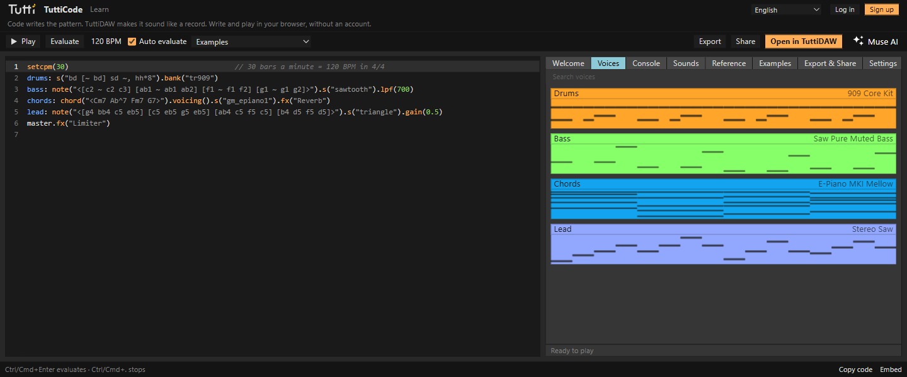

<p align="center">
  
</p>

<h1 align="center">TuttiCode for agents</h1>

<p align="center">
  <a href="README.md">English</a> ·
  <a href="README.zh-CN.md">简体中文</a> ·
  <a href="README.zh-TW.md">繁體中文</a> ·
  <a href="README.ja.md">日本語</a> ·
  <strong>한국어</strong>
</p>

<p align="center">
  <a href="https://www.npmjs.com/package/tutticode"></a>
  <a href="https://github.com/tuttidaw/tutticode/actions/workflows/e2e.yml"></a>
  <a href="LICENSE"></a>
</p>

<p align="center"><strong>에이전트가 음악을 코드로 씁니다. 듣고 나서 DAW에서 여세요.</strong></p>

TuttiCode는 음악을 위한 패턴 언어로, [Strudel](https://strudel.cc)의 상위 집합이며 [TuttiDAW](https://tuttidaw.com)의 악기와 이펙트로 소리를 냅니다. 이 저장소는 Claude Code, Codex, Copilot CLI 및 모든 MCP 클라이언트를 작곡가이자 사운드 디자이너로 만들어 줍니다. 에이전트는 짧은 프로그램을 작성하고 검사한 뒤, 정확한 길이로 **WAV, FLAC 또는 MP3**로 렌더링합니다. **스템**, 페이드, **라우드니스 목표**도 지원합니다. 렌더링 결과의 수치를 읽고 수정한 다음, 파일과 함께 `editUrl`을 건네줍니다. 이 링크는 TuttiDAW에서 프로그램을 열어 성부마다 트랙 하나씩 만들어 주므로, 이어서 직접 편집할 수 있습니다.

렌더링은 [tuttidaw.com/code](https://tuttidaw.com/code)와 같은 엔진으로 **여러분의 브라우저 안에서** 이루어집니다. 서버에서는 아무것도 렌더링하지 않으며, 무료입니다. 오디오 생성 모델은 전혀 사용하지 않습니다.

[](https://tuttidaw.com/code#c2V0Y3BtKDMwKSAgICAgICAgICAgICAgICAgICAgICAgICAgICAgICAgICAgICAgICAvLyAzMCBiYXJzIGEgbWludXRlID0gMTIwIEJQTSBpbiA0LzQKZHJ1bXM6IHMoImJkIFt%2BIGJkXSBzZCB%2BLCBoaCo4IikuYmFuaygidHI5MDkiKQpiYXNzOiBub3RlKCI8W2MyIH4gYzIgYzNdIFthYjEgfiBhYjEgYWIyXSBbZjEgfiBmMSBmMl0gW2cxIH4gZzEgZzJdPiIpLnMoInNhd3Rvb3RoIikubHBmKDcwMCkKY2hvcmRzOiBjaG9yZCgiPENtNyBBYl43IEZtNyBHNz4iKS52b2ljaW5nKCkucygiZ21fZXBpYW5vMSIpLmZ4KCJSZXZlcmIiKQpsZWFkOiBub3RlKCI8W2c0IGJiNCBjNSBlYjVdIFtjNSBlYjUgZzUgZWI1XSBbYWI0IGM1IGY1IGM1XSBbYjQgZDUgZjUgZDVdPiIpLnMoInRyaWFuZ2xlIikuZ2FpbigwLjUpCm1hc3Rlci5meCgiTGltaXRlciIpCg%3D%3D)

## 들어 보기

<!-- examples:start -->
여섯 곡을 각각 다른 모델이 [같은 시작 프롬프트](examples/prompt.md)와 한두 문장짜리 짧은 요청만으로 한 번에 만들었습니다. 제목과 사운드는 에이전트가 골랐고, 코드는 모두 에이전트가 작성했으며, 렌더링하고 수치를 읽고 수정했습니다. 작업하는 동안 아무도 답하지 않았고 아무도 코드를 고치지 않았습니다. 각 페이지에는 프로그램, 에이전트의 메모, TuttiDAW에서 여는 링크가 있습니다.

_첫 릴리스와 함께 공개됩니다._
<!-- examples:end -->

## 빠른 시작

1. 사용하는 에이전트에 **설치**합니다.

   | 에이전트 | 명령어 |
   | --- | --- |
   | Claude Code | `/plugin marketplace add tuttidaw/tutticode` 후 `/plugin install tutticode@tutticode` |
   | Codex, Cursor 등 | `npx skills add tuttidaw/tutticode` |
   | Copilot CLI | `copilot plugin marketplace add tuttidaw/tutticode` 후 `copilot plugin install tutticode@tutticode` |
   | 모든 MCP 클라이언트 | `npx -y tutticode mcp`를 stdio 서버로 등록하고 `npx tutticode skills install` 실행 |

   Node 20 이상과 Google Chrome 또는 Microsoft Edge가 필요합니다. 플러그인이 npm에서 MCP 서버([`tutticode`](https://www.npmjs.com/package/tutticode))를 실행하므로 따로 설정할 것은 없습니다.

2. 평소 말로 **요청**합니다.

   > 내 영상에 쓸 12초짜리 lo-fi 인트로 배경음악 만들어 줘. -16 LUFS, 끝에 1.5초 페이드아웃.

3. 파일, 리포트(길이, 초 단위 마디 그리드, 라우드니스, 트루 피크, 성부별 레벨), 그리고 `editUrl`을 **받습니다**. 링크를 열면 프로그램이 담긴 TuttiCode 에디터가 열리고, *Open in TuttiDAW*를 누르면 성부마다 트랙이 하나씩 있는 프로젝트가 됩니다.

선택 사항: `npx tutticode login`(무료 계정)으로 아래 제한이 풀립니다.

## 잘하는 것

- **지금 만들고 있는 것을 위한 음악.** 영상, 팟캐스트, 앱, 게임용 배경음악과 루프를 초·마디·루프 수 단위의 정확한 길이로, 플랫폼 라우드니스(웹 -14 LUFS, 팟캐스트 -16, 방송 -23)에 맞춰 만듭니다.
- **효과음.** 라이저, 임팩트, 우시, UI 클릭, 확인음, 오류음, 알림음. 검증된 레시피가 [`tutticode-sound-for-media`](skills/tutticode-sound-for-media/SKILL.md) 스킬에 있습니다.
- **노래.** 프로그램 하나로 최대 128마디의 곡 전체를 쓸 수 있습니다. 트랙마다 사운드는 한 번만, 섹션마다 블록 하나, 곡 순서는 form에 적습니다.
- **수정.** 한 줄 바꾸고 다시 렌더링합니다. `code_compare`는 렌더링을 목표(또는 장르 스타일)나 이전 렌더링과 비교하므로, 에이전트가 무엇이 달라졌는지 알 수 있습니다.
- **사람에게 넘기기.** 모든 결과가 에디터와 DAW로 연결됩니다. 코드가 곧 프로젝트입니다.

## 왜 text-to-music 모델이 아니라 코드인가?

| | text-to-music 모델 | TuttiCode |
|---|---|---|
| 한 가지만 바꾸기 | 곡 전체나 섹션을 다시 생성 | 한 줄 수정 후 다시 렌더링 |
| 얻는 것 | 오디오 파일 | 오디오, 스템, 프로그램, DAW 프로젝트 |
| 컷이나 레벨에 맞추기 | 대략 | 마디나 초 단위로: 정확한 길이, 루프 포인트, 초 단위 마디 그리드 |
| 플랫폼 라우드니스 | 나오는 대로 | LUFS 목표와 트루 피크 상한, 결과 보고 |
| 같은 곡 다시 | 새로운 테이크 | 같은 프로그램은 같은 오디오로 렌더링 |
| 실행 위치 | 클라우드 GPU | 여러분의 브라우저, 무료 |

에이전트가 이미 영상을 편집하거나 게임을 만들고 있다면, 장면이 얼마나 긴지, 컷이 어디에 들어가는지, 레벨이 어떻게 반복되는지 알고 있습니다. 그 숫자에 맞춰 쓸 수 있고, 편집이 바뀌면 달라진 마디만 다시 쓰면 됩니다.

## 언어 맛보기

```js
setcpm(30)                                        // 분당 30마디 = 4/4박자에서 120 BPM
drums: s("bd [~ bd] sd ~, hh*8").bank("tr909")
bass: note("<[c2 ~ c2 c3] [ab1 ~ ab1 ab2] [f1 ~ f1 f2] [g1 ~ g1 g2]>").s("sawtooth").lpf(700)
chords: chord("<Cm7 Ab^7 Fm7 G7>").voicing().s("gm_epiano1").fx("Reverb")
lead: note("<[g4 bb4 c5 eb5] [c5 eb5 g5 eb5] [ab4 c5 f5 c5] [b4 d5 f5 d5]>").s("triangle").gain(0.5)
master.fx("Limiter")
```

[▶ 이 프로그램을 TuttiCode에서 재생](https://tuttidaw.com/code#c2V0Y3BtKDMwKSAgICAgICAgICAgICAgICAgICAgICAgICAgICAgICAgICAgICAgICAvLyAzMCBiYXJzIGEgbWludXRlID0gMTIwIEJQTSBpbiA0LzQKZHJ1bXM6IHMoImJkIFt%2BIGJkXSBzZCB%2BLCBoaCo4IikuYmFuaygidHI5MDkiKQpiYXNzOiBub3RlKCI8W2MyIH4gYzIgYzNdIFthYjEgfiBhYjEgYWIyXSBbZjEgfiBmMSBmMl0gW2cxIH4gZzEgZzJdPiIpLnMoInNhd3Rvb3RoIikubHBmKDcwMCkKY2hvcmRzOiBjaG9yZCgiPENtNyBBYl43IEZtNyBHNz4iKS52b2ljaW5nKCkucygiZ21fZXBpYW5vMSIpLmZ4KCJSZXZlcmIiKQpsZWFkOiBub3RlKCI8W2c0IGJiNCBjNSBlYjVdIFtjNSBlYjUgZzUgZWI1XSBbYWI0IGM1IGY1IGM1XSBbYjQgZDUgZjUgZDVdPiIpLnMoInRyaWFuZ2xlIikuZ2FpbigwLjUpCm1hc3Rlci5meCgiTGltaXRlciIpCg%3D%3D)

Strudel 코드는 그대로 실행됩니다. TuttiCode는 여기에 TuttiDAW 악기와 이펙트(`.inst`, `.fx`, `.midifx`), 버스와 그룹, 오토메이션, 사이드체인, 섹션으로 구성된 곡 전체, 도레미로 쓰는 멜로디를 더합니다. [스킬](skills/tutticode/SKILL.md)이 이 모든 것을 에이전트에게 가르치고, 사람은 [tuttidaw.com/code/learn](https://tuttidaw.com/code/learn)에서 배울 수 있습니다.

## 동작 방식

```
agent ──MCP / CLI──▶ tutticode (Node, from npm) ──WebSocket 127.0.0.1──▶ tuttidaw.com/code/bridge (your browser)
```

1. 첫 호출 때 `127.0.0.1`에 임의 포트와 일회용 토큰으로 로컬 서버를 띄우고, 전용 프로필을 쓰는 헤드리스 Chrome 또는 Edge에서 TuttiCode 브리지 페이지를 엽니다.
2. 페이지가 TuttiCode 엔진으로 프로그램을 렌더링하고 오디오를 스트리밍으로 돌려보냅니다. tutticode는 받은 데이터를 모두 검사한 뒤 파일을 씁니다.
3. 브리지는 10분 동안 준비 상태를 유지하므로, 이후 렌더링은 바로 시작됩니다.

MCP 도구는 TuttiDAW 웹 에이전트 루프의 도구와 같아서, 스킬 하나로 둘 다 가르칠 수 있습니다.

| 도구 | 하는 일 |
| --- | --- |
| `code_check` | 컴파일과 계획만, 오디오 없음: 진단, 성부, 믹스 경고 |
| `code_render` | 파일로 렌더링. 경로, 통계, `editUrl` 반환 |
| `code_compare` | 렌더링을 목표(또는 스타일)와 비교하거나, 두 렌더링을 비교 |
| `code_open` | 화면에 보이는 TuttiCode 탭에서 프로그램 열기 |
| `code_reference` | 패키지에 포함된 TuttiCode 레퍼런스 검색 |
| `code_account` | 로그인 여부, 제한, 오늘 사용량 |

CLI로도 터미널이나 스크립트에서 같은 일을 할 수 있습니다.

```sh
npx tutticode check song.tc
npx tutticode render song.tc -o bed.wav --seconds 12 --fade-out 1.5 --lufs -16 --json
npx tutticode render song.tc -o loop.flac --loops 4 --stems stems/
```

전체 레퍼런스: [npm 패키지 README](https://www.npmjs.com/package/tutticode)와 [TuttiCode for agents](https://tuttidaw.com/code/learn/for-agents).

## 더 보기

<details>
<summary><b>제한과 로그인</b></summary>

| | 로그인 없이 | 무료 계정 |
| --- | --- | --- |
| 최장 렌더링 | 60초 | 5분 |
| 음성 태그 "register at TuttiDAW" | 30초가 넘는 렌더링에 섞임 | 없음 |
| 포맷, 스템, 라우드니스 | 모두 | 모두 |

`npx tutticode login`은 브라우저를 열어 승인을 받고, `npx tutticode login --device`는 어느 기기에서든 승인할 수 있는 코드를 출력합니다(SSH와 서버용). 이 로그인으로는 TuttiCode 렌더링만 할 수 있으며, 여러분의 프로젝트, 계정, 결제 정보에는 접근할 수 없습니다. CI에서는 계정 페이지에서 발급한 액세스 토큰을 `TUTTICODE_TOKEN`에 설정하세요.

</details>

<details>
<summary><b>개인정보</b></summary>

프로그램은 에이전트에서 여러분 브라우저 안의 TuttiCode 페이지로만 전달되고 다른 곳으로는 가지 않습니다. 프로그램 코드와 오디오는 저희 서버로 전송되지 않으며, tutticode는 원격 측정 데이터를 보내지 않습니다. 페이지는 일반 웹 페이지처럼 악기와 샘플과 함께 tuttidaw.com에서 로드되며, 렌더링마다 길이, 포맷, 결과를 집계합니다. 자세한 내용: [PRIVACY.md](PRIVACY.md).

</details>

<details>
<summary><b>문제 해결</b></summary>

- `npx tutticode doctor`는 Node, 브라우저, 페이지, 연결, 로그인을 점검하고 무엇을 고쳐야 하는지 알려 줍니다.
- Chrome 또는 Edge가 설치되어 있어야 합니다. 일반적이지 않은 위치에 있다면 그 경로를 `TUTTICODE_BROWSER`에 설정하세요.
- 사용자 네임스페이스가 없는 컨테이너나 CI에서는 `TUTTICODE_BROWSER_ARGS=--no-sandbox`를 설정하세요.
- 에이전트가 `limit`으로 렌더링에 실패했다고 하면: 곡이 로그인 없이 가능한 60초보다 깁니다. `npx tutticode login`을 실행하세요.

</details>

<details>
<summary><b>이 저장소에 있는 것</b></summary>

| 경로 | 내용 |
| --- | --- |
| [`skills/tutticode`](skills/tutticode/SKILL.md) | 언어 자체: 문법, 흔한 실수, check / render / compare 루프, 모든 함수·사운드·디바이스의 레퍼런스 |
| [`skills/tutticode-sound-for-media`](skills/tutticode-sound-for-media/SKILL.md) | 영상, 앱, 게임을 위한 배경음악, 루프, 스템, 효과음 |
| `.claude-plugin/`, `.codex-plugin/`, `.agents/` | 플러그인과 마켓플레이스 매니페스트 |
| [`.mcp.json`](.mcp.json) | MCP 서버: `npx -y tutticode@<version> mcp` |
| [`examples/`](examples) | 위의 곡들: 프로그램, 메모, 렌더링 설정 |

스킬은 배포된 npm 패키지에서 복사해 오므로 고정된 CLI 버전과 항상 일치하며, 워크플로가 동기화를 유지합니다. CLI 자체는 TuttiDAW의 메인 저장소에서 개발되어 npm에 배포됩니다.

</details>

## 피드백

버그, 이상하게 나오는 소리, 아이디어: [issue 열기](https://github.com/tuttidaw/tutticode/issues/new/choose). 만든 작품은 [Discussions](https://github.com/tuttidaw/tutticode/discussions)에서 보여 주세요.

## 라이선스

MIT, [LICENSE](LICENSE) 참고. 렌더링에는 tuttidaw.com의 TuttiCode 엔진이 [TuttiDAW 이용 약관](https://tuttidaw.com/page/terms-of-use)에 따라 사용되며, 이 약관은 여러분이 만든 것에 대해 어떠한 소유권도 주장하지 않습니다.
