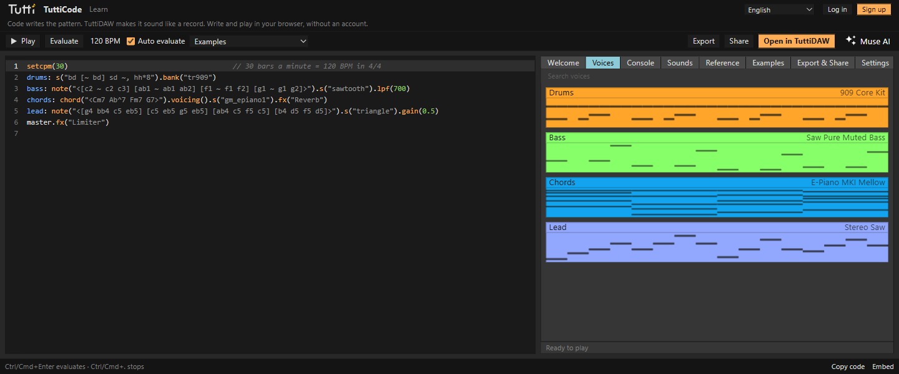

<p align="center">
  
</p>

<h1 align="center">TuttiCode for agents</h1>

<p align="center">
  <strong>English</strong> ·
  <a href="README.zh-CN.md">简体中文</a> ·
  <a href="README.zh-TW.md">繁體中文</a> ·
  <a href="README.ja.md">日本語</a> ·
  <a href="README.ko.md">한국어</a>
</p>

<p align="center">
  <a href="https://www.npmjs.com/package/tutticode"></a>
  <a href="https://github.com/tuttidaw/tutticode/actions/workflows/e2e.yml"></a>
  <a href="LICENSE"></a>
</p>

<p align="center"><strong>Your agent writes the music as code. You hear it, then open it in a DAW.</strong></p>

TuttiCode is a pattern language for music, a superset of [Strudel](https://strudel.cc), that plays on [TuttiDAW](https://tuttidaw.com)'s instruments and effects. This repository turns Claude Code, Codex, Copilot CLI and any MCP client into a composer and sound designer: the agent writes a short program, checks it, and renders it to **WAV, FLAC or MP3** at an exact length, with **stems**, fades and a **loudness target**. It reads the render's numbers, revises, and hands you the file plus an `editUrl` that opens the program in TuttiDAW, a track per voice, to keep editing by hand.

Rendering happens **in your own browser**, on the same engine as [tuttidaw.com/code](https://tuttidaw.com/code). Nothing is rendered on a server, and it is free. No audio-generation model is involved.



## Listen

<!-- examples:start -->
Six pieces, each by a different model, made in one take from [the same opening](examples/prompt.md) and a brief of one or two sentences. The agent chose the title and the sounds, wrote every line of code, rendered, read the numbers and revised. Nobody replied to it while it worked and nobody edited its code. Each page has the program, the agent's notes and a link that opens it in TuttiDAW.

_Coming with the first release._
<!-- examples:end -->

## Quick start

1. **Install** for your agent:

   | Agent | Command |
   | --- | --- |
   | Claude Code | `/plugin marketplace add tuttidaw/tutticode` then `/plugin install tutticode@tutticode` |
   | Codex, Cursor and others | `npx skills add tuttidaw/tutticode` |
   | Copilot CLI | `copilot plugin install tuttidaw/tutticode` |
   | Any MCP client | `npx -y tutticode mcp` as a stdio server, plus `npx tutticode skills install` |

   You need Node 20+ and Google Chrome or Microsoft Edge. The plugin starts the MCP server from npm ([`tutticode`](https://www.npmjs.com/package/tutticode)); there is nothing else to set up.

2. **Ask** in plain words:

   > Make a 12-second lo-fi intro bed for my video, -16 LUFS, with a 1.5 s fade-out.

3. **Get** the file, the report (length, bar grid in seconds, loudness, true peak, per-voice levels) and an `editUrl`. Open the link and you are in the TuttiCode editor with the program; *Open in TuttiDAW* turns it into a project with a track per voice.

Optional: `npx tutticode login` (a free account) lifts the limits below.

## What it is good at

- **Music for things you are making.** Beds and loops for videos, podcasts, apps and games, at an exact length in seconds, bars or loops, at a platform loudness (-14 LUFS web, -16 podcasts, -23 broadcast).
- **Sound effects.** Risers, impacts, whooshes, UI clicks, confirms, errors and notifications, with tested recipes in the [`tutticode-sound-for-media`](skills/tutticode-sound-for-media/SKILL.md) skill.
- **Songs.** A program can be a whole song of up to 128 bars: each track's sound once, each section in one block, the order in a form.
- **Revising.** Change one line and render again. `code_compare` checks a render against goals (or a genre style) or against the previous render, so the agent can tell what moved.
- **Handing over to a person.** Every result links to the editor and the DAW. The code is the project.

## Why code instead of a text-to-music model?

| | A text-to-music model | TuttiCode |
|---|---|---|
| Changing one thing | regenerate the piece or a section | edit a line; render again |
| What you get | an audio file | audio, stems, the program and a DAW project |
| Fitting a cut or a level | roughly | to the bar or the second: exact lengths, loop points, the bar grid in seconds |
| Loudness for a platform | whatever comes out | a LUFS target and a true-peak ceiling, reported |
| The same piece again | a new take | the same program renders the same audio |
| Where it runs | a GPU in the cloud | your browser, free |

If your agent is already cutting your video or building your game, it knows how long the scene runs, where the cuts land and how the level loops. It can write to those numbers, and when the edit changes, rewrite only the bars that moved.

## A taste of the language

```js
setcpm(30)                                        // 30 bars a minute = 120 BPM in 4/4
drums: s("bd [~ bd] sd ~, hh*8").bank("tr909")
bass: note("<[c2 ~ c2 c3] [ab1 ~ ab1 ab2] [f1 ~ f1 f2] [g1 ~ g1 g2]>").s("sawtooth").lpf(700)
chords: chord("<Cm7 Ab^7 Fm7 G7>").voicing().s("gm_epiano1").fx("Reverb")
lead: note("<[g4 bb4 c5 eb5] [c5 eb5 g5 eb5] [ab4 c5 f5 c5] [b4 d5 f5 d5]>").s("triangle").gain(0.5)
master.fx("Limiter")
```

Strudel code runs as is. TuttiCode adds TuttiDAW instruments and effects (`.inst`, `.fx`, `.midifx`), buses and groups, automation, sidechain, whole songs with sections, and melodies in do-re-mi. The [skill](skills/tutticode/SKILL.md) teaches all of it to the agent; people can learn it at [tuttidaw.com/code/learn](https://tuttidaw.com/code/learn).

## How it works

```
agent ──MCP / CLI──▶ tutticode (Node, from npm) ──WebSocket 127.0.0.1──▶ tuttidaw.com/code/bridge (your browser)
```

1. The first call starts a local server on `127.0.0.1` with a random port and a one-time token, and opens the TuttiCode bridge page in a headless Chrome or Edge with its own profile.
2. The page renders the program with the TuttiCode engine and streams the audio back; tutticode checks everything it receives and writes your files.
3. The bridge stays warm for 10 minutes, so later renders start at once.

The MCP tools are the same as TuttiDAW's web agent loop, so one skill teaches both:

| tool | what it does |
| --- | --- |
| `code_check` | compile and plan, no audio: diagnostics, voices, mix warnings |
| `code_render` | render to a file; returns the paths, statistics and `editUrl` |
| `code_compare` | compare a render with goals (or a style), or two renders |
| `code_open` | open a program in a visible TuttiCode tab |
| `code_reference` | search the TuttiCode reference shipped in the package |
| `code_account` | signed in or not, the limits and today's usage |

The CLI does the same from a terminal or a script:

```sh
npx tutticode check song.tc
npx tutticode render song.tc -o bed.wav --seconds 12 --fade-out 1.5 --lufs -16 --json
npx tutticode render song.tc -o loop.flac --loops 4 --stems stems/
```

Full reference: the [npm package README](https://www.npmjs.com/package/tutticode) and [TuttiCode for agents](https://tuttidaw.com/code/learn/for-agents).

## More

<details>
<summary><b>Limits and sign-in</b></summary>

| | Without sign-in | Free account |
| --- | --- | --- |
| Longest render | 60 s | 5 minutes |
| Spoken "register at TuttiDAW" tag | mixed into renders over 30 s | never |
| Formats, stems, loudness | all | all |

`npx tutticode login` opens your browser to approve; `npx tutticode login --device` prints a code to approve on any device (for SSH and servers). The sign-in can only render with TuttiCode: it cannot open your projects, account or billing. For CI, set `TUTTICODE_TOKEN` to an access token from your account page.

</details>

<details>
<summary><b>Privacy</b></summary>

Your program goes from the agent to the TuttiCode page in your own browser and nowhere else; no program code and no audio are sent to our servers, and tutticode sends no telemetry. The page loads from tuttidaw.com like any web page, with its instruments and samples, and counts each render's length, format and outcome. Details: [PRIVACY.md](PRIVACY.md).

</details>

<details>
<summary><b>Troubleshooting</b></summary>

- `npx tutticode doctor` checks Node, the browser, the page, the connection and the sign-in, and says what to fix.
- Chrome or Edge must be installed. Set `TUTTICODE_BROWSER` to its path if it is somewhere unusual.
- In a container or CI without user namespaces, set `TUTTICODE_BROWSER_ARGS=--no-sandbox`.
- An agent says a render failed with `limit`: the piece is longer than 60 s without sign-in. Run `npx tutticode login`.

</details>

<details>
<summary><b>What is in this repository</b></summary>

| Path | What |
| --- | --- |
| [`skills/tutticode`](skills/tutticode/SKILL.md) | The language: syntax, common mistakes, the check / render / compare loop, references for every function, sound and device |
| [`skills/tutticode-sound-for-media`](skills/tutticode-sound-for-media/SKILL.md) | Music beds, loops, stems and sound effects for videos, apps and games |
| `.claude-plugin/`, `.codex-plugin/`, `.agents/` | Plugin and marketplace manifests |
| [`.mcp.json`](.mcp.json) | The MCP server: `npx -y tutticode@<version> mcp` |
| [`examples/`](examples) | The pieces above: program, notes and render settings |

The skills are copied from the published npm package, so they always match the pinned CLI version; a workflow keeps them in sync. The CLI itself is developed in TuttiDAW's main repository and published to npm.

</details>

## Feedback

Bugs, sounds that come out wrong, and ideas: [open an issue](https://github.com/tuttidaw/tutticode/issues/new/choose). Show us what you made in [Discussions](https://github.com/tuttidaw/tutticode/discussions).

## License

MIT, see [LICENSE](LICENSE). Rendering uses the TuttiCode engine on tuttidaw.com under the [TuttiDAW terms of use](https://tuttidaw.com/page/terms-of-use), which claim no ownership of what you make.
