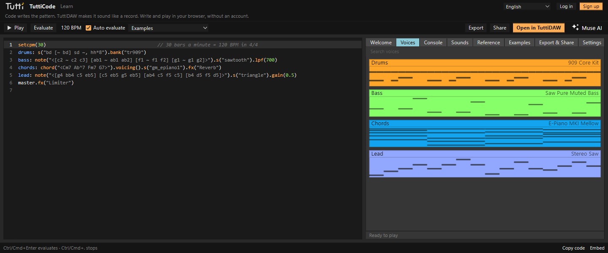

<p align="center">
  
</p>

<h1 align="center">TuttiCode for agents</h1>

<p align="center">
  <a href="README.md">English</a> ·
  <strong>简体中文</strong> ·
  <a href="README.zh-TW.md">繁體中文</a> ·
  <a href="README.ja.md">日本語</a> ·
  <a href="README.ko.md">한국어</a>
</p>

<p align="center">
  <a href="https://www.npmjs.com/package/tutticode"></a>
  <a href="https://github.com/tuttidaw/tutticode/actions/workflows/e2e.yml"></a>
  <a href="LICENSE"></a>
</p>

<p align="center"><strong>你的 Agent 把音乐写成代码。你来听，再用 DAW 打开。</strong></p>

TuttiCode 是一种音乐模式语言，是 [Strudel](https://strudel.cc) 的超集，用 [TuttiDAW](https://tuttidaw.com) 的乐器和效果器发声。这个仓库让 Claude Code、Codex、Copilot CLI 以及任何 MCP 客户端成为作曲者和声音设计师：Agent 写一段简短的程序，检查它，然后按精确时长渲染成 **WAV、FLAC 或 MP3**，可带 **分轨（stems）**、淡入淡出和 **响度目标**。它读取渲染结果的各项数值，修改程序，最后交给你音频文件和一个 `editUrl`。这个链接会在 TuttiDAW 中打开该程序，每个声部一条轨道，方便你继续手动编辑。

渲染 **在你自己的浏览器里** 完成，使用的引擎与 [tuttidaw.com/code](https://tuttidaw.com/code) 相同。不在服务器上渲染，而且免费。整个过程不涉及任何音频生成模型。

[](https://tuttidaw.com/code#c2V0Y3BtKDMwKSAgICAgICAgICAgICAgICAgICAgICAgICAgICAgICAgICAgICAgICAvLyAzMCBiYXJzIGEgbWludXRlID0gMTIwIEJQTSBpbiA0LzQKZHJ1bXM6IHMoImJkIFt%2BIGJkXSBzZCB%2BLCBoaCo4IikuYmFuaygidHI5MDkiKQpiYXNzOiBub3RlKCI8W2MyIH4gYzIgYzNdIFthYjEgfiBhYjEgYWIyXSBbZjEgfiBmMSBmMl0gW2cxIH4gZzEgZzJdPiIpLnMoInNhd3Rvb3RoIikubHBmKDcwMCkKY2hvcmRzOiBjaG9yZCgiPENtNyBBYl43IEZtNyBHNz4iKS52b2ljaW5nKCkucygiZ21fZXBpYW5vMSIpLmZ4KCJSZXZlcmIiKQpsZWFkOiBub3RlKCI8W2c0IGJiNCBjNSBlYjVdIFtjNSBlYjUgZzUgZWI1XSBbYWI0IGM1IGY1IGM1XSBbYjQgZDUgZjUgZDVdPiIpLnMoInRyaWFuZ2xlIikuZ2FpbigwLjUpCm1hc3Rlci5meCgiTGltaXRlciIpCg%3D%3D)

## 试听

<!-- examples:start -->
六首作品，各由一个不同的模型完成，都基于 [同一段开场提示](examples/prompt.md) 加上一两句简要说明，一次做完。标题和音色由 Agent 自己选，每一行代码都由它编写；它渲染、读数值、再修改。过程中没有人回复它，也没有人改动它的代码。每个页面都有程序、Agent 的笔记，以及在 TuttiDAW 中打开它的链接。

_随首个版本发布。_
<!-- examples:end -->

## 快速开始

1. 为你的 Agent **安装**：

   | Agent | 命令 |
   | --- | --- |
   | Claude Code | `/plugin marketplace add tuttidaw/tutticode`，然后 `/plugin install tutticode@tutticode` |
   | Codex、Cursor 等 | `npx skills add tuttidaw/tutticode` |
   | Copilot CLI | `copilot plugin marketplace add tuttidaw/tutticode`，然后 `copilot plugin install tutticode@tutticode` |
   | 任意 MCP 客户端 | `npx -y tutticode mcp` 作为 stdio 服务器，再执行 `npx tutticode skills install` |

   需要 Node 20+ 以及 Google Chrome 或 Microsoft Edge。插件会从 npm 启动 MCP 服务器（[`tutticode`](https://www.npmjs.com/package/tutticode)），无需其他配置。

2. 用平常的话 **提需求**：

   > 给我的视频做一段 12 秒的 lo-fi 片头垫乐，-16 LUFS，结尾 1.5 秒淡出。

3. **拿到** 文件、报告（时长、以秒为单位的小节网格、响度、真峰值、各声部电平）和一个 `editUrl`。打开链接就进入 TuttiCode 编辑器，程序已载入；点 *Open in TuttiDAW* 会把它变成一个工程，每个声部一条轨道。

可选：`npx tutticode login`（免费账号）可解除下面的限制。

## 擅长什么

- **为你正在做的东西配乐。** 给视频、播客、应用和游戏做垫乐和循环，时长可精确到秒、小节或循环次数，响度符合平台标准（网络 -14 LUFS、播客 -16、广播 -23）。
- **音效。** 上升音、撞击声、呼啸声、UI 点击、确认、错误和通知音，[`tutticode-sound-for-media`](skills/tutticode-sound-for-media/SKILL.md) skill 中有经过测试的做法。
- **歌曲。** 一段程序可以是一首最长 128 小节的完整歌曲：每条轨道的音色只写一次，每个段落写在一个块里，顺序写在曲式（form）里。
- **修改。** 改一行，再渲染一次。`code_compare` 可以把渲染结果与目标（或某种曲风）对比，或与上一次渲染对比，Agent 由此知道哪里变了。
- **交给人接手。** 每个结果都链接到编辑器和 DAW。代码就是工程。

## 为什么用代码，而不是文本生成音乐的模型？

| | 文本生成音乐的模型 | TuttiCode |
|---|---|---|
| 只改一处 | 重新生成整首或整段 | 改一行，再渲染 |
| 得到什么 | 一个音频文件 | 音频、分轨、程序和一个 DAW 工程 |
| 对齐剪辑点或电平 | 大致 | 精确到小节或秒：精确时长、循环点、以秒为单位的小节网格 |
| 平台响度 | 出来什么样就是什么样 | 设定 LUFS 目标和真峰值上限，并报告结果 |
| 再要一次同样的作品 | 一个新版本 | 同一段程序渲染出同样的音频 |
| 在哪里运行 | 云端 GPU | 你的浏览器，免费 |

如果你的 Agent 已经在剪你的视频或开发你的游戏，它知道场景有多长、剪辑点落在哪里、关卡如何循环。它可以按这些数字来写；剪辑变了，只需重写变动的那几个小节。

## 语言一瞥

```js
setcpm(30)                                        // 每分钟 30 小节 = 4/4 拍下 120 BPM
drums: s("bd [~ bd] sd ~, hh*8").bank("tr909")
bass: note("<[c2 ~ c2 c3] [ab1 ~ ab1 ab2] [f1 ~ f1 f2] [g1 ~ g1 g2]>").s("sawtooth").lpf(700)
chords: chord("<Cm7 Ab^7 Fm7 G7>").voicing().s("gm_epiano1").fx("Reverb")
lead: note("<[g4 bb4 c5 eb5] [c5 eb5 g5 eb5] [ab4 c5 f5 c5] [b4 d5 f5 d5]>").s("triangle").gain(0.5)
master.fx("Limiter")
```

[▶ 在 TuttiCode 里播放这段程序](https://tuttidaw.com/code#c2V0Y3BtKDMwKSAgICAgICAgICAgICAgICAgICAgICAgICAgICAgICAgICAgICAgICAvLyAzMCBiYXJzIGEgbWludXRlID0gMTIwIEJQTSBpbiA0LzQKZHJ1bXM6IHMoImJkIFt%2BIGJkXSBzZCB%2BLCBoaCo4IikuYmFuaygidHI5MDkiKQpiYXNzOiBub3RlKCI8W2MyIH4gYzIgYzNdIFthYjEgfiBhYjEgYWIyXSBbZjEgfiBmMSBmMl0gW2cxIH4gZzEgZzJdPiIpLnMoInNhd3Rvb3RoIikubHBmKDcwMCkKY2hvcmRzOiBjaG9yZCgiPENtNyBBYl43IEZtNyBHNz4iKS52b2ljaW5nKCkucygiZ21fZXBpYW5vMSIpLmZ4KCJSZXZlcmIiKQpsZWFkOiBub3RlKCI8W2c0IGJiNCBjNSBlYjVdIFtjNSBlYjUgZzUgZWI1XSBbYWI0IGM1IGY1IGM1XSBbYjQgZDUgZjUgZDVdPiIpLnMoInRyaWFuZ2xlIikuZ2FpbigwLjUpCm1hc3Rlci5meCgiTGltaXRlciIpCg%3D%3D)

Strudel 代码可以原样运行。TuttiCode 在此基础上加入了 TuttiDAW 的乐器和效果器（`.inst`、`.fx`、`.midifx`）、总线和编组、自动化、侧链、带段落的完整歌曲，以及用唱名（do-re-mi）写旋律。[skill](skills/tutticode/SKILL.md) 会把这些全部教给 Agent；人可以在 [tuttidaw.com/code/learn](https://tuttidaw.com/code/learn) 学习。

## 工作原理

```
agent ──MCP / CLI──▶ tutticode (Node, from npm) ──WebSocket 127.0.0.1──▶ tuttidaw.com/code/bridge (your browser)
```

1. 第一次调用会在 `127.0.0.1` 上启动一个本地服务器，使用随机端口和一次性令牌，并在无头（headless）Chrome 或 Edge 中用独立的配置文件打开 TuttiCode 桥接页面。
2. 页面用 TuttiCode 引擎渲染程序并把音频流式传回；tutticode 校验收到的所有数据，然后写出你的文件。
3. 桥接会保持热启动状态 10 分钟，之后的渲染可以立即开始。

MCP 工具与 TuttiDAW 网页版 Agent 循环中的工具相同，所以一份 skill 可以同时教会两者：

| 工具 | 作用 |
| --- | --- |
| `code_check` | 编译并规划，不出音频：诊断信息、声部、混音警告 |
| `code_render` | 渲染为文件；返回路径、统计数据和 `editUrl` |
| `code_compare` | 将一次渲染与目标（或某种风格）对比，或对比两次渲染 |
| `code_open` | 在可见的 TuttiCode 标签页中打开程序 |
| `code_reference` | 搜索包内附带的 TuttiCode 参考文档 |
| `code_account` | 是否已登录、限制额度和今日用量 |

CLI 可以在终端或脚本里做同样的事：

```sh
npx tutticode check song.tc
npx tutticode render song.tc -o bed.wav --seconds 12 --fade-out 1.5 --lufs -16 --json
npx tutticode render song.tc -o loop.flac --loops 4 --stems stems/
```

完整参考：[npm 包的 README](https://www.npmjs.com/package/tutticode) 和 [TuttiCode for agents](https://tuttidaw.com/code/learn/for-agents)。

## 更多

<details>
<summary><b>限制与登录</b></summary>

| | 未登录 | 免费账号 |
| --- | --- | --- |
| 最长渲染时长 | 60 秒 | 5 分钟 |
| 口播提示 “register at TuttiDAW” | 混入超过 30 秒的渲染 | 从不 |
| 格式、分轨、响度 | 全部可用 | 全部可用 |

`npx tutticode login` 会打开浏览器让你确认授权；`npx tutticode login --device` 会打印一个代码，可在任意设备上确认（适用于 SSH 和服务器）。该登录只能用于 TuttiCode 渲染：无法访问你的工程、账号或账单。在 CI 中，把 `TUTTICODE_TOKEN` 设为账号页面中生成的访问令牌。

</details>

<details>
<summary><b>隐私</b></summary>

你的程序只会从 Agent 传到你自己浏览器里的 TuttiCode 页面，不会去别处；程序代码和音频都不会发送到我们的服务器，tutticode 也不发送任何遥测数据。页面像普通网页一样从 tuttidaw.com 加载，连同乐器和采样，并统计每次渲染的时长、格式和结果。详见 [PRIVACY.md](PRIVACY.md)。

</details>

<details>
<summary><b>故障排查</b></summary>

- `npx tutticode doctor` 会检查 Node、浏览器、页面、连接和登录状态，并告诉你要修什么。
- 必须安装 Chrome 或 Edge。如果安装位置不常见，把 `TUTTICODE_BROWSER` 设为它的路径。
- 在没有用户命名空间（user namespaces）的容器或 CI 中，设置 `TUTTICODE_BROWSER_ARGS=--no-sandbox`。
- Agent 报告渲染因 `limit` 失败：作品超过了未登录时的 60 秒上限。运行 `npx tutticode login`。

</details>

<details>
<summary><b>仓库里有什么</b></summary>

| 路径 | 内容 |
| --- | --- |
| [`skills/tutticode`](skills/tutticode/SKILL.md) | 语言本身：语法、常见错误、check / render / compare 循环，以及每个函数、音色和设备的参考 |
| [`skills/tutticode-sound-for-media`](skills/tutticode-sound-for-media/SKILL.md) | 为视频、应用和游戏制作垫乐、循环、分轨和音效 |
| `.claude-plugin/`、`.codex-plugin/`、`.agents/` | 插件和插件市场清单 |
| [`.mcp.json`](.mcp.json) | MCP 服务器：`npx -y tutticode@<version> mcp` |
| [`examples/`](examples) | 上面的作品：程序、笔记和渲染设置 |

这些 skill 复制自已发布的 npm 包，因此始终与锁定的 CLI 版本一致；有一个 workflow 负责保持同步。CLI 本身在 TuttiDAW 的主仓库中开发，并发布到 npm。

</details>

## 反馈

Bug、声音不对、新想法：[提交 issue](https://github.com/tuttidaw/tutticode/issues/new/choose)。在 [Discussions](https://github.com/tuttidaw/tutticode/discussions) 里展示你的作品。

## 许可证

MIT，见 [LICENSE](LICENSE)。渲染使用 tuttidaw.com 上的 TuttiCode 引擎，受 [TuttiDAW 使用条款](https://tuttidaw.com/page/terms-of-use) 约束，该条款不主张对你所创作内容的任何所有权。
