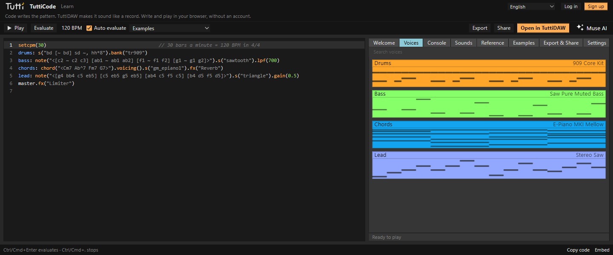
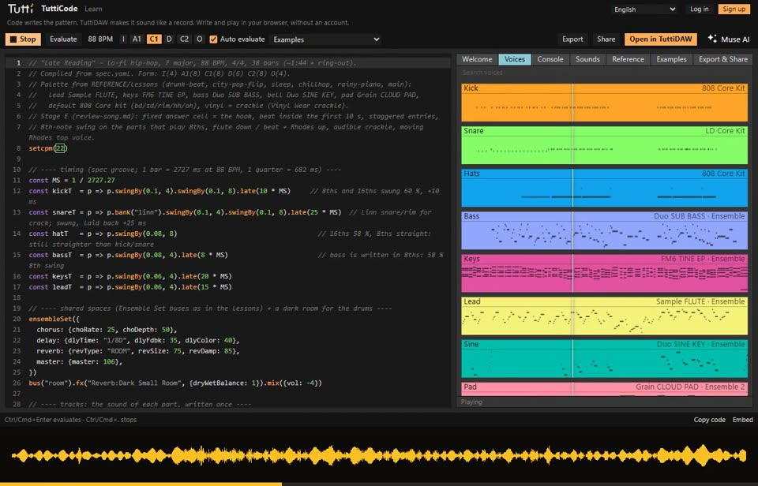
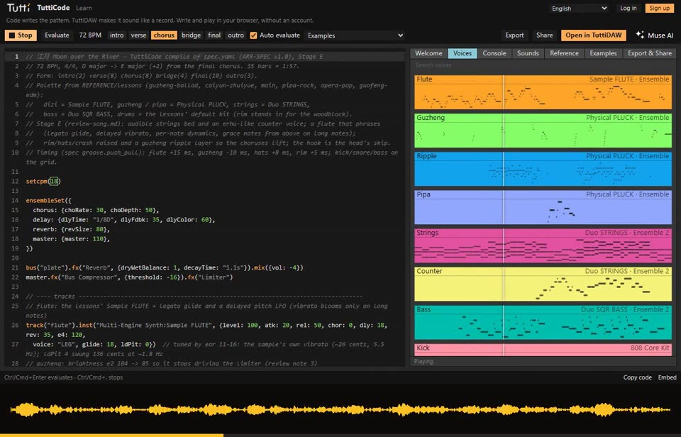
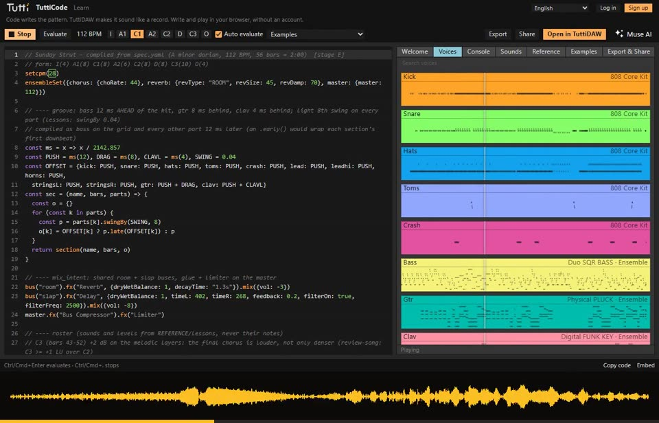
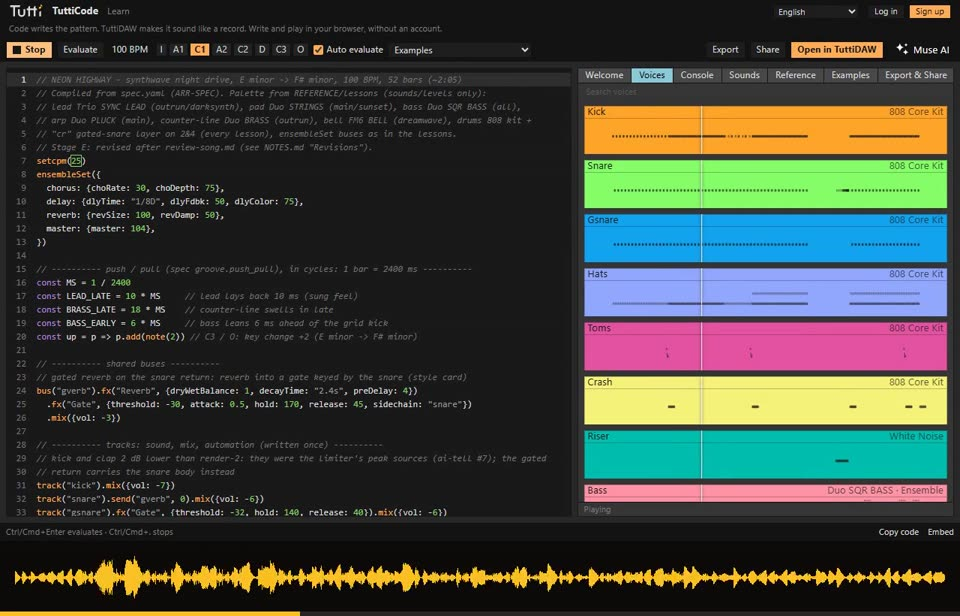
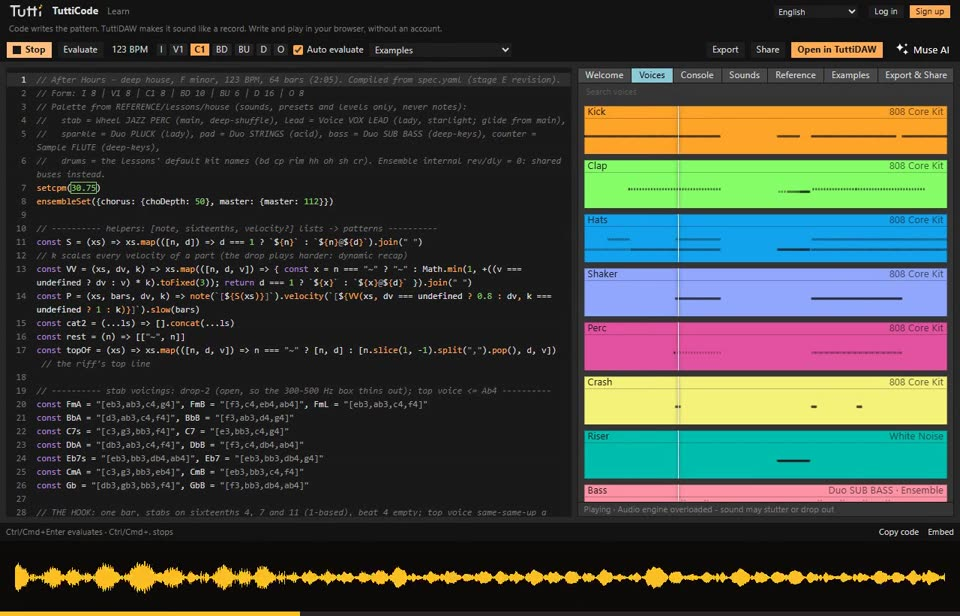

<p align="center">
  
</p>

<h1 align="center">TuttiCode for agents</h1>

<p align="center">
  <a href="README.md">English</a> ·
  <a href="README.zh-CN.md">简体中文</a> ·
  <strong>繁體中文</strong> ·
  <a href="README.ja.md">日本語</a> ·
  <a href="README.ko.md">한국어</a>
</p>

<p align="center">
  <a href="https://www.npmjs.com/package/tutticode"></a>
  <a href="https://github.com/tuttidaw/tutticode/actions/workflows/e2e.yml"></a>
  <a href="LICENSE"></a>
</p>

<p align="center"><strong>你的 Agent 把音樂寫成程式碼。你來聽，再用 DAW 開啟。</strong></p>

TuttiCode 是一種音樂模式語言，是 [Strudel](https://strudel.cc) 的超集，用 [TuttiDAW](https://tuttidaw.com) 的樂器和效果器發聲。這個儲存庫讓 Claude Code、Codex、Copilot CLI 以及任何 MCP 用戶端成為作曲者和聲音設計師：Agent 寫一段簡短的程式，檢查它，然後依精確長度算繪成 **WAV、FLAC 或 MP3**，可附 **分軌（stems）**、淡入淡出和 **響度目標**。它讀取算繪結果的各項數值、修改程式，最後交給你音訊檔和一個 `editUrl`。這個連結會在 TuttiDAW 中開啟該程式，每個聲部一條音軌，方便你繼續手動編輯。

算繪 **在你自己的瀏覽器裡** 進行，使用的引擎與 [tuttidaw.com/code](https://tuttidaw.com/code) 相同。不在伺服器上算繪，而且免費。整個過程不涉及任何音訊生成模型。

[](https://tuttidaw.com/code#c2V0Y3BtKDMwKSAgICAgICAgICAgICAgICAgICAgICAgICAgICAgICAgICAgICAgICAvLyAzMCBiYXJzIGEgbWludXRlID0gMTIwIEJQTSBpbiA0LzQKZHJ1bXM6IHMoImJkIFt%2BIGJkXSBzZCB%2BLCBoaCo4IikuYmFuaygidHI5MDkiKQpiYXNzOiBub3RlKCI8W2MyIH4gYzIgYzNdIFthYjEgfiBhYjEgYWIyXSBbZjEgfiBmMSBmMl0gW2cxIH4gZzEgZzJdPiIpLnMoInNhd3Rvb3RoIikubHBmKDcwMCkKY2hvcmRzOiBjaG9yZCgiPENtNyBBYl43IEZtNyBHNz4iKS52b2ljaW5nKCkucygiZ21fZXBpYW5vMSIpLmZ4KCJSZXZlcmIiKQpsZWFkOiBub3RlKCI8W2c0IGJiNCBjNSBlYjVdIFtjNSBlYjUgZzUgZWI1XSBbYWI0IGM1IGY1IGM1XSBbYjQgZDUgZjUgZDVdPiIpLnMoInRyaWFuZ2xlIikuZ2FpbigwLjUpCm1hc3Rlci5meCgiTGltaXRlciIpCg%3D%3D)

## For agents

If you are an AI agent asked to make music or sound with this repository, you do not need to install anything first:

1. `npx -y tutticode doctor` checks Node 20+ and Chrome or Edge. No browser on Linux: install Chrome as a package (`curl -fLO https://dl.google.com/linux/direct/google-chrome-stable_current_amd64.deb && sudo apt install ./google-chrome-stable_current_amd64.deb`); an unpacked or container Chrome also needs `TUTTICODE_BROWSER_ARGS=--no-sandbox`.
2. Read the skill: [`skills/tutticode/SKILL.md`](skills/tutticode/SKILL.md) ([raw](https://raw.githubusercontent.com/tuttidaw/tutticode/main/skills/tutticode/SKILL.md)); for beds, loops and sound effects at a length and loudness, also [`skills/tutticode-sound-for-media/SKILL.md`](skills/tutticode-sound-for-media/SKILL.md) ([raw](https://raw.githubusercontent.com/tuttidaw/tutticode/main/skills/tutticode-sound-for-media/SKILL.md)).
3. Write the program to a `.tc` file, then `npx -y tutticode check song.tc` until it is clean, and `npx -y tutticode render song.tc -o song.mp3 --seconds 20 --lufs -14 --json`. Give the user the file, its loudness and the `editUrl`.

Without sign-in a render is at most 60 s and one over 30 s carries a spoken tag: for longer pieces ask the user to run `npx tutticode login` (free). `npx tutticode skills install` keeps the skills for Claude Code, Copilot CLI and Codex.

## 試聽

<!-- examples:start -->
五首作品，由 Agent（Claude Code + Claude Opus 5.5）依據每首一段話的需求，用 TuttiCode 寫成：先做規劃、寫三段旋律，由一個獨立的評審 Agent 挑出一段，再用段落結構寫完整首，第二位評審給出意見後修改。每段影片都是 TuttiDAW 實際在播放這段程式。[製作過程](examples/README.md)。

| | |
|---|---|
| [](https://assets.tuttidaw.com/showcase/late-reading/late-reading-hq.mp4) | **Late Reading**<br>Lo-fi 嘻哈 · 88 BPM · 1:44<br>[影片](https://assets.tuttidaw.com/showcase/late-reading/late-reading-hq.mp4) · [MP3](https://assets.tuttidaw.com/showcase/late-reading/late-reading.mp3) · [程式碼和筆記](examples/late-reading) |
| [](https://assets.tuttidaw.com/showcase/moon-over-the-river/moon-over-the-river-hq.mp4) | **江月 Moon over the River**<br>國風抒情 · 72 BPM · 1:57<br>[影片](https://assets.tuttidaw.com/showcase/moon-over-the-river/moon-over-the-river-hq.mp4) · [MP3](https://assets.tuttidaw.com/showcase/moon-over-the-river/moon-over-the-river.mp3) · [程式碼和筆記](examples/moon-over-the-river) |
| [](https://assets.tuttidaw.com/showcase/sunday-strut/sunday-strut-hq.mp4) | **Sunday Strut**<br>放克 / 迪斯可 · 112 BPM · 2:00<br>[影片](https://assets.tuttidaw.com/showcase/sunday-strut/sunday-strut-hq.mp4) · [MP3](https://assets.tuttidaw.com/showcase/sunday-strut/sunday-strut.mp3) · [程式碼和筆記](examples/sunday-strut) |
| [](https://assets.tuttidaw.com/showcase/neon-highway/neon-highway-hq.mp4) | **Neon Highway**<br>合成器浪潮 · 100 BPM · 2:05<br>[影片](https://assets.tuttidaw.com/showcase/neon-highway/neon-highway-hq.mp4) · [MP3](https://assets.tuttidaw.com/showcase/neon-highway/neon-highway.mp3) · [程式碼和筆記](examples/neon-highway) |
| [](https://assets.tuttidaw.com/showcase/after-hours/after-hours-hq.mp4) | **After Hours**<br>深浩室 · 123 BPM · 2:05<br>[影片](https://assets.tuttidaw.com/showcase/after-hours/after-hours-hq.mp4) · [MP3](https://assets.tuttidaw.com/showcase/after-hours/after-hours.mp3) · [程式碼和筆記](examples/after-hours) |
<!-- examples:end -->

## 快速開始

1. 為你的 Agent **安裝**：

   | Agent | 指令 |
   | --- | --- |
   | Claude Code | `/plugin marketplace add tuttidaw/tutticode`，接著 `/plugin install tutticode@tutticode` |
   | Codex、Cursor 等 | `npx skills add tuttidaw/tutticode` |
   | Copilot CLI | `copilot plugin marketplace add tuttidaw/tutticode`，接著 `copilot plugin install tutticode@tutticode` |
   | 任何 MCP 用戶端 | `npx -y tutticode mcp` 作為 stdio 伺服器，再執行 `npx tutticode skills install` |

   需要 Node 20+ 以及 Google Chrome 或 Microsoft Edge。外掛會從 npm 啟動 MCP 伺服器（[`tutticode`](https://www.npmjs.com/package/tutticode)），不需要其他設定。

2. 用平常的話 **提出需求**：

   > 幫我的影片做一段 12 秒的 lo-fi 片頭襯底音樂，-16 LUFS，結尾 1.5 秒淡出。

3. **取得** 檔案、報告（長度、以秒為單位的小節格線、響度、真峰值、各聲部音量）和一個 `editUrl`。開啟連結就進入 TuttiCode 編輯器，程式已載入；按 *Open in TuttiDAW* 會把它轉成一個專案，每個聲部一條音軌。

選用：`npx tutticode login`（免費帳號）可解除下方的限制。

## 擅長什麼

- **為你正在做的東西配樂。** 為影片、Podcast、應用程式和遊戲製作襯底音樂和循環段落，長度可精確到秒、小節或循環次數，響度符合平台標準（網路 -14 LUFS、Podcast -16、廣播 -23）。
- **音效。** 上升音、撞擊聲、呼嘯聲、UI 點擊、確認、錯誤和通知音，[`tutticode-sound-for-media`](skills/tutticode-sound-for-media/SKILL.md) skill 裡有測試過的做法。
- **歌曲。** 一段程式可以是一首最長 128 小節的完整歌曲：每條音軌的音色只寫一次，每個段落寫在一個區塊裡，順序寫在曲式（form）裡。
- **修改。** 改一行，再算繪一次。`code_compare` 可以把算繪結果與目標（或某種曲風）比較，或與上一次算繪比較，讓 Agent 知道哪裡變了。
- **交給人接手。** 每個結果都連到編輯器和 DAW。程式碼就是專案。

## 為什麼用程式碼，而不是文字生成音樂的模型？

| | 文字生成音樂的模型 | TuttiCode |
|---|---|---|
| 只改一處 | 重新生成整首或整段 | 改一行，再算繪 |
| 得到什麼 | 一個音訊檔 | 音訊、分軌、程式和一個 DAW 專案 |
| 對齊剪接點或音量 | 大概 | 精確到小節或秒：精確長度、循環點、以秒為單位的小節格線 |
| 平台響度 | 出來是什麼就是什麼 | 設定 LUFS 目標和真峰值上限，並回報結果 |
| 再要一次同樣的作品 | 一個新版本 | 同一段程式算繪出同樣的音訊 |
| 在哪裡執行 | 雲端 GPU | 你的瀏覽器，免費 |

如果你的 Agent 已經在剪你的影片或開發你的遊戲，它知道場景有多長、剪接點落在哪裡、關卡如何循環。它可以照這些數字來寫；剪接變了，只要重寫變動的那幾個小節。

## 語言初探

```js
setcpm(30)                                        // 每分鐘 30 小節 = 4/4 拍下 120 BPM
drums: s("bd [~ bd] sd ~, hh*8").bank("tr909")
bass: note("<[c2 ~ c2 c3] [ab1 ~ ab1 ab2] [f1 ~ f1 f2] [g1 ~ g1 g2]>").s("sawtooth").lpf(700)
chords: chord("<Cm7 Ab^7 Fm7 G7>").voicing().s("gm_epiano1").fx("Reverb")
lead: note("<[g4 bb4 c5 eb5] [c5 eb5 g5 eb5] [ab4 c5 f5 c5] [b4 d5 f5 d5]>").s("triangle").gain(0.5)
master.fx("Limiter")
```

[▶ 在 TuttiCode 中播放這段程式](https://tuttidaw.com/code#c2V0Y3BtKDMwKSAgICAgICAgICAgICAgICAgICAgICAgICAgICAgICAgICAgICAgICAvLyAzMCBiYXJzIGEgbWludXRlID0gMTIwIEJQTSBpbiA0LzQKZHJ1bXM6IHMoImJkIFt%2BIGJkXSBzZCB%2BLCBoaCo4IikuYmFuaygidHI5MDkiKQpiYXNzOiBub3RlKCI8W2MyIH4gYzIgYzNdIFthYjEgfiBhYjEgYWIyXSBbZjEgfiBmMSBmMl0gW2cxIH4gZzEgZzJdPiIpLnMoInNhd3Rvb3RoIikubHBmKDcwMCkKY2hvcmRzOiBjaG9yZCgiPENtNyBBYl43IEZtNyBHNz4iKS52b2ljaW5nKCkucygiZ21fZXBpYW5vMSIpLmZ4KCJSZXZlcmIiKQpsZWFkOiBub3RlKCI8W2c0IGJiNCBjNSBlYjVdIFtjNSBlYjUgZzUgZWI1XSBbYWI0IGM1IGY1IGM1XSBbYjQgZDUgZjUgZDVdPiIpLnMoInRyaWFuZ2xlIikuZ2FpbigwLjUpCm1hc3Rlci5meCgiTGltaXRlciIpCg%3D%3D)

Strudel 程式碼可以原樣執行。TuttiCode 在此之上加入了 TuttiDAW 的樂器和效果器（`.inst`、`.fx`、`.midifx`）、匯流排和群組、自動化、側鏈、含段落的完整歌曲，以及用唱名（do-re-mi）寫旋律。[skill](skills/tutticode/SKILL.md) 會把這些全部教給 Agent；人可以在 [tuttidaw.com/code/learn](https://tuttidaw.com/code/learn) 學習。

## 運作方式

```
agent ──MCP / CLI──▶ tutticode (Node, from npm) ──WebSocket 127.0.0.1──▶ tuttidaw.com/code/bridge (your browser)
```

1. 第一次呼叫會在 `127.0.0.1` 上啟動一個本機伺服器，使用隨機連接埠和一次性權杖，並在無頭（headless）Chrome 或 Edge 中以獨立的設定檔開啟 TuttiCode 橋接頁面。
2. 頁面用 TuttiCode 引擎算繪程式，並把音訊串流傳回；tutticode 驗證收到的所有資料，然後寫出你的檔案。
3. 橋接會保持熱機 10 分鐘，之後的算繪可以立即開始。

MCP 工具與 TuttiDAW 網頁版 Agent 迴圈中的工具相同，所以一份 skill 就能同時教會兩者：

| 工具 | 用途 |
| --- | --- |
| `code_check` | 編譯並規劃，不產生音訊：診斷訊息、聲部、混音警告 |
| `code_render` | 算繪成檔案；回傳路徑、統計資料和 `editUrl` |
| `code_compare` | 將一次算繪與目標（或某種風格）比較，或比較兩次算繪 |
| `code_open` | 在可見的 TuttiCode 分頁中開啟程式 |
| `code_reference` | 搜尋套件內附的 TuttiCode 參考文件 |
| `code_account` | 是否已登入、限制額度和今日用量 |

CLI 可以在終端機或指令碼裡做同樣的事：

```sh
npx tutticode check song.tc
npx tutticode render song.tc -o bed.wav --seconds 12 --fade-out 1.5 --lufs -16 --json
npx tutticode render song.tc -o loop.flac --loops 4 --stems stems/
```

完整參考：[npm 套件的 README](https://www.npmjs.com/package/tutticode) 和 [TuttiCode for agents](https://tuttidaw.com/code/learn/for-agents)。

## 更多

<details>
<summary><b>限制與登入</b></summary>

| | 未登入 | 免費帳號 |
| --- | --- | --- |
| 最長算繪長度 | 60 秒 | 5 分鐘 |
| 語音提示 “register at TuttiDAW” | 混入超過 30 秒的算繪 | 永不 |
| 格式、分軌、響度 | 全部可用 | 全部可用 |

`npx tutticode login` 會開啟瀏覽器讓你核准；`npx tutticode login --device` 會印出一組代碼，可在任何裝置上核准（適用於 SSH 和伺服器）。這個登入只能用於 TuttiCode 算繪：無法存取你的專案、帳號或帳務。在 CI 中，把 `TUTTICODE_TOKEN` 設為帳號頁面中產生的存取權杖。

</details>

<details>
<summary><b>隱私</b></summary>

你的程式只會從 Agent 傳到你自己瀏覽器裡的 TuttiCode 頁面，不會到其他地方；程式碼和音訊都不會傳送到我們的伺服器，tutticode 也不傳送任何遙測資料。頁面像一般網頁一樣從 tuttidaw.com 載入，連同樂器和取樣，並統計每次算繪的長度、格式和結果。詳情：[PRIVACY.md](PRIVACY.md)。

</details>

<details>
<summary><b>疑難排解</b></summary>

- `npx tutticode doctor` 會檢查 Node、瀏覽器、頁面、連線和登入狀態，並告訴你要修正什麼。
- 必須安裝 Chrome 或 Edge。如果安裝位置不常見，把 `TUTTICODE_BROWSER` 設為它的路徑。
- 在沒有使用者命名空間（user namespaces）的容器或 CI 中，設定 `TUTTICODE_BROWSER_ARGS=--no-sandbox`。
- Agent 回報算繪因 `limit` 失敗：作品超過了未登入時的 60 秒上限。執行 `npx tutticode login`。

</details>

<details>
<summary><b>儲存庫裡有什麼</b></summary>

| 路徑 | 內容 |
| --- | --- |
| [`skills/tutticode`](skills/tutticode/SKILL.md) | 語言本身：語法、常見錯誤、check / render / compare 迴圈，以及每個函式、音色和裝置的參考 |
| [`skills/tutticode-sound-for-media`](skills/tutticode-sound-for-media/SKILL.md) | 為影片、應用程式和遊戲製作襯底音樂、循環段落、分軌和音效 |
| `.claude-plugin/`、`.codex-plugin/`、`.agents/` | 外掛和外掛市集的資訊清單 |
| [`.mcp.json`](.mcp.json) | MCP 伺服器：`npx -y tutticode@<version> mcp` |
| [`examples/`](examples) | 上面的作品：程式、筆記和算繪設定 |

這些 skill 複製自已發布的 npm 套件，因此永遠與鎖定的 CLI 版本一致；由一個 workflow 負責保持同步。CLI 本身在 TuttiDAW 的主儲存庫中開發，並發布到 npm。

</details>

## 意見回饋

Bug、聲音不對、新點子：[開一個 issue](https://github.com/tuttidaw/tutticode/issues/new/choose)。在 [Discussions](https://github.com/tuttidaw/tutticode/discussions) 分享你的作品。

## 授權

MIT，見 [LICENSE](LICENSE)。算繪使用 tuttidaw.com 上的 TuttiCode 引擎，受 [TuttiDAW 使用條款](https://tuttidaw.com/page/terms-of-use) 規範，該條款不主張對你所創作內容的任何所有權。
