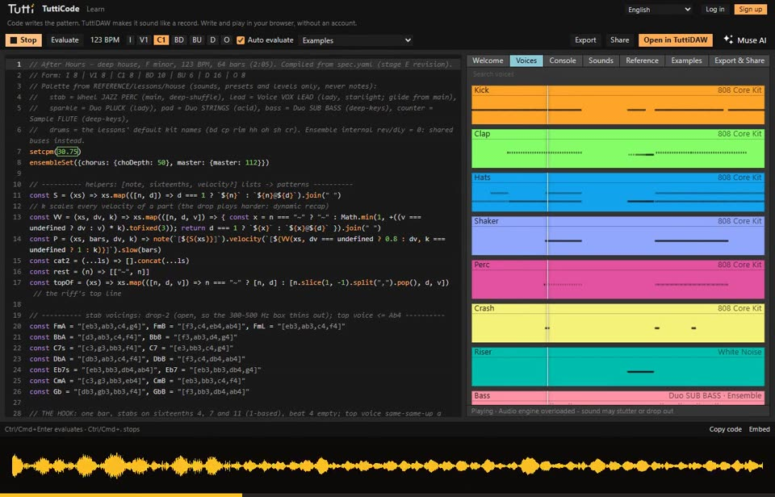

# After Hours

Deep house · 123 BPM · 2:05

- [Watch](https://assets.tuttidaw.com/showcase/after-hours/after-hours-hq.mp4) (TuttiDAW playing the program) · [MP3](https://assets.tuttidaw.com/showcase/after-hours/after-hours.mp3)
- [▶ Open in TuttiCode](https://tuttidaw.com/code#Ly8gQWZ0ZXIgSG91cnMgLSBkZWVwIGhvdXNlLCBGIG1pbm9yLCAxMjMgQlBNLCA2NCBiYXJzICgyOjA1KS4gQ29tcGlsZWQgZnJvbSBzcGVjLnlhbWwgKHN0YWdlIEUgcmV2aXNpb24pLgovLyBGb3JtOiBJIDggfCBWMSA4IHwgQzEgOCB8IEJEIDEwIHwgQlUgNiB8IEQgMTYgfCBPIDgKLy8gUGFsZXR0ZSBmcm9tIFJFRkVSRU5DRS9sZXNzb25zL2hvdXNlIChzb3VuZHMsIHByZXNldHMgYW5kIGxldmVscyBvbmx5LCBuZXZlciBub3Rlcyk6Ci8vICAgc3RhYiA9IFdoZWVsIEpBWlogUEVSQyAobWFpbiwgZGVlcC1zaHVmZmxlKSwgbGVhZCA9IFZvaWNlIFZPWCBMRUFEIChsYWR5LCBzdGFybGlnaHQ7IGdsaWRlIGZyb20gbWFpbiksCi8vICAgc3BhcmtsZSA9IER1byBQTFVDSyAobGFkeSksIHBhZCA9IER1byBTVFJJTkdTIChhY2lkKSwgYmFzcyA9IER1byBTVUIgQkFTUyAoZGVlcC1rZXlzKSwgY291bnRlciA9IFNhbXBsZSBGTFVURSAoZGVlcC1rZXlzKSwKLy8gICBkcnVtcyA9IHRoZSBsZXNzb25zJyBkZWZhdWx0IGtpdCBuYW1lcyAoYmQgY3AgcmltIGhoIG9oIHNoIGNyKS4gRW5zZW1ibGUgaW50ZXJuYWwgcmV2L2RseSA9IDA6IHNoYXJlZCBidXNlcyBpbnN0ZWFkLgpzZXRjcG0oMzAuNzUpCmVuc2VtYmxlU2V0KHtjaG9ydXM6IHtjaG9EZXB0aDogNTB9LCBtYXN0ZXI6IHttYXN0ZXI6IDExMn19KQoKLy8gLS0tLS0tLS0tLSBoZWxwZXJzOiBbbm90ZSwgc2l4dGVlbnRocywgdmVsb2NpdHk%2FXSBsaXN0cyAtPiBwYXR0ZXJucyAtLS0tLS0tLS0tCmNvbnN0IFMgPSAoeHMpID0%2BIHhzLm1hcCgoW24sIGRdKSA9PiBkID09PSAxID8gYCR7bn1gIDogYCR7bn1AJHtkfWApLmpvaW4oIiAiKQovLyBrIHNjYWxlcyBldmVyeSB2ZWxvY2l0eSBvZiBhIHBhcnQgKHRoZSBkcm9wIHBsYXlzIGhhcmRlcjogZHluYW1pYyByZWNhcCkKY29uc3QgVlYgPSAoeHMsIGR2LCBrKSA9PiB4cy5tYXAoKFtuLCBkLCB2XSkgPT4geyBjb25zdCB4ID0gbiA9PT0gIn4iID8gIn4iIDogTWF0aC5taW4oMSwgKygodiA9PT0gdW5kZWZpbmVkID8gZHYgOiB2KSAqIGspLnRvRml4ZWQoMykpOyByZXR1cm4gZCA9PT0gMSA%2FIGAke3h9YCA6IGAke3h9QCR7ZH1gIH0pLmpvaW4oIiAiKQpjb25zdCBQID0gKHhzLCBiYXJzLCBkdiwgaykgPT4gbm90ZShgWyR7Uyh4cyl9XWApLnZlbG9jaXR5KGBbJHtWVih4cywgZHYgPT09IHVuZGVmaW5lZCA%2FIDAuOCA6IGR2LCBrID09PSB1bmRlZmluZWQgPyAxIDogayl9XWApLnNsb3coYmFycykKY29uc3QgY2F0MiA9ICguLi5scykgPT4gW10uY29uY2F0KC4uLmxzKQpjb25zdCByZXN0ID0gKG4pID0%2BIFtbIn4iLCBuXV0KY29uc3QgdG9wT2YgPSAoeHMpID0%2BIHhzLm1hcCgoW24sIGQsIHZdKSA9PiBuID09PSAifiIgPyBbbiwgZF0gOiBbbi5zbGljZSgxLCAtMSkuc3BsaXQoIiwiKS5wb3AoKSwgZCwgdl0pICAgLy8gdGhlIHJpZmYncyB0b3AgbGluZQoKLy8gLS0tLS0tLS0tLSBzdGFiIHZvaWNpbmdzOiBkcm9wLTIgKG9wZW4sIHNvIHRoZSAzMDAtNTAwIEh6IGJveCB0aGlucyBvdXQpOyB0b3Agdm9pY2UgPD0gQWI0IC0tLS0tLS0tLS0KY29uc3QgRm1BID0gIltlYjMsYWIzLGM0LGc0XSIsIEZtQiA9ICJbZjMsYzQsZWI0LGFiNF0iLCBGbUwgPSAiW2ViMyxhYjMsYzQsZjRdIgpjb25zdCBCYkEgPSAiW2QzLGFiMyxjNCxmNF0iLCBCYkIgPSAiW2YzLGFiMyxkNCxnNF0iCmNvbnN0IEM3cyA9ICJbYzMsZzMsYmIzLGY0XSIsIEM3ID0gIltlMyxiYjMsYzQsZzRdIgpjb25zdCBEYkEgPSAiW2RiMyxhYjMsYzQsZjRdIiwgRGJCID0gIltmMyxjNCxkYjQsYWI0XSIKY29uc3QgRWI3cyA9ICJbZWIzLGJiMyxkYjQsYWI0XSIsIEViNyA9ICJbZWIzLGJiMyxkYjQsZzRdIgpjb25zdCBDbUEgPSAiW2MzLGczLGJiMyxlYjRdIiwgQ21CID0gIltlYjMsYmIzLGM0LGY0XSIKY29uc3QgR2IgPSAiW2RiMyxnYjMsYmIzLGY0XSIsIEdiQiA9ICJbZjMsYmIzLGRiNCxhYjRdIgoKLy8gVEhFIEhPT0s6IG9uZSBiYXIsIHN0YWJzIG9uIHNpeHRlZW50aHMgNCwgNyBhbmQgMTEgKDEtYmFzZWQpLCBiZWF0IDQgZW1wdHk7IHRvcCB2b2ljZSBzYW1lLXNhbWUtdXAgYSBzdGVwLgovLyBGb3VyIHZlbG9jaXR5IHNoYXBlcyByb3RhdGUgYmFyIGJ5IGJhciwgc28gdGhlIHJpZmYgaXMgcGxheWVkLCBub3Qgc3RhbXBlZC4KY29uc3QgVlMgPSBbWzAuOCwgMC42OCwgMC43Nl0sIFswLjc2LCAwLjcsIDAuOF0sIFswLjgyLCAwLjY0LCAwLjc0XSwgWzAuNzgsIDAuNzEsIDAuNzJdXQpjb25zdCBzYiA9IChhLCBiLCBjLCB2KSA9PiBbWyJ%2BIiwzXSxbYSwyLHZbMF1dLFsifiIsMV0sW2IsMix2WzFdXSxbIn4iLDJdLFtjLDMsdlsyXV0sWyJ%2BIiwzXV0KY29uc3QgcmlmZiA9IChiYXJzKSA9PiBjYXQyKC4uLmJhcnMubWFwKChbYSwgYiwgY10sIGkpID0%2BIHNiKGEsIGIsIGMsIFZTW2kgJSA0XSkpKQpjb25zdCB2ZXJzZUJhcnMgPSBbW0ZtQSxGbUEsRm1CXSxbRm1CLEZtQSxGbUxdLFtCYkEsQmJBLEJiQl0sW0JiQixCYkEsQmJBXSxbRm1BLEZtQSxGbUJdLFtGbUIsRm1BLEZtTF0sW0JiQSxCYkEsQmJCXSxbQzdzLEM3cyxDN11dCmNvbnN0IGNob3J1c0JhcnMgPSBbW0RiQSxEYkEsRGJCXSxbRWI3cyxFYjdzLEViN10sW0NtQSxDbUEsQ21CXSxbRm1BLEZtQSxGbUJdLFtEYkEsRGJBLERiQl0sW0ViN3MsRWI3cyxFYjddLFtHYixHYixDN10sW0ZtQixGbUEsRm1MXV0KY29uc3QgaW50cm9CYXJzID0gY2F0Mih2ZXJzZUJhcnMuc2xpY2UoMCwgNCksIHZlcnNlQmFycy5zbGljZSgwLCA0KSkKLy8gQnJlYWtkb3duOiB0aGUgcmlmZiBhbG9uZSBhdCBoYWxmIGhhcm1vbmljIHNwZWVkIChhdWdtZW50KSwgRGIgRGIgRWI3c3VzIEViNyBDbSBDbSBHYiBHYiBDN3N1cyBDNwpjb25zdCBiZEJhcnMgPSBbW0RiQSxEYkEsRGJCXSxbRGJCLERiQSxEYkFdLFtFYjdzLEViN3MsRWI3c10sW0ViNyxFYjcsRWI3c10sW0NtQSxDbUEsQ21CXSxbQ21CLENtQSxDbUFdLFtHYixHYixHYkJdLFtHYkIsR2IsR2JdLFtDN3MsQzdzLEM3c10sW0M3LEM3LEM3XV0KY29uc3Qgc3RhYlZlcnNlID0gcmlmZih2ZXJzZUJhcnMpLCBzdGFiQ2hvcnVzID0gcmlmZihjaG9ydXNCYXJzKQovLyBCdWlsZDogZnJhZ21lbnQgKyBkaW1pbnV0aW9uIC0gdHdvIHN0YWJzLCBvZmZiZWF0IDh0aHMsIDE2dGhzLCB0aGVuIHNpbGVuY2Ugb24gYmVhdCA0IChrZXB0IGJlbG93IHRoZSBkcm9wKQpjb25zdCB0d28gPSBbWyJ%2BIiwzXSxbQmJBLDIsMC42XSxbIn4iLDFdLFtCYkEsMiwwLjZdLFsifiIsOF1dCmNvbnN0IG9mZjggPSAodiwgdmVsKSA9PiBjYXQyKC4uLkFycmF5KDQpLmZpbGwoW1sifiIsMl0sW3YsMix2ZWxdXSkpCmNvbnN0IHMxNiA9ICh2LCBuLCB2ZWwpID0%2BIEFycmF5KG4pLmZpbGwoW3YsMSx2ZWxdKQpjb25zdCBzdGFiQlUgPSBjYXQyKHR3bywgdHdvLCBvZmY4KEJiQSwgMC42MiksIG9mZjgoQmJBLCAwLjY0KSwgczE2KEM3cywgMTYsIDAuNiksIHMxNihDNywgMTIsIDAuNjQpLCByZXN0KDQpKQovLyBPdXRybzogY29udHJhY3QgLSBvbmUgc2hvcnQgc3RhYiBwZXIgYmFyLCB0aGVuIGdvbmUKY29uc3Qgb25lID0gKHYpID0%2BIFtbIn4iLDNdLFt2LDMsMC42Nl0sWyJ%2BIiwxMF1dCmNvbnN0IHN0YWJPID0gY2F0MihvbmUoRm1BKSwgb25lKEZtQiksIG9uZShCYkEpLCBvbmUoQmJBKSwgcmVzdCg2NCkpCgovLyAtLS0tLS0tLS0tIGJyZWFrZG93biBzdHJpbmdzOiBsb3cgc2hlbGxzIHVuZGVyIHRoZSBzdGFiIGZyb20gYmFyIDI5ICh0aGV5IGJpbmQgaXQ7IHRoZXkgZG8gbm90IHJlcGxhY2UgaXQpIC0tLS0tLS0tLS0KY29uc3QgcGFkQkQgPSBjYXQyKHJlc3QoNjQpLCBbWyJbYzIsZzIsZWIzXSIsMzJdLFsiW2diMixkYjMsYmIzXSIsMzJdLFsiW2MyLGcyLGYzXSIsMTZdLFsiW2MyLGcyLGUzXSIsMTZdXSkKLy8gY291bnRlci1saW5lIChicmVha2Rvd24sIGJhcnMgMjktMzQpOiB0aGUgY2FsbCBCYjQtRWI1LUY1IGF1Z21lbnRlZCB0byB3aG9sZSBub3RlcywgdGhlbiBGNS1FYjUtQzUsIHRoZW4gRTUKLy8gbGVhZGluZyBpbnRvIHRoZSBkcm9wJ3MgZmlyc3Qgbm90ZSAoRjUpOiBhIGhhbmQtb2ZmIHRvIHRoZSBsZWFkLgpjb25zdCBjb3VudGVyQkQgPSBjYXQyKHJlc3QoNjQpLCBbWyJiYjQiLDE2XSxbImViNSIsMTZdLFsiZjUiLDI0XSxbImViNSIsOF0sWyJjNSIsMTZdLFsiZTUiLDE2XV0pCgovLyAtLS0tLS0tLS0tIGJhc3M6IHJvb3RzIChNSURJKSBwZXIgY2hvcmQgc3BhbiAtLS0tLS0tLS0tCmNvbnN0IHZlcnNlSCA9IFtbMjksMzJdLFszNCwzMl0sWzI5LDMyXSxbMzQsMTZdLFszNiwxNl1dCmNvbnN0IGNob3J1c0ggPSBbWzM3LDE2XSxbMzksMTZdLFszNiwxNl0sWzI5LDE2XSxbMzcsMTZdLFszOSwxNl0sWzMwLDhdLFszNiw4XSxbMjksMTZdXQovLyBvZmZiZWF0IDh0aHMgKGNhcmQgJ29mZmJlYXQnKTogYmFzcyBhbnN3ZXJzIHRoZSBraWNrICjkupLnrZTlvI8pCmNvbnN0IG9mZmJlYXQgPSAoSCwgdmVsKSA9PiBjYXQyKC4uLkgubWFwKChbciwgZF0pID0%2BIGNhdDIoLi4uQXJyYXkoZCAvIDQpLmZpbGwoW1sifiIsMl0sW3IsMix2ZWxdXSkpKSkKLy8gcm9sbGluZzogcm9vdCwgb2N0YXZlLCBmaWZ0aCBiZXR3ZWVuIHRoZSBraWNrcy4gQzEgcm9sbHMgbGlnaHRseSAocm9sbEEgb25seSksIHRoZSBkcm9wIGZ1bGx5Lgpjb25zdCByb2xsQSA9IChyKSA9PiBbWyJ%2BIiwyXSxbciwxLDAuODZdLFtyICsgMTIsMSwwLjddLFsifiIsMl0sW3IsMSwwLjhdLFsifiIsMV1dCmNvbnN0IHJvbGxCID0gKHIpID0%2BIFtbIn4iLDJdLFtyLDEsMC44Nl0sW3IgKyAxMiwxLDAuN10sWyJ%2BIiwxXSxbciArIDcsMSwwLjY2XSxbciwxLDAuOF0sWyJ%2BIiwxXV0KY29uc3Qgcm9sbGluZyA9IChIKSA9PiBjYXQyKC4uLkgubWFwKChbciwgZF0pID0%2BIGNhdDIoLi4uQXJyYXkoZCAvIDgpLmZpbGwoMCkubWFwKChfLCBrKSA9PiBrICUgMiA9PT0gMCA%2FIHJvbGxBKHIpIDogcm9sbEIocikpKSkpCmNvbnN0IHJvbGxpbmdMaWdodCA9IChIKSA9PiBjYXQyKC4uLkgubWFwKChbciwgZF0pID0%2BIGNhdDIoLi4uQXJyYXkoZCAvIDgpLmZpbGwoMCkubWFwKCgpID0%2BIHJvbGxBKHIpKSkpKQoKLy8gLS0tLS0tLS0tLSB0aGUgbWVsb2R5IChzdGFnZSBFKTogY2FsbHMgaW4gYmVhdHMgMS0zIHVuZGVyIHRoZSByaWZmJ3MgaGVsZCBzdGFicywgYW5zd2VycyBpbiB0aGUgcmlmZidzIGVtcHR5IGJlYXQgNCwKLy8gbGFuZGluZyBvbiB0aGUgbmV4dCBkb3duYmVhdDsgdGhlIGxlYWQgbmV2ZXIgZ29lcyBiZWxvdyBCYjQgKHN0YWIgdG9wIDw9IEFiNCkuIFZlbG9jaXRpZXMgc2hhcGVkIHBlciBwaHJhc2UuCmNvbnN0IGxlYWRWID0gWwogIFsifiIsMl0sWyJiYjQiLDIsMC43NF0sWyJlYjUiLDEsMC44XSxbImY1IiwzLDAuODhdLFsifiIsNF0sWyJmNSIsMiwwLjc4XSxbImViNSIsMiwwLjcyXSwgICAvLyA5ICBGbTkgICBjYWxsIHosIGFuc3dlciB6JyBhcyBhIHBpY2t1cAogIFsiYzUiLDYsMC42Nl0sWyJ%2BIiwxMF0sICAgICAgICAgICAgICAgICAgICAgICAgICAgICAgICAgICAgICAgICAgICAgICAgICAgICAgICAgICAgICAgICAgLy8gMTAgRm05ICAgbGFuZHMgb24gMTsgdGhlIHJpZmYgYW5zd2VycyBhbG9uZQogIFsifiIsMl0sWyJjNSIsMiwwLjc0XSxbImY1IiwxLDAuOF0sWyJnNSIsMywwLjg4XSxbIn4iLDRdLFsiZzUiLDIsMC43OF0sWyJmNSIsMiwwLjcyXSwgICAgLy8gMTEgQmI5ICAgY2FsbCBhIHN0ZXAgdXAKICBbImQ1Iiw2LDAuNjZdLFsifiIsMTBdLCAgICAgICAgICAgICAgICAgICAgICAgICAgICAgICAgICAgICAgICAgICAgICAgICAgICAgICAgICAgICAgICAgIC8vIDEyIEJiOSAgIGxhbmRzIG9uIHRoZSBkb3JpYW4gRAogIFsifiIsMl0sWyJiYjQiLDIsMC43Nl0sWyJlYjUiLDEsMC44Ml0sWyJmNSIsMywwLjldLFsifiIsNF0sWyJmNSIsMiwwLjc2XSxbImViNSIsMiwwLjddLCAgLy8gMTMgRm05ICAgPSBjYWxsIDEKICBbImM1Iiw0LDAuNjhdLFsiZWI1Iiw4LDAuNzZdLFsifiIsNF0sICAgICAgICAgICAgICAgICAgICAgICAgICAgICAgICAgICAgICAgICAgICAgICAgICAgIC8vIDE0IEZtOSAgIHRoZSBhbnN3ZXIgdHVybnMgdXAgYW5kIGhvbGRzOiBhIHF1ZXN0aW9uCiAgWyJ%2BIiwyXSxbImM1IiwyLDAuNzRdLFsiZjUiLDEsMC44Ml0sWyJnNSIsMywwLjkyXSxbIn4iLDhdLCAgICAgICAgICAgICAgICAgICAgICAgICAgICAgICAvLyAxNSBCYjkgICBjYWxsIHdpdGggbm8gYW5zd2VyCiAgWyJ%2BIiwxMl0sWyJiYjQiLDIsMC43XSxbImM1IiwyLDAuNzhdLCAgICAgICAgICAgICAgICAgICAgICAgICAgICAgICAgICAgICAgICAgICAgICAgICAgICAvLyAxNiBDN3N1czQgQzcgIHRoZSBtaXNzaW5nIGFuc3dlciwgdGhlbiBydW4tdXAKXQpjb25zdCBsZWFkQyA9IFsKICBbImY1IiwyLDAuOV0sWyJlYjUiLDIsMC44Ml0sWyJjNSIsNCwwLjc0XSxbIn4iLDRdLFsiYmI0IiwyLDAuNjZdLFsiYzUiLDIsMC43NF0sICAgICAgICAgIC8vIDE3IERibWFqNyAgY2FsbCBmYWxscyBmcm9tIHRoZSBkb3duYmVhdDsgYW5zd2VyIHJpc2VzIGluIGJlYXQgNAogIFsiZWI1Iiw2LDAuOF0sWyJ%2BIiw4XSxbImc1IiwyLDAuODRdLCAgICAgICAgICAgICAgICAgICAgICAgICAgICAgICAgICAgICAgICAgICAgICAgICAgICAgLy8gMTggRWI3c3VzNCBFYjcgIGxhbmRzOyBuZXh0IGNhbGwgYW50aWNpcGF0ZWQKICBbImc1IiwyLDAuOV0sWyJmNSIsMiwwLjgyXSxbImViNSIsNCwwLjc0XSxbIn4iLDRdLFsiYmI0IiwyLDAuNzJdLFsiZWI1IiwxLDAuOF0sWyJmNSIsNywwLjg4XSwgLy8gMTkgQ203ICBhbnN3ZXIgPSB0aGUgdmVyc2UncyBjYWxsLCB0aWVkCiAgWyJ%2BIiwxMF0sICAgICAgICAgICAgICAgICAgICAgICAgICAgICAgICAgICAgICAgICAgICAgICAgICAgICAgICAgICAgICAgICAgICAgICAgICAgICAgICAvLyAyMCBGbTkgICAoRjUgaGVsZCB0byBiZWF0IDIpCiAgWyJmNSIsMiwwLjldLFsiZWI1IiwyLDAuODJdLFsiYzUiLDQsMC43NF0sWyJ%2BIiw0XSxbImViNSIsMiwwLjg0XSxbImFiNSIsMTAsMC45Nl0sICAgICAgICAvLyAyMSBEYm1hajcgIHdpbmQtdXAgQzUsIHJ1bi11cCBFYjUsIEFiNSBhbnRpY2lwYXRlZAogIFsiZzUiLDQsMC44Nl0sWyJ%2BIiw0XSwgICAgICAgICAgICAgICAgICAgICAgICAgICAgICAgICAgICAgICAgICAgICAgICAgICAgICAgICAgICAgICAgICAgLy8gMjIgRWI3c3VzNCBFYjcgIChBYjUgdG8gYmVhdCAzKSBHNSB3aXRoIEViNwogIFsiZjUiLDQsMC44NF0sWyJkYjUiLDIsMC43Nl0sWyJ%2BIiwyXSxbImM1IiwzLDAuNzJdLFsiYmI0IiwxLDAuNjhdLFsiYzUiLDIsMC43NF0sWyJlNSIsMiwwLjgyXSwgLy8gMjMgR2JtYWo3IEM3ICB0aGUgbG9uZyBhbnN3ZXIgcmlzZXMKICBbImY1Iiw4LDAuODZdLFsifiIsOF0sICAgICAgICAgICAgICAgICAgICAgICAgICAgICAgICAgICAgICAgICAgICAgICAgICAgICAgICAgICAgICAgICAgIC8vIDI0IEZtOSAgIGhvbWUgb24gRjUgdGhyb3VnaCB0aGUgbGVhZGluZyB0b25lCl0KLy8gc2Vjb25kIHZvaWNlLCBhIHRoaXJkIGJlbG93LCBvbmx5IGZvciB0aGUgZHJvcCdzIGxhc3QgZm91ciBiYXJzICh0aGUgY2xpbWF4IGFuZCBjYWRlbmNlIG9mIGl0cyBzZWNvbmQgcGFzcykKY29uc3QgbGVhZDJEID0gY2F0MihyZXN0KDE5MiksIFtbImRiNSIsMiwwLjY2XSxbImM1IiwyLDAuNjJdLFsiYWI0Iiw0LDAuNThdLFsifiIsNF0sWyJjNSIsMiwwLjY0XSxbImY1IiwxMCwwLjcyXSwKICBbImViNSIsNCwwLjY2XSxbIn4iLDRdLCBbImRiNSIsNCwwLjY0XSxbImJiNCIsMiwwLjZdLFsifiIsMTBdLCBbImM1Iiw4LDAuNjZdLFsifiIsOF1dKQovLyBpbnRybyB0ZWFzZTogdGhlIGNhbGwgb25jZSwgcXVpZXRseSwgaW4gYmFyIDYgKGFuIEZtIGJhcjsgaW4gYmFyIDcgaXRzIEViNSBjbGFzaGVkIHdpdGggQmI5J3MgRCAtIGNvZGVfY2hlY2spCmNvbnN0IHRlYXNlSSA9IGNhdDIocmVzdCg4MCksIFtbIn4iLDJdLFsiYmI0IiwyLDAuNTZdLFsiZWI1IiwxLDAuNl0sWyJmNSIsMywwLjY2XSxbIn4iLDhdXSwgcmVzdCgzMikpCgovLyAtLS0tLS0tLS0tIGJ1c2VzIC0tLS0tLS0tLS0KYnVzKCJyb29tIikuZngoIlJldmVyYjpEYXJrIE1lZGl1bSBSb29tIiwge2RyeVdldEJhbGFuY2U6IDF9KQpidXMoImhhbGwiKS5meCgiUmV2ZXJiOkxhcmdlIEhhbGwiLCB7ZHJ5V2V0QmFsYW5jZTogMSwgcHJlRGVsYXk6IDMwfSkKYnVzKCJlY2hvIikuZngoIkRlbGF5Iiwge3RpbWVMOiAzNjYsIHRpbWVSOiAzNjYsIGZlZWRiYWNrOiAwLjM1LCBwaW5nUG9uZzogdHJ1ZSwgZmlsdGVyT246IHRydWUsIGZpbHRlckZyZXE6IDI0MDAsIGRyeVdldEJhbGFuY2U6IDF9KS5taXgoe3ZvbDogLTR9KQoKLy8gLS0tLS0tLS0tLSB0cmFja3MgLS0tLS0tLS0tLQovLyBsZXZlbHMgcmV2aXNlZCBhZnRlciByZW5kZXItMiArIHRoZSBBSS10ZWxsIGF1ZGl0IChOT1RFUy5tZCk6IGtpY2sgY2xpcCBoYXJkZXIsIGJyZWFrZG93biBzdHJpbmdzIC0xMCBkQiwgZHJvcCBoYXJkZXIKdHJhY2soImtpY2siKS5meCgiU2F0dXJhdG9yIiwge2RyaXZlOiA3LCBwb3N0Q2xpcE1vZGU6ICJTb2Z0IENsaXAifSkubWl4KHt2b2w6IC0zfSkgICAvLyBzb2Z0LWNsaXAgdGhlIHBlYWtzIGhlcmUsIG5vdCBhdCB0aGUgbWFzdGVyCnRyYWNrKCJjbGFwIikuc2VuZCgicm9vbSIsIC0xMikubWl4KHt2b2w6IC04fSkKdHJhY2soImhhdHMiKS5taXgoe3ZvbDogLTksIHBhbjogMC41fSkKdHJhY2soInNoYWtlciIpLm1peCh7dm9sOiAtMTQsIHBhbjogLTAuNTV9KQp0cmFjaygicGVyYyIpLnNlbmQoInJvb20iLCAtMTQpLm1peCh7dm9sOiAtMTIsIHBhbjogMC41NX0pCnRyYWNrKCJjcmFzaCIpLnNlbmQoImhhbGwiLCAtMTQpLm1peCh7dm9sOiAtMTV9KQp0cmFjaygicmlzZXIiKS5meCgiQXV0byBGaWx0ZXIiLCB7ZmlsdGVyVHlwZUluZGV4OiAiTG93LXBhc3MiLCBmcmVxdWVuY3k6IGVudigiMDozMDAgNjo5MDAwfi0uMyIpfSkKICAuc2VuZCgiaGFsbCIsIC04KS5taXgoe3ZvbDogLTE1fSkKdHJhY2soImJhc3MiKS5pbnN0KCJNdWx0aS1FbmdpbmUgU3ludGg6RHVvIFNVQiBCQVNTIiwge2xldmVsOiA5OCwgZGVjOiA3MCwgc3VzOiA5MCwgcmVsOiAzMCwgZGx5OiAwLCByZXY6IDAsIGU0OiA0NSwgZTY6IDI1LCB2b2ljZTogMX0pCiAgLmZ4KCJTYXR1cmF0b3IiLCB7ZHJpdmU6IDEwLCBkcnlXZXRCYWxhbmNlOiAwLjZ9KSAgICAgICAgICAgICAgICAgICAgICAgICAgICAgICAgICAgLy8gaGFybW9uaWNzIHNvIGl0IHJlYWRzIG9uIHNtYWxsIHNwZWFrZXJzCiAgLmZ4KCJDb21wcmVzc29yIiwge3RocmVzaG9sZDogLTI0LCByYXRpbzogMywgYXR0YWNrOiAxLCByZWxlYXNlOiA4MCwgc2lkZWNoYWluOiAia2ljayIsIHNpZGVjaGFpbkZpbHRlcjogIjE1MEh6In0pCiAgLmZ4KCJVdGlsaXR5Iiwge2Jhc3NNb25vOiB0cnVlfSkubWl4KHt2b2w6IC01fSkKdHJhY2soInN0YWIiKS5pbnN0KCJNdWx0aS1FbmdpbmUgU3ludGg6V2hlZWwgSkFaWiBQRVJDIiwge2Nob3I6IDQwLCBkbHk6IDAsIHJldjogMH0pCiAgLmZ4KCJBdXRvIEZpbHRlciIsIHtmaWx0ZXJUeXBlSW5kZXg6ICJIaWdoLXBhc3MiLCBmcmVxdWVuY3k6IDEyMH0pCiAgLmZ4KCJDb21wcmVzc29yIiwge3RocmVzaG9sZDogLTI2LCByYXRpbzogMywgYXR0YWNrOiAxLCByZWxlYXNlOiAxODAsIHNpZGVjaGFpbjogImtpY2siLCBzaWRlY2hhaW5GaWx0ZXI6ICIxNTBIeiJ9KQogIC5zZW5kKCJyb29tIiwgLTEwKS5zZW5kKCJlY2hvIiwgLTE4KS5taXgoe3ZvbDogLTZ9KQp0cmFjaygic3RhYl9pbnRybyIpLmluc3QoIk11bHRpLUVuZ2luZSBTeW50aDpXaGVlbCBKQVpaIFBFUkMiLCB7Y2hvcjogNDAsIGRseTogMCwgcmV2OiAwfSkKICAuZngoIkF1dG8gRmlsdGVyIiwge2ZpbHRlclR5cGVJbmRleDogIkxvdy1wYXNzIiwgc2xvcGUyNDogdHJ1ZSwgZnJlcXVlbmN5OiBlbnYoIjA6NzAwIDg6OTAwMH4tLjQiKX0pCiAgLnNlbmQoInJvb20iLCAtMTApLm1peCh7dm9sOiAtNH0pCnRyYWNrKCJzdGFiX2JkIikuaW5zdCgiTXVsdGktRW5naW5lIFN5bnRoOldoZWVsIEpBWlogUEVSQyIsIHtjaG9yOiA0MCwgZGx5OiAwLCByZXY6IDB9KQogIC5meCgiQXV0byBGaWx0ZXIiLCB7ZmlsdGVyVHlwZUluZGV4OiAiSGlnaC1wYXNzIiwgZnJlcXVlbmN5OiAxMjB9KQogIC5zZW5kKCJoYWxsIiwgLTYpLm1peCh7dm9sOiAtNn0pICAgICAgICAgICAgICAgICAgICAgICAgICAgICAgICAgICAgICAgICAgICAgICAgICAgICAvLyB0aGUgYnJlYWtkb3duJ3MgcmlmZiwgbm8gc2lkZWNoYWluLCBsb25nIGhhbGwKdHJhY2soInNwYXJrbGUiKS5pbnN0KCJNdWx0aS1FbmdpbmUgU3ludGg6RHVvIFBMVUNLIiwge2RlYzogNDUsIHN1czogMzAsIHJlbDogMjAsIGVkRmx0OiAyNSwgY2hvcjogMzAsIGRseTogMCwgcmV2OiAwLCBlMTogNiwgZTI6IDQwLCBlNDogNzIsIGU1OiAyNX0pCiAgLmZ4KCJBdXRvIEZpbHRlciIsIHtmaWx0ZXJUeXBlSW5kZXg6ICJIaWdoLXBhc3MiLCBmcmVxdWVuY3k6IDQwMH0pCiAgLnNlbmQoImVjaG8iLCAtMTApLm1peCh7dm9sOiAtMTIsIHBhbjogMC4zNX0pICAgICAgICAgICAgICAgICAgICAgICAgICAgICAgICAgICAgICAgLy8gZHJvcCBvbmx5OiB0aGUgcmlmZidzIHRvcCBsaW5lIHR3byBvY3RhdmVzIHVwCnRyYWNrKCJwYWQiKS5pbnN0KCJNdWx0aS1FbmdpbmUgU3ludGg6RHVvIFNUUklOR1MiLCB7bGV2ZWw6IDk2LCBhdGs6IDYwLCByZWw6IDgwLCBjaG9yOiA1MCwgZGx5OiAwLCByZXY6IDAsIGU0OiA1NX0pCiAgLnNlbmQoImhhbGwiLCAtOCkubWl4KHt2b2w6IC0xOX0pCnRyYWNrKCJsZWFkIikuaW5zdCgiTXVsdGktRW5naW5lIFN5bnRoOlZvaWNlIFZPWCBMRUFEIiwge2xldmVsOiAxMDIsIHJlbDogNTAsIGNob3I6IDE1LCBkbHk6IDAsIHJldjogMCwgZ2xpZGU6IDYsIGUwOiA0NSwgZTM6IDAsIGU0OiA4MCwgZTY6IDY1fSkKICAuc2VuZCgicm9vbSIsIC0xMikuc2VuZCgiZWNobyIsIC0xNSkubWl4KHt2b2w6IC0yfSkKdHJhY2soImxlYWQyIikuaW5zdCgiTXVsdGktRW5naW5lIFN5bnRoOlZvaWNlIFZPWCBMRUFEIiwge2xldmVsOiAxMDIsIHJlbDogNTAsIGNob3I6IDE1LCBkbHk6IDAsIHJldjogMCwgZ2xpZGU6IDYsIGUwOiA0NSwgZTM6IDAsIGU0OiA4MCwgZTY6IDY1fSkKICAuc2VuZCgicm9vbSIsIC0xMCkuc2VuZCgiZWNobyIsIC0xNSkubWl4KHt2b2w6IC05LCBwYW46IDAuM30pCnRyYWNrKCJsZWFkX3RlYXNlIikuaW5zdCgiTXVsdGktRW5naW5lIFN5bnRoOlZvaWNlIFZPWCBMRUFEIiwge2xldmVsOiAxMDIsIHJlbDogNTAsIGNob3I6IDE1LCBkbHk6IDAsIHJldjogMCwgZ2xpZGU6IDYsIGUwOiA0NSwgZTM6IDAsIGU0OiA4MCwgZTY6IDY1fSkKICAuc2VuZCgicm9vbSIsIC0xMCkuc2VuZCgiZWNobyIsIC02KS5taXgoe3ZvbDogLTZ9KQp0cmFjaygiY291bnRlciIpLmluc3QoIk11bHRpLUVuZ2luZSBTeW50aDpTYW1wbGUgRkxVVEUiLCB7bGV2ZWw6IDEwOCwgYXRrOiA0NywgcmVsOiA3NiwgY2hvcjogMCwgZGx5OiAwLCByZXY6IDAsIGU0OiAxMDAsIHZvaWNlOiAxfSkKICAuc2VuZCgiaGFsbCIsIC04KS5taXgoe3ZvbDogLTEzLCBwYW46IC0wLjJ9KQoKLy8gLS0tLS0tLS0tLSBkcnVtIHBhcnRzIC0tLS0tLS0tLS0KY29uc3QgS0lDSyA9IHMoImJkKjQiKS52ZWxvY2l0eSgwLjk0KSAgICAgICAgICAgICAgICAgICAgICAgICAgICAgICAgICAgICAgICAgIC8vIGtpY2s6IG9uIHRoZSBncmlkLCB0aGUgcmVmZXJlbmNlCmNvbnN0IENMQVAgPSBzKCJ%2BIGNwIH4gY3AiKS52ZWxvY2l0eSgwLjgyKS5sYXRlKDAuMDAzKSAgICAgICAgICAgICAgICAgICAgICAgICAvLyBjbGFwICs2IG1zOiBoZWF2aWVyIGJhY2tiZWF0CmNvbnN0IEhBVFNfQ0wgPSBzKCJbfiBoaCB%2BIGhoXSo0IikudmVsb2NpdHkoIlt%2BIDAuNCB%2BIDAuNV0qNCIpLnN3aW5nQnkoMC4xLCA4KSAvLyB2ZXJzZTogY2xvc2VkIGhhdHMgb25seQpjb25zdCBIQVRTID0gcygiW2hoIH4gb2ggaGhdKjQiKS52ZWxvY2l0eSgiWzAuNDIgfiAwLjY2IDAuM10qNCIpLnN3aW5nQnkoMC4xLCA4KQpjb25zdCBIQVRTX0QgPSBzKCJbaGggfiBvaCBoaF0qNCIpLnZlbG9jaXR5KCJbMC40OCB%2BIDAuNzYgMC4zNl0qNCIpLnN3aW5nQnkoMC4xLCA4KSAgIC8vIGRyb3A6IGhhdHMgaGFyZGVyCmNvbnN0IFNIQUtFUiA9IHMoInNoKjE2IikudmVsb2NpdHkoIlswLjMgMC40Nl0qOCIpLnN3aW5nQnkoMC4xLCA4KQpjb25zdCBSSU0gPSBzKCJbfiB%2BIH4gfl0gW34gfiByaW0gfl0gW34gfiB%2BIH5dIFt%2BIH4gcmltIH5dIikudmVsb2NpdHkoMC40Mikuc3dpbmdCeSgwLjEsIDgpCmNvbnN0IFJJTTIgPSBzKCJbfiB%2BIHJpbSB%2BXSBbfiB%2BIH4gcmltXSBbfiB%2BIHJpbSB%2BXSBbfiByaW0gfiB%2BXSIpLnZlbG9jaXR5KCIwLjQ0IDAuMzggMC40NCAwLjUiKS5zd2luZ0J5KDAuMSwgOCkKY29uc3QgTEVBRCA9ICh4cywgYmFycywgaykgPT4gUCh4cywgYmFycywgMC44LCBrKS5sZWdhdG8oMS4wNSkuZWFybHkoMC4wMDMpICAgLy8gc2xpZ2h0bHkgb3ZlcmxhcHBpbmcgbm90ZXMgKyBnbGlkZSA9IHNsdXJyZWQgbGlrZSBhIHZvaWNlCgovLyAtLS0tLS0tLS0tIHNlY3Rpb25zIC0tLS0tLS0tLS0Kc2VjdGlvbigiSSIsIDgsIHsKICBraWNrOiBLSUNLLAogIGhhdHM6IHMoIjxbfiB%2BIGhoIH5dKjQgW34gfiBoaCB%2BXSo0IFt%2BIH4gaGggfl0qNCBbfiB%2BIGhoIH5dKjQgW2hoIH4gb2ggfl0qNCBbaGggfiBvaCB%2BXSo0IFtoaCB%2BIG9oIH5dKjQgW2hoIH4gb2ggfl0qND4iKQogICAgLnZlbG9jaXR5KCI8MC40NSAwLjQ1IDAuNDUgMC40NSBbMC40IH4gMC42IH5dKjQgWzAuNCB%2BIDAuNiB%2BXSo0IFswLjQgfiAwLjYgfl0qNCBbMC40IH4gMC42IH5dKjQ%2BIikuc3dpbmdCeSgwLjEsIDgpLAogIGNsYXA6IHMoIjx%2BIH4gfiB%2BIH4gfiB%2BIFt%2BIH4gfiBbY3AgY3AgY3AgY3BdXT4iKS52ZWxvY2l0eSgiPDAgMCAwIDAgMCAwIDAgWzAgMCAwIFswLjQgMC41IDAuNiAwLjc1XV0%2BIiksIC8vIGZpbGwgYmFyIDgKICBzdGFiX2ludHJvOiBQKHJpZmYoaW50cm9CYXJzKSwgOCkuc3dpbmdCeSgwLjEsIDgpLCAgICAgICAgICAgICAgICAgICAgICAgICAvLyB0aGUgZnVsbCByaWZmIGZyb20gYmFyIDEsIGZpbHRlciBvcGVuaW5nIGZyb20gNzAwIEh6CiAgbGVhZF90ZWFzZTogTEVBRCh0ZWFzZUksIDgpLAp9KQpzZWN0aW9uKCJWMSIsIDgsIHsKICBraWNrOiBLSUNLLCBjbGFwOiBDTEFQLCBoYXRzOiBIQVRTX0NMLAogIHBlcmM6IHMoIjx%2BIH4gfiB%2BIH4gfiB%2BIFt%2BIH4gfiBbcmltIHJpbSByaW0gcmltXV0%2BIikudmVsb2NpdHkoMC40KSwgICAgICAvLyBmaWxsIGJhciAxNjogYSBxdWlldCByaW0gcm9sbCwgdGhlIGxlYWQncyBzaWxlbmNlIHN0YXlzCiAgYmFzczogUChvZmZiZWF0KHZlcnNlSCwgMC44KSwgOCkubGF0ZSgwLjAwNCksCiAgc3RhYjogUChzdGFiVmVyc2UsIDgsIDAuOCwgMC44KS5zd2luZ0J5KDAuMSwgOCksICAgICAgICAgICAgICAgICAgICAgICAgIC8vIHZlcnNlIHBsYXlzIHRoZSByaWZmIHNvZnRlcjogdGhlIGNob3J1cyBjYW4gc3RlcCB1cAogIGxlYWQ6IExFQUQobGVhZFYsIDgpLAp9KQpzZWN0aW9uKCJDMSIsIDgsIHsKICBraWNrOiBLSUNLLCBjbGFwOiBDTEFQLCBoYXRzOiBIQVRTLCBwZXJjOiBSSU0sCiAgc2hha2VyOiBzKCJzaCoxNiIpLnZlbG9jaXR5KCJbMC4yMiAwLjM0XSo4Iikuc3dpbmdCeSgwLjEsIDgpLCAgICAgICAgICAgLy8gbGlnaHRlciB0aGFuIGluIHRoZSBkcm9wCiAgY3Jhc2g6IHMoIjxjciB%2BIH4gfiB%2BIH4gfiB%2BPiIpLnZlbG9jaXR5KDAuNiksCiAgYmFzczogUChyb2xsaW5nTGlnaHQoY2hvcnVzSCksIDgpLmxhdGUoMC4wMDQpLnN3aW5nQnkoMC4xLCA4KSwKICBzdGFiOiBQKHN0YWJDaG9ydXMsIDgsIDAuOCwgMC45NSkuc3dpbmdCeSgwLjEsIDgpLAogIGxlYWQ6IExFQUQobGVhZEMsIDgpLAp9KQpzZWN0aW9uKCJCRCIsIDEwLCB7CiAgc3RhYl9iZDogUChyaWZmKGJkQmFycyksIDEwLCAwLjgsIDAuOCkuc3dpbmdCeSgwLjEsIDgpLCAgICAgICAgICAgICAgICAgICAvLyB0aGUgaG9vayBhbG9uZSwgdGhlbiBzdHJpbmdzIGFuZCB0aGUgY291bnRlci1saW5lIHVuZGVyL292ZXIgaXQKICBwYWQ6IFAocGFkQkQsIDEwLCAwLjcpLAogIGNvdW50ZXI6IFAoY291bnRlckJELCAxMCwgMC43MiksCn0pCnNlY3Rpb24oIkJVIiwgNiwgewogIGtpY2s6IHMoIjxiZCo0IGJkKjQgYmQqNCBiZCo0IH4gfj4iKS52ZWxvY2l0eSgwLjgpLAogIGhhdHM6IHMoIjxoaCoxNiBoaCoxNiBoaCoxNiBoaCoxNiBoaCoxNiBbaGghMTIgfiE0XT4iKS52ZWxvY2l0eShzYXcucmFuZ2UoMC4yNSwgMC42KS5zbG93KDYpKSwKICBjbGFwOiBzKCI8W34gc2QgfiBzZF0gW34gc2QgfiBzZF0gc2QqOCBzZCo4IHNkKjE2IFtzZCExMiB%2BITRdPiIpLnZlbG9jaXR5KHNhdy5yYW5nZSgwLjMsIDAuNykuc2xvdyg2KSksCiAgcmlzZXI6IHMoIjx3aGl0ZSoxNiB3aGl0ZSoxNiB3aGl0ZSoxNiB3aGl0ZSoxNiB3aGl0ZSoxNiBbd2hpdGUhMTIgfiE0XT4iKS5nYWluKHNhdy5yYW5nZSgwLjEsIDAuNCkuc2xvdyg2KSksCiAgc3RhYjogUChzdGFiQlUsIDYpLAp9KQpzZWN0aW9uKCJEIiwgMTYsIHsKICBraWNrOiBzKCI8YmQqNCExNSB%2BPiIpLnZlbG9jaXR5KDAuOTQpLCAgICAgICAgICAgICAgICAgICAgICAgICAgICAgICAgICAgICAvLyBiYXIgNTY6IGtpY2stb3V0IGludG8gdGhlIG91dHJvCiAgY2xhcDogcygiPFt%2BIGNwIH4gY3BdITcgW34gY3AgfiBbY3AgY3AgY3AgY3BdXSBbfiBjcCB%2BIGNwXSE4PiIpLnZlbG9jaXR5KDAuODIpLmxhdGUoMC4wMDMpLCAvLyBmaWxsIGJhciA0OAogIGhhdHM6IEhBVFNfRCwgc2hha2VyOiBTSEFLRVIsIHBlcmM6IFJJTTIsCiAgY3Jhc2g6IHMoIjxjciB%2BIH4gfiB%2BIH4gfiB%2BIGNyIH4gfiB%2BIH4gfiB%2BIH4%2BIikudmVsb2NpdHkoMC44NSksCiAgYmFzczogUChyb2xsaW5nKGNhdDIoY2hvcnVzSCwgY2hvcnVzSCkpLCAxNikubGF0ZSgwLjAwNCkuc3dpbmdCeSgwLjEsIDgpLAogIHN0YWI6IFAoY2F0MihzdGFiQ2hvcnVzLCBzdGFiQ2hvcnVzKSwgMTYsIDAuOCwgMS4xNSkuc3dpbmdCeSgwLjEsIDgpLCAgICAgIC8vIHRoZSBkcm9wIG9wZW5zIHdpdGggdGhlIGNob3J1cyAoQzcgLT4gRGJtYWo3KQogIHNwYXJrbGU6IFAodG9wT2YoY2F0MihzdGFiQ2hvcnVzLCBzdGFiQ2hvcnVzKSksIDE2LCAwLjgsIDAuOSkuYWRkKG5vdGUoMjQpKS5zd2luZ0J5KDAuMSwgOCksCiAgbGVhZDogTEVBRChjYXQyKGxlYWRDLCBsZWFkQyksIDE2LCAxLjEpLAogIGxlYWQyOiBMRUFEKGxlYWQyRCwgMTYpLAp9KQpzZWN0aW9uKCJPIiwgOCwgewogIGtpY2s6IEtJQ0ssIGhhdHM6IEhBVFMsCiAgY2xhcDogcygiPFt%2BIGNwIH4gY3BdITQgfiE0PiIpLnZlbG9jaXR5KDAuNzgpLmxhdGUoMC4wMDMpLAogIGJhc3M6IFAoY2F0MihvZmZiZWF0KFtbMjksMzJdLFszNCwzMl1dLCAwLjc2KSwgcmVzdCg2NCkpLCA4KS5sYXRlKDAuMDA0KSwKICBzdGFiOiBQKHN0YWJPLCA4KS5zd2luZ0J5KDAuMSwgOCksCn0pCmZvcm0oIkkgVjEgQzEgQkQgQlUgRCBPIikKCi8vIC0tLS0tLS0tLS0gbWFzdGVyOiBuYXJyb3dlciBpbnRyby9vdXRybywgbGlnaHQgZ2x1ZSwgdGhlbiB0aGUgbGltaXRlciAtLS0tLS0tLS0tCm1hc3Rlci5meCgiVXRpbGl0eSIsIHtzdGVyZW9XaWR0aDogZW52KCIwOjAuOCBfODoxLjI1IF81NjowLjggNjQ6MC44Iil9KSAgIC8vIHdpZGVucyB0aGUgc2lkZSBzaWduYWwgdGhlIHBhbnMvY2hvcnVzIGNyZWF0ZQogIC5meCgiQnVzIENvbXByZXNzb3IiLCB7dGhyZXNob2xkOiAtOCwgcmF0aW9JbmRleDogIjIgOiAxIiwgYXR0YWNrSW5kZXg6ICIxMCBtcyIsIGF1dG9SZWxlYXNlOiB0cnVlfSkKICAuZngoIkxpbWl0ZXIiLCB7Y2VpbGluZzogLTF9KQo%3D): play it, change it, open it in TuttiDAW
- [`song.tc`](song.tc): the program · [`NOTES.md`](NOTES.md): the agent's own notes (plan, lead sheet, sounds, revisions, audits)

Render it yourself: `npx tutticode render song.tc -o after-hours.wav --lufs -14 --limit --tail 3`

How it was made: [../README.md](../README.md).
