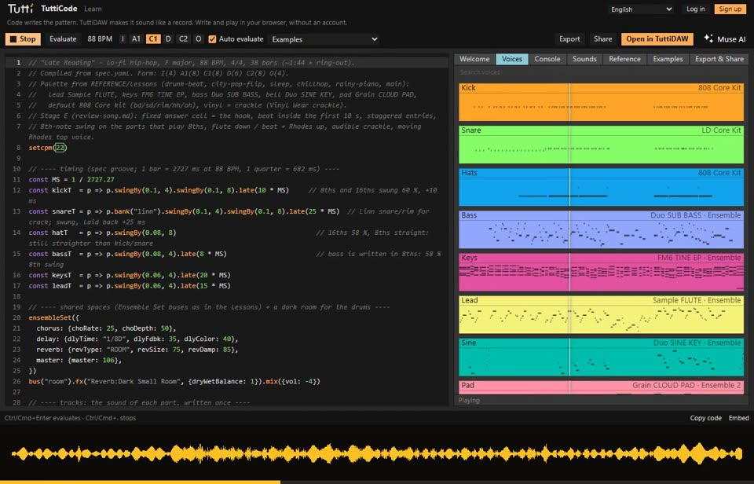

# Late Reading

Lo-fi hip-hop · 88 BPM · 1:44

- [Watch](https://assets.tuttidaw.com/showcase/late-reading/late-reading-hq.mp4) (TuttiDAW playing the program) · [MP3](https://assets.tuttidaw.com/showcase/late-reading/late-reading.mp3)
- [▶ Open in TuttiCode](https://tuttidaw.com/code#Ly8gIkxhdGUgUmVhZGluZyIgLSBsby1maSBoaXAtaG9wLCBGIG1ham9yLCA4OCBCUE0sIDQvNCwgMzggYmFycyAofjE6NDQgKyByaW5nLW91dCkuCi8vIENvbXBpbGVkIGZyb20gc3BlYy55YW1sLiBGb3JtOiBJKDQpIEExKDgpIEMxKDgpIEQoNikgQzIoOCkgTyg0KS4KLy8gUGFsZXR0ZSBmcm9tIFJFRkVSRU5DRS9sZXNzb25zIChkcnVuay1iZWF0LCBjaXR5LXBvcC1mbGlwLCBzbGVlcCwgY2hpbGxob3AsIHJhaW55LXBpYW5vLCBtYWluKToKLy8gICBsZWFkIFNhbXBsZSBGTFVURSwga2V5cyBGTTYgVElORSBFUCwgYmFzcyBEdW8gU1VCIEJBU1MsIGJlbGwgRHVvIFNJTkUgS0VZLCBwYWQgR3JhaW4gQ0xPVUQgUEFELAovLyAgIGRlZmF1bHQgODA4IENvcmUga2l0IChiZC9zZC9yaW0vaGgvb2gpLCB2aW55bCA9IGNyYWNrbGUgKFZpbnlsIFdlYXIgY3JhY2tsZSkuCi8vIFN0YWdlIEUgKHJldmlldy1zb25nLm1kKTogZml4ZWQgYW5zd2VyIGNlbGwgPSB0aGUgaG9vaywgYmVhdCBpbnNpZGUgdGhlIGZpcnN0IDEwIHMsIHN0YWdnZXJlZCBlbnRyaWVzLAovLyA4dGgtbm90ZSBzd2luZyBvbiB0aGUgcGFydHMgdGhhdCBwbGF5IDh0aHMsIGZsdXRlIGRvd24gLyBiZWF0ICsgUmhvZGVzIHVwLCBhdWRpYmxlIGNyYWNrbGUsIG1vdmluZyBSaG9kZXMgdG9wIHZvaWNlLgpzZXRjcG0oMjIpCgovLyAtLS0tIHRpbWluZyAoc3BlYyBncm9vdmU7IDEgYmFyID0gMjcyNyBtcyBhdCA4OCBCUE0sIDEgcXVhcnRlciA9IDY4MiBtcykgLS0tLQpjb25zdCBNUyA9IDEgLyAyNzI3LjI3CmNvbnN0IGtpY2tUICA9IHAgPT4gcC5zd2luZ0J5KDAuMSwgNCkuc3dpbmdCeSgwLjEsIDgpLmxhdGUoMTAgKiBNUykgICAgIC8vIDh0aHMgYW5kIDE2dGhzIHN3dW5nIDYwICUsICsxMCBtcwpjb25zdCBzbmFyZVQgPSBwID0%2BIHAuYmFuaygibGlubiIpLnN3aW5nQnkoMC4xLCA0KS5zd2luZ0J5KDAuMSwgOCkubGF0ZSgyNSAqIE1TKSAgLy8gTGlubiBzbmFyZS9yaW0gZm9yIGNyYWNrOyBzd3VuZywgbGFpZCBiYWNrICsyNSBtcwpjb25zdCBoYXRUICAgPSBwID0%2BIHAuc3dpbmdCeSgwLjA4LCA4KSAgICAgICAgICAgICAgICAgICAgICAgICAgICAgICAgICAgIC8vIDE2dGhzIDU4ICUsIDh0aHMgc3RyYWlnaHQ6IHN0aWxsIHN0cmFpZ2h0ZXIgdGhhbiBraWNrL3NuYXJlCmNvbnN0IGJhc3NUICA9IHAgPT4gcC5zd2luZ0J5KDAuMDgsIDQpLmxhdGUoOCAqIE1TKSAgICAgICAgICAgICAgICAgICAgICAgLy8gYmFzcyBpcyB3cml0dGVuIGluIDh0aHM6IDU4ICUgOHRoIHN3aW5nCmNvbnN0IGtleXNUICA9IHAgPT4gcC5zd2luZ0J5KDAuMDYsIDQpLmxhdGUoMjAgKiBNUykKY29uc3QgbGVhZFQgID0gcCA9PiBwLnN3aW5nQnkoMC4wNiwgNCkubGF0ZSgxNSAqIE1TKQoKLy8gLS0tLSBzaGFyZWQgc3BhY2VzIChFbnNlbWJsZSBTZXQgYnVzZXMgYXMgaW4gdGhlIGxlc3NvbnMpICsgYSBkYXJrIHJvb20gZm9yIHRoZSBkcnVtcyAtLS0tCmVuc2VtYmxlU2V0KHsKICBjaG9ydXM6IHtjaG9SYXRlOiAyNSwgY2hvRGVwdGg6IDUwfSwKICBkZWxheToge2RseVRpbWU6ICIxLzhEIiwgZGx5RmRiazogMzUsIGRseUNvbG9yOiA0MH0sCiAgcmV2ZXJiOiB7cmV2VHlwZTogIlJPT00iLCByZXZTaXplOiA3NSwgcmV2RGFtcDogODV9LAogIG1hc3Rlcjoge21hc3RlcjogMTA2fSwKfSkKYnVzKCJyb29tIikuZngoIlJldmVyYjpEYXJrIFNtYWxsIFJvb20iLCB7ZHJ5V2V0QmFsYW5jZTogMX0pLm1peCh7dm9sOiAtNH0pCgovLyAtLS0tIHRyYWNrczogdGhlIHNvdW5kIG9mIGVhY2ggcGFydCwgd3JpdHRlbiBvbmNlIC0tLS0KLy8gbGV2ZWxzIChyZXZpZXctc29uZyBpc3N1ZSAzKTogdGhlIGFuY2hvciBpcyBraWNrICsgYmFzcyArIHNuYXJlICsgUmhvZGVzOyB0aGUgZmx1dGUgc2l0cyBvbiB0b3AsIG5vdCBvdmVyIGV2ZXJ5dGhpbmcKZ3JvdXAoImRydW1zIikuZngoIkF1dG8gRmlsdGVyIiwge2ZpbHRlclR5cGVJbmRleDogIkxvdy1wYXNzIiwgZnJlcXVlbmN5OiA5NTAwfSkuc2VuZCgicm9vbSIsIC0xNikKdHJhY2soImtpY2siKS5ncm91cCgiZHJ1bXMiKS5meCgiQXV0byBGaWx0ZXIiLCB7ZmlsdGVyVHlwZUluZGV4OiAiSGlnaC1wYXNzIiwgZnJlcXVlbmN5OiA0MH0pLm1peCh7dm9sOiAtNH0pCnRyYWNrKCJzbmFyZSIpLmdyb3VwKCJkcnVtcyIpLm1peCh7dm9sOiAtMS41LCBwYW46IC0wLjEyfSkKdHJhY2soImhhdHMiKS5ncm91cCgiZHJ1bXMiKS5taXgoe3ZvbDogMCwgcGFuOiAwLjR9KQp0cmFjaygiYmFzcyIpLmluc3QoIk11bHRpLUVuZ2luZSBTeW50aDpEdW8gU1VCIEJBU1MiLCB7YXRrOiA2LCBkZWM6IDcwLCBzdXM6IDgwLCByZWw6IDQwLCByZXY6IDUsIGUwOiAyLCBlNDogNDgsIGU1OiA1LCBlNjogMTAsIGU3OiA2NCwgdm9pY2U6IDF9KQogIC5meCgiU2F0dXJhdG9yOldhcm0gVGFwZSIpLm1peCh7dm9sOiAtMTJ9KQp0cmFjaygia2V5cyIpLmluc3QoIk11bHRpLUVuZ2luZSBTeW50aDpGTTYgVElORSBFUCIsIHtsZXZlbDogMTA2LCBjaG9yOiA1MCwgZGx5OiAwLCByZXY6IDIyfSkKICAuZngoIkF1dG8gRmlsdGVyIiwge2ZpbHRlclR5cGVJbmRleDogIkxvdy1wYXNzIiwgZnJlcXVlbmN5OiBlbnYoIjA6MTEwMCAzOjIwMDAgNDoxODAwMCAzNToxODAwMCAzODoxNDAwIiwgMzgpfSkKICAuZngoIkNob3J1czpXaWRlIENsYXNzaWMiLCB7ZHJ5V2V0QmFsYW5jZTogMC40NX0pCiAgLmZ4KCJDb21wcmVzc29yIiwge3RocmVzaG9sZDogLTMyLCByYXRpbzogMywgYXR0YWNrOiA1LCByZWxlYXNlOiAxODAsIHNpZGVjaGFpbjogImtpY2siLCBzaWRlY2hhaW5GaWx0ZXI6ICIxNTBIeiJ9KQogIC5taXgoe3ZvbDogMCwgcGFuOiAtMC4zfSkKdHJhY2soImxlYWQiKS5pbnN0KCJNdWx0aS1FbmdpbmUgU3ludGg6U2FtcGxlIEZMVVRFIiwge2xldmVsOiAxMDAsIGNob3I6IDAsIGRseTogMjUsIHJldjogMTgsIHZvaWNlOiAxfSkubWl4KHt2b2w6IC00LjUsIHBhbjogMC4wNX0pCnRyYWNrKCJzaW5lIikuaW5zdCgiTXVsdGktRW5naW5lIFN5bnRoOkR1byBTSU5FIEtFWSIsIHtsZXZlbDogMTAwLCByZWw6IDMwLCBjaG9yOiAwLCBkbHk6IDEwLCByZXY6IDM1LCB2b2ljZTogMX0pLm1peCh7dm9sOiAwLCBwYW46IDAuNDV9KQp0cmFjaygicGFkIikuaW5zdCgiTXVsdGktRW5naW5lIFN5bnRoOkdyYWluIENMT1VEIFBBRCIsIHtsZXZlbDogOTIsIGNob3I6IDYwLCBkbHk6IDAsIHJldjogNzB9KS5meCgiQ2hvcnVzOkVuc2VtYmxlIikubWl4KHt2b2w6IC0xMH0pCnRyYWNrKCJ2aW55bCIpLmZ4KCJWaW55bCBXZWFyIiwge3RyYWNpbmdPbjogZmFsc2UsIHBpbmNoT246IGZhbHNlLCBnbG9iYWxEcml2ZTogMCwgY3JhY2tsZURlbnNpdHk6IDAuNCwgY3JhY2tsZVZvbHVtZTogMC43NX0pCiAgLmZ4KCJMaW1pdGVyIiwge2dhaW5EYjogMTIsIGNlaWxpbmc6IC0yMn0pLm1peCh7dm9sOiAwfSkgICAvLyBjbGlja3MgY2FwcGVkIHNvIHRoZSBiZWQgY2FuIGJlIGhlYXJkIHdpdGhvdXQgZHJpdmluZyB0aGUgbWFzdGVyIGxpbWl0ZXIKY29uc3QgdmlueWwgPSBnID0%2BIHMoImNyYWNrbGUiKS5nYWluKGcpCgovLyAtLS0tIGRydW0gdm9jYWIgKDE2IHN0ZXBzIHBlciBiYXIpIC0tLS0KY29uc3QgS1YgPSAiWzAuOCAwLjYgMC42IDAuNiAwLjYgMC42IDAuNjYgMC41IDAuNiAwLjYgMC43IDAuNiAwLjYgMC41IDAuNiAwLjZdIgpjb25zdCBTViA9ICJbMC4zIDAuMyAwLjI2IDAuMyAwLjc2IDAuMyAwLjMgMC4zIDAuNjIgMC4zIDAuMjYgMC4zIDAuNzQgMC4zIDAuNCAwLjNdIiAgIC8vIGJhY2tiZWF0IDImNCwgZ2hvc3RzIDwgMC40CmNvbnN0IGtWZXJzZUEgPSAiW2JkIH4gfiB%2BIH4gfiB%2BIH4gfiB%2BIGJkIH4gfiB%2BIH4gfl0iCmNvbnN0IGtWZXJzZUIgPSAiW2JkIH4gfiB%2BIH4gfiB%2BIGJkIH4gfiBiZCB%2BIH4gfiB%2BIH5dIgpjb25zdCBrQ2hvcnVzID0gIltiZCB%2BIH4gfiB%2BIH4gYmQgfiB%2BIH4gYmQgfiB%2BIGJkIH4gfl0iCmNvbnN0IHJpbVYgICAgPSAiW34gfiB%2BIH4gcmltIH4gfiB%2BIH4gfiB%2BIH4gcmltIH4gfiB%2BXSIKY29uc3Qgc25DICAgICA9ICJbfiB%2BIHNkIH4gc2QgfiB%2BIH4gfiB%2BIHNkIH4gc2QgfiB%2BIHNkXSIKY29uc3QgaGF0OCAgICA9ICJbaGggfiBoaCB%2BIGhoIH4gaGggfiBoaCB%2BIGhoIH4gaGggfiBoaCB%2BXSIKY29uc3QgaGF0MTYgICA9ICJoaCoxNiIKY29uc3QgaGF0MTZvICA9ICJbaGggaGggaGggaGggaGggaGggaGggaGggaGggaGggaGggaGggaGggaGggb2ggfl0iCmNvbnN0IEhWOCAgPSAiWzAuNTIgMC4zIDAuMzQgMC4zIDAuNSAwLjMgMC4zNCAwLjMgMC41MiAwLjMgMC4zNCAwLjMgMC41IDAuMyAwLjM0IDAuM10iCmNvbnN0IEhWMTYgPSAiWzAuNDYgMC4yMiAwLjMyIDAuMjJdKjQiCgovLyAtLS0tIGhhcm1vbnk6IHJvb3RsZXNzIFJob2RlcyB2b2ljaW5ncyAoc3BlYyBmb3JtW10uaGFybW9ueV9sZXR0ZXJzKSAtLS0tCi8vIGNob3J1cyBzZXQgcmUtdm9pY2VkIHNvIHRoZSB0b3Agdm9pY2UgbW92ZXMgYnkgaGFsZi1zdGVwcyAocmV2aWV3IG5vdGUgMSwgbWMtc3R5bGUtamF6eiDCpzQuMSk6IEQgQyBDIEMgRCB8IEQgQyBCIEMgRGIgQwpjb25zdCBWID0gewogIERtOTogIltmMyxhMyxjNCxlNF0iLCBHMTM6ICJbZjMsYTMsYjMsZTRdIiwgQmJtYWo5OiAiW2YzLGEzLGM0LGQ0XSIsIEJiNjk6ICJbZjMsZzMsYzQsZDRdIiwKICBCYm02OiAiW2YzLGczLGJiMyxkYjRdIiwgQW05OiAiW2UzLGczLGIzLGM0XSIsIEFtMTE6ICJbZTMsZzMsYzQsZDRdIiwgR205OiAiW2YzLGEzLGJiMyxkNF0iLAogIEdtMTE6ICJbZjMsYmIzLGM0LGQ0XSIsIEM5c3VzNDogIltmMyxnMyxiYjMsZDRdIiwgQzk6ICJbZTMsZzMsYmIzLGQ0XSIsIEQ3Yjk6ICJbZiMzLGEzLGM0LGViNF0iLAogIEFiZGltNzogIltmMyxhYjMsYjMsZDRdIiwgQzdiOTogIltlMyxnMyxiYjMsZGI0XSIsIEZtYWo5OiAiW2UzLGczLGEzLGM0XSIsIERibWFqOTogIltmMyxhYjMsYzQsZWI0XSIsCiAgQ205OiAiW2ViMyxnMyxiYjMsZDRdIiwgRjEzOiAiW2ViMyxnMyxhMyxkNF0iLCBHYjdzMTE6ICJbZTMsYWIzLGJiMyxjNF0iLCBEYkVuZDogIltkYjIsZjMsYWIzLGM0LGViNF0iLAogIEFtN2M6ICJbZTMsZzMsYTMsYzRdIiwgRDdiOWM6ICJbZWIzLGYjMyxhMyxjNF0iLCBHbTExYzogIltkMyxmMyxiYjMsYzRdIiwgQWJkaW03YzogIltkMyxmMyxhYjMsYjNdIiwKfQpjb25zdCBoZWxkICA9IChhLCBiKSA9PiBiID8gYFske1ZbYV19QDQgJHtWW2JdfUA0XWAgOiBgJHtWW2FdfWAKY29uc3QgY29tcFYgPSAoYSwgYikgPT4gYiA%2FIGBbJHtWW2FdfUAzIH4gJHtWW2JdfUAzIH5dYCA6IGBbJHtWW2FdfUA1IH4gJHtWW2FdfUAyXWAKY29uc3QgY29tcEMgPSAoYSwgYikgPT4gYiA%2FIGBbJHtWW2FdfUAzIH4gJHtWW2JdfUAzICR7VltiXX1dYCA6IGBbJHtWW2FdfUAzICR7VlthXX1AMyB%2BICR7VlthXX1dYApjb25zdCBiYXJzICA9IGxpc3QgPT4gYDwke2xpc3Quam9pbigiICIpfT5gCmNvbnN0IGtleXMgID0gKGxpc3QsIHZlbCkgPT4ga2V5c1Qobm90ZShiYXJzKGxpc3QpKS52ZWxvY2l0eSh2ZWwpKQoKLy8gLS0tLSBtZWxvZHkgQyAoZml4ZWQgYWZ0ZXIgcmV2aWV3LW1lbG9keS5tZCkgYW5kIHRoZSBzdGFnZS1FIGhvb2sgZml4IChyZXZpZXctc29uZyBpc3N1ZSAxKSAtLS0tCi8vIHRoZSBhbnN3ZXIgaXMgbm93IE9ORSBjZWxsOiAifkAyIEE1IHhAMiBsYW5kQDMiIC0gaGVhZCBBNSBldmVyeSB0aW1lLCBvbmx5IHRoZSBsYW5kaW5nIGZvbGxvd3MgdGhlIGNob3JkCmNvbnN0IGNhbGxBMSA9IFsKICAiW34gZDUgZTUgZjUgYTVANF0iLCAiW35ANCBkNSBiNEAyIH5dIiwgIlt%2BIGQ1IGU1IGY1IGE1QDIgZzVAMl0iLCAiW35ANCBmNSBlNUAyIH5dIiwKICAiW34gYzUgZDUgZTVAMiBhNUAzXSIsICJbfkA0IGY1IGRiNUAzXSIsICJbfiBjNSBkNSBlNSBnNUA0XSIsICJbfkA0IGJiNCBjNUAyIH5dIl0KY29uc3QgaG9va0MxID0gWwogICJbfiBiYjQgYzUgZDUgZjVANF0iLCAiW35AMiBhNSBmIzVAMiBkNUAzXSIsICAgICAgLy8gQW03IHwgRDdiOTogMTMgLT4gMyAtPiByb290CiAgIlt%2BIGJiNCBjNSBkNSBhNUA0XSIsICJbfkAyIGE1IGc1QDIgZTVAM10iLCAgICAgICAvLyBDMTM6IDEzLCA1LCAzCiAgIlt%2BIGJiNCBjNSBkNSBmNUA0XSIsICJbfkAyIGE1IGI1QDIgYWI1QDNdIiwgICAgICAvLyBBbTcgfCBBYmRpbTcKICAiW34gZDUgYzUgYmI0QDIgfiBkYjUgYzVdIiwgIlt%2BQDIgYTUgZzVAMiBmNUAzXSJdIC8vIEZtYWo5OiBsYW5kcyBvbiB0aGUgdG9uaWMKY29uc3QgaG9va0MyID0gWyAgICAgICAgICAgICAgICAgICAgICAgICAgICAgICAgICAgIC8vIGNhbGxzIGEgM3JkIGhpZ2hlciwgdGhlIHNhbWUgYW5zd2VyIGNlbGwgZnJvbSBDNgogICJbfiBkNSBlNSBmNSBhNUA0XSIsICJbfkAyIGM2IGE1QDIgZiM1QDNdIiwKICAiW34gZDUgZTUgZjUgYmI1QDRdIiwgIlt%2BQDIgYzYgYmI1QDIgYTVAM10iLAogICJbfiBkNSBlNSBmNSBhNUA0XSIsICJbfkAyIGM2IGI1QDIgYWI1QDNdIiwKICAiW34gZjUgZTUgZDUgfiB%2BIGRiNSBjNV0iLCAiW35AMiBjNiBhNUAyIGY1QDNdIl0KLy8gdGhlIGJlbGwgZG91YmxlcyBldmVyeSBjaG9ydXMgYW5zd2VyIGFuIG9jdGF2ZSBiZWxvdzogdGhlIG5vbi1sZWFkIGxheWVyIHRoYXQgY2FycmllcyB0aGUgaG9vawpjb25zdCBiZWxsQzEgPSBbIn4iLCAiW35AMiBhNCBmIzRAMiBkNEAzXSIsICJ%2BIiwgIlt%2BQDIgYTQgZzRAMiBlNEAzXSIsICJ%2BIiwgIlt%2BQDIgYTQgYjRAMiBhYjRAM10iLCAifiIsICJbfkAyIGE0IGc0QDIgZjRAM10iXQpjb25zdCBsZWFkID0gKGxpc3QsIHZlbCkgPT4gbGVhZFQobm90ZShiYXJzKGxpc3QpKS52ZWxvY2l0eSh2ZWwpKQoKLy8gPT09PT09PT09PT09PT09PT09PT09PT09PT09PT09PT0gU0VDVElPTlMgPT09PT09PT09PT09PT09PT09PT09PT09PT09PT09PT0Kc2VjdGlvbigiSSIsIDQsIHsKICAvLyB0aGUgY2hvcnVzIGNhbGwgKyBUSEUgYW5zd2VyIGluIHRoZSBmaXJzdCA1IHM7IGEgc29mdCBiZWF0IGZyb20gYmFyIDMgKDA6MDUpOyBiYXIgNCA9IHRoZSAnc3RvcCcgcGlja3VwCiAga2V5czogIGtleXMoW2hlbGQoIkJiNjkiKSwgaGVsZCgiQW0xMSIsICJEN2I5IiksIGBbJHtWLkdtMTF9QDUgfiAke1YuR20xMX1AMl1gLCBgWyR7Vi5DOXN1czR9QDUgfiAke1YuQzlzdXM0fUAyXWBdLCAwLjYpLAogIGxlYWQ6ICBsZWFkKFtob29rQzFbMF0sIGhvb2tDMVsxXSwgaG9va0MxWzJdLCAifiJdLCAiPDAuNjYgMC42NCAwLjY2IDA%2BIiksCiAgc2luZTogIGtleXNUKG5vdGUoIjx%2BIFt%2BQDIgYTQgZiM0QDIgZDRAM10gfiBbfkAxMiBnNCBiYjQgZDUgZjVdPiIpLnZlbG9jaXR5KCI8MCAwLjYgMCAwLjY2PiIpKSwKICBraWNrOiAga2lja1QocygiPH4gfiBbYmQgfiB%2BIH4gfiB%2BIH4gfiB%2BIH4gYmQgfiB%2BIH4gfiB%2BXSBbYmQgfiB%2BIH4gfiB%2BIH4gfiB%2BIH4gfiB%2BIH4gfiB%2BIH5dPiIpLnZlbG9jaXR5KDAuNSkpLAogIHNuYXJlOiBzbmFyZVQocygiPH4gfiBbfiB%2BIH4gfiByaW0gfiB%2BIH4gfiB%2BIH4gfiByaW0gfiB%2BIH5dIFt%2BIH4gfiB%2BIHJpbSB%2BIH4gfiB%2BIH4gfiB%2BIH4gfiBzZCBzZF0%2BIikudmVsb2NpdHkoU1YpKSwKICB2aW55bDogdmlueWwoMSksCn0pCgpzZWN0aW9uKCJBMSIsIDgsIHsKICBraWNrOiAga2lja1QocyhiYXJzKFtrVmVyc2VBLCBrVmVyc2VCLCBrVmVyc2VBLCBrVmVyc2VCLCBrVmVyc2VBLCBrVmVyc2VCLCBrVmVyc2VBLAogICAgICAgICAgICAgICAgICAgICAgICJbYmQgfiB%2BIH4gfiB%2BIH4gfiB%2BIH4gfiB%2BIH4gfiB%2BIH5dIl0pKS52ZWxvY2l0eShLVikuZ2FpbigwLjg1KSksICAgLy8gdmVyc2Uga2ljayBzb2Z0ZXI6IHJvb20gZm9yIHRoZSBjaG9ydXMgbGlmdAogIHNuYXJlOiBzbmFyZVQocyhiYXJzKFtyaW1WLCByaW1WLCByaW1WLCByaW1WLCByaW1WLCByaW1WLCByaW1WLAogICAgICAgICAgICAgICAgICAgICAgICAiW34gfiB%2BIH4gcmltIH4gfiB%2BIHNkIH4gfiB%2BIH4gfiBzZCBzZF0iXSkpLnZlbG9jaXR5KFNWKSksCiAgaGF0czogIGhhdFQocyhiYXJzKFsifiIsICJ%2BIiwgIn4iLCAifiIsIGhhdDgsIGhhdDgsIGhhdDgsICAgICAgICAgICAgICAgICAgICAvLyBoYXRzIGVudGVyIGhhbGZ3YXkgKGJhciA5KQogICAgICAgICAgICAgICAgICAgICAgIltoaCB%2BIGhoIH4gaGggfiBoaCB%2BIGhoIH4gaGggfiB%2BIH4gfiB%2BXSJdKSkudmVsb2NpdHkoSFY4KSksCiAgYmFzczogIGJhc3NUKG5vdGUoYmFycyhbCiAgICAiW2QyQDMgfkAyIGExIGMyIGUyXSIsICJbZzFAMyB%2BQDIgZDIgZjIgZTJdIiwgIltkMkAzIH5AMiBhMSBjMiBkMl0iLCAiW2cxQDMgfkAyIGIxIGQyIGYyXSIsCiAgICAiW2JiMUAzIH5AMiBkMiBmMiBhMV0iLCAiW2JiMUAzIH5AMiBmMSBnMSBhYjFdIiwgIlthMUAzIH5AMiBlMiBjMiBhMV0iLCAiW2cxQDIgZDIgfiBjMkAyIGcxIGExXSJdKSkKICAgIC52ZWxvY2l0eSgiWzAuNzIgMC41NiAwLjU2IDAuNiAwLjU4IDAuNiAwLjU2IDAuNThdIikpLAogIGtleXM6ICBrZXlzKFtjb21wVigiRG05IiksIGNvbXBWKCJHMTMiKSwgY29tcFYoIkRtOSIpLCBjb21wVigiRzEzIiksCiAgICAgICAgICAgICAgIGNvbXBWKCJCYm1hajkiKSwgY29tcFYoIkJibTYiKSwgY29tcFYoIkFtOSIpLCBjb21wVigiR205IiwgIkM5c3VzNCIpXSwgIlswLjQyIDAuMzJdIiksCiAgbGVhZDogIGxlYWQoY2FsbEExLCAiPDAuNzIgMC42IDAuNyAwLjYzIDAuNzQgMC42MiAwLjY5IDAuNjQ%2BIiksCiAgdmlueWw6IHZpbnlsKDAuNyksCn0pCgpzZWN0aW9uKCJDMSIsIDgsIHsKICBraWNrOiAga2lja1QocyhiYXJzKFtrQ2hvcnVzLCBrQ2hvcnVzLCBrQ2hvcnVzLCBrQ2hvcnVzLCBrQ2hvcnVzLCBrQ2hvcnVzLCBrQ2hvcnVzLAogICAgICAgICAgICAgICAgICAgICAgICJbYmQgfiB%2BIH4gfiB%2BIGJkIH4gfiB%2BIH4gfiB%2BIH4gfiB%2BXSJdKSkudmVsb2NpdHkoS1YpKSwKICBzbmFyZTogc25hcmVUKHMoYmFycyhbc25DLCBzbkMsIHNuQywgc25DLCBzbkMsIHNuQywgc25DLAogICAgICAgICAgICAgICAgICAgICAgICAiW34gfiB%2BIH4gc2QgfiB%2BIH4gfiB%2BIH4gfiBzZCB%2BIHNkIHNkXSJdKSkudmVsb2NpdHkoU1YpKSwKICBoYXRzOiAgaGF0VChzKGJhcnMoW2hhdDE2LCBoYXQxNiwgaGF0MTYsIGhhdDE2bywgaGF0MTYsIGhhdDE2LCBoYXQxNiwKICAgICAgICAgICAgICAgICAgICAgICJbaGggaGggaGggaGggaGggaGggaGggaGggaGggaGggaGggaGggb2ggfiB%2BIH5dIl0pKS52ZWxvY2l0eShIVjE2KSksCiAgYmFzczogIGJhc3NUKG5vdGUoYmFycyhbCiAgICAiW2JiMUAzIGJiMSB%2BIGYyIH4gYzJdIiwgIlthMUAyIGUyIH4gZDJAMiBhMSBmIzFdIiwgIltnMUAzIGcxIH4gZDIgYmIxIGIxXSIsICJbYzJAMyBjMiB%2BIGUyIGQyIGMyXSIsCiAgICAiW2JiMUAzIGJiMSB%2BIGYyIH4gYzJdIiwgIlthMUAyIGUyIH4gYWIxQDIgZDIgYWIxXSIsICJbZzFAMiBkMiB%2BIGMyQDIgZzEgZTFdIiwgIltmMUAzIH5AMiBjMiBlMiBlYjJdIl0pKQogICAgLnZlbG9jaXR5KCJbMC44IDAuNiAwLjYgMC43IDAuNiAwLjY2IDAuNiAwLjYyXSIpKSwKICBrZXlzOiAga2V5cyhbY29tcEMoIkJiNjkiKSwgY29tcEMoIkFtN2MiLCAiRDdiOWMiKSwgY29tcEMoIkdtMTFjIiksIGNvbXBDKCJDOSIpLAogICAgICAgICAgICAgICBjb21wQygiQmI2OSIpLCBjb21wQygiQW03YyIsICJBYmRpbTdjIiksIGNvbXBDKCJHbTExYyIsICJDN2I5IiksIGNvbXBDKCJGbWFqOSIpXSwgIlswLjYgMC40OCAwLjUyIDAuNDhdIiksCiAgbGVhZDogIGxlYWQoaG9va0MxLCAiPDAuNzQgMC43MiAwLjc1IDAuNzQgMC43MyAwLjcyIDAuNzIgMC42OD4iKSwKICBzaW5lOiAga2V5c1Qobm90ZShiYXJzKGJlbGxDMSkpLnZlbG9jaXR5KDAuNykpLCAgICAgICAgICAgICAgICAgICAgICAgICAgLy8gTkVXIGxheWVyIGF0IEMxOiB0aGUgYmVsbCBkb3VibGVzIHRoZSBhbnN3ZXJzCiAgdmlueWw6IHZpbnlsKDAuNiksCn0pCgpzZWN0aW9uKCJEIiwgNiwgewogIC8vIGRydW1zIG91dCAoc3VidHJhY3Rpb24pLCBiYXNzIGluIGhlbGQgbm90ZXMsIHBhZCBpbiwgbW90aWYgaGVhZCBhdWdtZW50ZWQgYW5kIGxvdwogIGJhc3M6ICBiYXNzVChub3RlKGJhcnMoWyJbZGIyQDYgfkAyXSIsICJbYzJAMyB%2BIGYxQDMgfl0iLCAiW2JiMUA2IH5AMl0iLCAiW2JiMUAzIH4gZGIyQDMgfl0iLCAiW2ExQDMgfiBhYjFAMyB%2BXSIsICJ%2BIl0pKS52ZWxvY2l0eSgwLjQ4KSksCiAga2V5czogIGtleXMoW2BbJHtWLkRibWFqOX1ANiB%2BQDJdYCwgYFske1YuQ205fUAzIH4gJHtWLkYxM31AMyB%2BXWAsIGBbJHtWLkJibWFqOX1ANiB%2BQDJdYCwKICAgICAgICAgICAgICAgYFske1YuQmJtNn1ANiB%2BQDJdYCwgYFske1YuQW0xMX1AMyB%2BICR7Vi5BYmRpbTd9QDMgfl1gLCBgWyR7Vi5HbTl9QDMgfiAke1YuQzdiOX1AMiB%2BQDJdYF0sIDAuNDIpLAogIHBhZDogICBub3RlKGJhcnMoWyJbYWI1LGM2XSIsICJbZzUsZDZdIiwgIlthNSxkNl0iLCAiW2c1LGRiNl0iLCAiW1tnNSxjNl0gW2Y1LGI1XV0iLCAiW1tmNSxhNV0gfl0iXSkpLnZlbG9jaXR5KDAuNSksCiAgbGVhZDogIGxlYWQoWyJbfkAyIGY0QDIgZzRAMiBhYjRAMl0iLCAiW2M1QDQgfkAyIGQ1IGE0XSIsICJbfkAyIGQ0QDIgZTRAMiBmNEAyXSIsCiAgICAgICAgICAgICAgICJbZzRANCB%2BQDIgZjQgZGI0XSIsICJbfiBjNSBkNSBlNSB%2BIGQ1IGI0QDJdIiwgIlt%2BIGJiNCBjNSBkNSB%2BQDRdIl0sCiAgICAgICAgICAgICAgIjwwLjY2IDAuNjQgMC42NCAwLjY2IDAuNjggMC42Nj4iKSwKICB2aW55bDogdmlueWwoMSksCn0pCgpzZWN0aW9uKCJDMiIsIDgsIHsKICBraWNrOiAga2lja1QocyhiYXJzKFtrQ2hvcnVzLCBrQ2hvcnVzLCBrQ2hvcnVzLCAiW2JkIH4gfiB%2BIH4gfiBiZCB%2BIH4gfiBiZCB%2BIH4gfiB%2BIH5dIiwKICAgICAgICAgICAgICAgICAgICAgICBrQ2hvcnVzLCBrQ2hvcnVzLCBrQ2hvcnVzLCAiW2JkIH4gfiB%2BIH4gfiB%2BIH4gfiB%2BIH4gfiB%2BIH4gfiB%2BXSJdKSkudmVsb2NpdHkoS1YpKSwKICBzbmFyZTogc25hcmVUKHMoYmFycyhbc25DLCBzbkMsIHNuQywgIlt%2BIH4gc2QgfiBzZCB%2BIH4gfiB%2BIH4gc2QgfiBzZCBzZCBzZCBzZF0iLAogICAgICAgICAgICAgICAgICAgICAgICBzbkMsIHNuQywgc25DLCAiW34gfiB%2BIH4gc2QgfiB%2BIH4gfiB%2BIH4gfiBzZCB%2BIH4gfl0iXSkpCiAgICAudmVsb2NpdHkoIjxbMC4zIDAuMyAwLjI4IDAuMyAwLjc4IDAuMyAwLjMgMC4zIDAuMyAwLjMgMC4yOCAwLjMgMC43NiAwLjMgMC4zIDAuM10hMyBbMC4zIDAuMyAwLjI4IDAuMyAwLjc4IDAuMyAwLjMgMC4zIDAuMyAwLjMgMC4yOCAwLjMgMC43IDAuMyAwLjQgMC41XSBbMC4zIDAuMyAwLjI4IDAuMyAwLjc4IDAuMyAwLjMgMC4zIDAuMyAwLjMgMC4yOCAwLjMgMC43NiAwLjMgMC4zIDAuM10hND4iKSksCiAgaGF0czogIGhhdFQocyhiYXJzKFtoYXQxNiwgaGF0MTZvLCBoYXQxNiwgaGF0MTYsIGhhdDE2LCBoYXQxNm8sIGhhdDE2LAogICAgICAgICAgICAgICAgICAgICAgIltoaCBoaCBoaCBoaCBoaCBoaCBoaCBoaCBoaCBoaCBoaCBoaCB%2BIH4gfiB%2BXSJdKSkudmVsb2NpdHkoIlswLjU0IDAuMjYgMC4zOCAwLjI2XSo0IikpLAogIGJhc3M6ICBiYXNzVChub3RlKGJhcnMoWwogICAgIltiYjFAMyBiYjEgfiBmMiB%2BIGMyXSIsICJbYTFAMiBlMiB%2BIGQyQDIgYTEgZiMxXSIsICJbZzFAMyBnMSB%2BIGQyIGJiMSBiMV0iLCAiW2MyQDMgYzIgfiBlMiBkMiBjMl0iLAogICAgIltiYjFAMyBiYjEgfiBmMiB%2BIGMyXSIsICJbYTFAMiBlMiB%2BIGFiMUAyIGQyIGFiMV0iLCAiW2cxQDIgZDIgfiBnYjFAMiBkYjIgZ2IxXSIsICJbZjFAMyB%2BQDIgYTEgYzIgYTFdIl0pKQogICAgLnZlbG9jaXR5KCJbMC44MiAwLjYgMC42IDAuNzIgMC42IDAuNjggMC42IDAuNjJdIikpLAogIGtleXM6ICBrZXlzKFtjb21wQygiQmJtYWo5IiksIGNvbXBDKCJBbTdjIiwgIkQ3YjljIiksIGNvbXBDKCJHbTExYyIpLCBjb21wQygiQzkiKSwKICAgICAgICAgICAgICAgY29tcEMoIkJibWFqOSIpLCBjb21wQygiQW03YyIsICJBYmRpbTdjIiksIGNvbXBDKCJHbTExYyIsICJHYjdzMTEiKSwgY29tcEMoIkZtYWo5IildLCAiWzAuNjggMC41NiAwLjYgMC41Nl0iKSwKICBsZWFkOiAgbGVhZChob29rQzIsICI8MC44IDAuOCAwLjg0IDAuODQgMC44IDAuNzggMC43OCAwLjc0PiIpLAogIC8vIGJlbGw6IGNvdW50ZXItbGluZSBpbiB0aGUgY2FsbCBiYXJzIChlbnRlcnMgb24gYmVhdCAzIHVuZGVyIHRoZSBmbHV0ZSdzIGxvbmcgbm90ZSwgQzUtRjUpLAogIC8vICAgICAgIHRoZSBhbnN3ZXIgY2VsbCBhbiBvY3RhdmUgYmVsb3cgaW4gdGhlIGFuc3dlciBiYXJzIChzYW1lIGRvdWJsaW5nIGFzIEMxLCBub3cgZnJvbSBDNSkKICBzaW5lOiAga2V5c1Qobm90ZShiYXJzKFsiW35ANCBkNUA0XSIsICJbfkAyIGM1IGE0QDIgZiM0QDNdIiwgIlt%2BQDQgZjVANF0iLCAiW35AMiBjNSBiYjRAMiBhNEAzXSIsCiAgICAgICAgICAgICAgICAgICAgICAgICAgIlt%2BQDQgYzVANF0iLCAiW35AMiBjNSBiNEAyIGFiNEAzXSIsICJbfkA0IGJiNEA0XSIsICJbfkAyIGM1IGE0QDIgZjRAM10iXSkpCiAgICAudmVsb2NpdHkoIjwwLjcgMC44IDAuNyAwLjggMC43IDAuOCAwLjcgMC44PiIpKSwKICAvLyB0aGUgYnJpZGdlJ3MgcGFkIHN0YXlzIHVuZGVyIEMyLCBsb3cgKHRleHR1cmUgbGlmdCkKICBwYWQ6ICAgbm90ZShiYXJzKFsiW2E1LGQ2XSIsICJbW2c1LGM2XSBbZiM1LGM2XV0iLCAiW2Y1LGJiNV0iLCAiW2U1LGJiNV0iLAogICAgICAgICAgICAgICAgICAgICJbYTUsZDZdIiwgIltbZzUsYzZdIFtmNSxiNV1dIiwgIltbZjUsYmI1XSBbZTUsYmI1XV0iLCAiW2U1LGE1XSJdKSkudmVsb2NpdHkoMC41NSksCiAgdmlueWw6IHZpbnlsKDAuNiksCn0pCgpzZWN0aW9uKCJPIiwgNCwgewogIC8vIGxvb3AtYW5kLXN1YnRyYWN0OiBvbmUgbGF5ZXIgbGVhdmVzIGF0IGVhY2ggYmFybGluZTsgaGVhZCBhdWdtZW50ZWQsIG5vIGFuc3dlcjsgRGJtYWo5CiAgYmFzczogIGJhc3NUKG5vdGUoYmFycyhbImJiMSIsICJbYTEgZDJdIiwgIltnMUA0IH5ANF0iLCAifiJdKSkudmVsb2NpdHkoIjwwLjU4IDAuNDggMC40MiAwPiIpKSwKICBrZXlzOiAga2V5cyhbaGVsZCgiQmJtYWo5IiksIGhlbGQoIkFtMTEiLCAiRDdiOSIpLCBoZWxkKCJHbTkiLCAiQzlzdXM0IiksIGAke1YuRGJFbmR9YF0sICI8MC40NCAwLjM4IDAuMzMgMC4zPiIpLAogIGxlYWQ6ICBsZWFkKFsiW35AMiBkNUAyIGU1QDIgZjVAMl0iLCAiW2E1QDQgfkA0XSIsICJ%2BIiwgIn4iXSwgIjwwLjYgMC40NSAwIDA%2BIiksCiAgc2luZTogIG5vdGUoIjx%2BIH4gfiBbfkA0IGY0IGFiNCBjNSBlYjVdPiIpLnZlbG9jaXR5KDAuNjIpLCAgICAgICAgICAgLy8gdGhlIGJlbGwgcmlwcGxlLCBsYXN0IHRpbWUsIG92ZXIgRGJtYWo5CiAgdmlueWw6IHZpbnlsKDEpLAp9KQoKZm9ybSgiSSBBMSBDMSBEIEMyIE8iKQoKbWFzdGVyLmZ4KCJVdGlsaXR5Iiwge3N0ZXJlb1dpZHRoOiBlbnYoIjA6MC43IF80OjEgXzEyOjEuMyBfMjA6MC43NSBfMjY6MS4zNSBfMzQ6MC43IiwgMzgpfSkKICAuZngoIkF1dG8gRmlsdGVyIiwge2ZpbHRlclR5cGVJbmRleDogIkxvdy1wYXNzIiwgZnJlcXVlbmN5OiAxNDAwMH0pCiAgLmZ4KCJCdXMgQ29tcHJlc3NvciIsIHt0aHJlc2hvbGQ6IC0xNCwgcmF0aW9JbmRleDogIjIgOiAxIiwgYXR0YWNrSW5kZXg6ICIzMCBtcyIsIGF1dG9SZWxlYXNlOiB0cnVlfSkKICAuZngoIkxpbWl0ZXIiLCB7Y2VpbGluZzogLTF9KQo%3D): play it, change it, open it in TuttiDAW
- [`song.tc`](song.tc): the program · [`NOTES.md`](NOTES.md): the agent's own notes (plan, lead sheet, sounds, revisions, audits)

Render it yourself: `npx tutticode render song.tc -o late-reading.wav --lufs -14 --limit --tail 4`

How it was made: [../README.md](../README.md).
