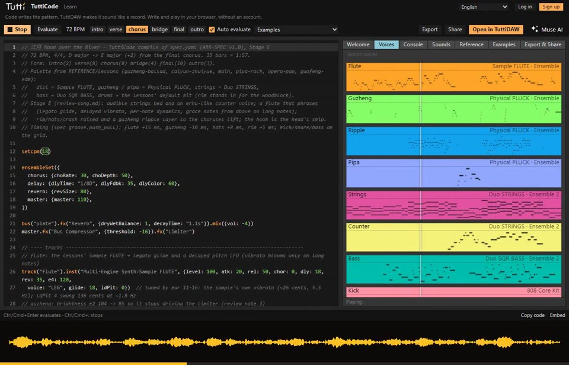

# 江月 Moon over the River

Guofeng (Chinese-style) ballad · 72 BPM · 1:57

- [Watch](https://assets.tuttidaw.com/showcase/moon-over-the-river/moon-over-the-river-hq.mp4) (TuttiDAW playing the program) · [MP3](https://assets.tuttidaw.com/showcase/moon-over-the-river/moon-over-the-river.mp3)
- [▶ Open in TuttiCode](https://tuttidaw.com/code#Ly8g5rGf5pyIIE1vb24gb3ZlciB0aGUgUml2ZXIgLSBUdXR0aUNvZGUgY29tcGlsZSBvZiBzcGVjLnlhbWwgKEFSUi1TUEVDIHYxLjApLCBTdGFnZSBFCi8vIDcyIEJQTSwgNC80LCBEIG1ham9yIC0%2BIEUgbWFqb3IgKCsyKSBmcm9tIHRoZSBmaW5hbCBjaG9ydXMuIDM1IGJhcnMgPSAxOjU3LgovLyBGb3JtOiBpbnRybygyKSB2ZXJzZSg4KSBjaG9ydXMoOCkgYnJpZGdlKDQpIGZpbmFsKDEwKSBvdXRybygzKS4KLy8gUGFsZXR0ZSBmcm9tIFJFRkVSRU5DRS9sZXNzb25zIChndXpoZW5nLWJhbGxhZCwgY2FpeXVuLXpodWl5dWUsIG1haW4sIHBpcGEtcm9jaywgb3BlcmEtcG9wLCBndW9mZW5nLWVkbSk6Ci8vICAgZGl6aSA9IFNhbXBsZSBGTFVURSwgZ3V6aGVuZyAvIHBpcGEgPSBQaHlzaWNhbCBQTFVDSywgc3RyaW5ncyA9IER1byBTVFJJTkdTLAovLyAgIGJhc3MgPSBEdW8gU1FSIEJBU1MsIGRydW1zID0gdGhlIGxlc3NvbnMnIGRlZmF1bHQga2l0IChyaW0gc3RhbmRzIGluIGZvciB0aGUgd29vZGJsb2NrKS4KLy8gU3RhZ2UgRSAocmV2aWV3LXNvbmcubWQpOiBhdWRpYmxlIHN0cmluZ3MgYmVkIGFuZCBhbiBlcmh1LWxpa2UgY291bnRlciB2b2ljZTsgYSBmbHV0ZSB0aGF0IHBocmFzZXMKLy8gICAobGVnYXRvIGdsaWRlLCBkZWxheWVkIHZpYnJhdG8sIHBlci1ub3RlIGR5bmFtaWNzLCBncmFjZSBub3RlcyBmcm9tIGFib3ZlIG9uIGxvbmcgbm90ZXMpOwovLyAgIHJpbS9oYXRzL2NyYXNoIHJhaXNlZCBhbmQgYSBndXpoZW5nIHJpcHBsZSBsYXllciBzbyB0aGUgY2hvcnVzZXMgbGlmdDsgdGhlIGhvb2sgaXMgdGhlIGhlYWQncyBza2lwLgovLyBUaW1pbmcgKHNwZWMgZ3Jvb3ZlLnB1c2hfcHVsbCk6IGZsdXRlICsxNSBtcywgZ3V6aGVuZyAtMTAgbXMsIGhhdHMgKzggbXMsIHJpbSArNSBtczsga2ljay9zbmFyZS9iYXNzIG9uIHRoZSBncmlkLgoKc2V0Y3BtKDE4KQoKZW5zZW1ibGVTZXQoewogIGNob3J1czoge2Nob1JhdGU6IDMwLCBjaG9EZXB0aDogNTB9LAogIGRlbGF5OiB7ZGx5VGltZTogIjEvOEQiLCBkbHlGZGJrOiAzNSwgZGx5Q29sb3I6IDYwfSwKICByZXZlcmI6IHtyZXZTaXplOiA4MH0sCiAgbWFzdGVyOiB7bWFzdGVyOiAxMTB9LAp9KQoKYnVzKCJwbGF0ZSIpLmZ4KCJSZXZlcmIiLCB7ZHJ5V2V0QmFsYW5jZTogMSwgZGVjYXlUaW1lOiAiMS4xcyJ9KS5taXgoe3ZvbDogLTR9KQptYXN0ZXIuZngoIkJ1cyBDb21wcmVzc29yIiwge3RocmVzaG9sZDogLTE2fSkuZngoIkxpbWl0ZXIiKQoKLy8gLS0tLSB0cmFja3MgLS0tLS0tLS0tLS0tLS0tLS0tLS0tLS0tLS0tLS0tLS0tLS0tLS0tLS0tLS0tLS0tLS0tLS0tLS0tLS0tLS0tLS0tLS0tLS0tLS0tLS0tLS0tCi8vIGZsdXRlOiB0aGUgbGVzc29ucycgU2FtcGxlIEZMVVRFICsgbGVnYXRvIGdsaWRlIGFuZCBhIGRlbGF5ZWQgcGl0Y2ggTEZPICh2aWJyYXRvIGJsb29tcyBvbmx5IG9uIGxvbmcgbm90ZXMpCnRyYWNrKCJmbHV0ZSIpLmluc3QoIk11bHRpLUVuZ2luZSBTeW50aDpTYW1wbGUgRkxVVEUiLCB7bGV2ZWw6IDEwMCwgYXRrOiAyMCwgcmVsOiA1MCwgY2hvcjogMCwgZGx5OiAxOCwgcmV2OiAzNSwgZTQ6IDEyMCwKICB2b2ljZTogIkxFRyIsIGdsaWRlOiAxOCwgbGRQaXQ6IDB9KSAgLy8gdHVuZWQgYnkgZWFyIDExLTE2OiB0aGUgc2FtcGxlJ3Mgb3duIHZpYnJhdG8gKH4yNiBjZW50cywgNS41IEh6KTsgbGRQaXQgNCBzd3VuZyAxMzYgY2VudHMgYXQgfjEuOCBIegovLyBndXpoZW5nOiBicmlnaHRuZXNzIGUyIDEwNCAtPiA4NSBzbyBpdCBzdG9wcyBkcml2aW5nIHRoZSBsaW1pdGVyIChyZXZpZXcgbm90ZSAzKQp0cmFjaygiZ3V6aGVuZyIpLmluc3QoIk11bHRpLUVuZ2luZSBTeW50aDpQaHlzaWNhbCBQTFVDSyIsIHtyZWw6IDk2LCBkbHk6IDIwLCByZXY6IDU1LCBlMTogMzIsIGUyOiA4NSwgZTM6IDEyMCwgZTQ6IDE0LCBlNTogMTAwLCBlNzogMTR9KS5taXgoe3ZvbDogLTZ9KQp0cmFjaygicmlwcGxlIikuaW5zdCgiTXVsdGktRW5naW5lIFN5bnRoOlBoeXNpY2FsIFBMVUNLIiwge3JlbDogODAsIGRseTogMTUsIHJldjogNTAsIGUxOiAzMiwgZTI6IDg1LCBlMzogMTIwLCBlNDogMzAsIGU1OiAxMDAsIGU3OiAzMH0pLm1peCh7dm9sOiAtMTB9KQp0cmFjaygicGlwYSIpLmluc3QoIk11bHRpLUVuZ2luZSBTeW50aDpQaHlzaWNhbCBQTFVDSyIsIHtsZXZlbDogMTEyLCByZWw6IDUwLCBkbHk6IDAsIHJldjogMzAsIGUxOiAzMiwgZTI6IDk2LCBlMzogMTIwLCBlNDogMjQsIGU1OiAxMDAsIGU3OiAyNH0pLm1peCh7dm9sOiAtMTd9KQp0cmFjaygic3RyaW5ncyIpLmluc3QoIk11bHRpLUVuZ2luZSBTeW50aDpEdW8gU1RSSU5HUyIsIHtsZXZlbDogMTA1LCBhdGs6IDQ1LCByZWw6IDcwLCBjaG9yOiA4MCwgZGx5OiAwLCByZXY6IDUwLCBlMTogNiwgZTI6IDQwfSkubWl4KHt2b2w6IC02fSkKLy8gY291bnRlcjogZXJodS1saWtlIHNlY29uZCB2b2ljZSAtIGxlZ2F0byBzbGlkZXMgKyBkZWxheWVkIHZpYnJhdG8gb24gYSBEdW8gU1RSSU5HUyBzaW5nbGUgbGluZQp0cmFjaygiY291bnRlciIpLmluc3QoIk11bHRpLUVuZ2luZSBTeW50aDpEdW8gU1RSSU5HUyIsIHtsZXZlbDogMTIwLCByZWw6IDcwLCBjaG9yOiAyMCwgZGx5OiAwLCByZXY6IDQwLCBlMTogNiwgZTI6IDQwLAogIHZvaWNlOiAiTEVHIiwgZ2xpZGU6IDIwLCBscmF0ZTogOTAsIGxkUGl0OiAxLCBsZmFkZTogODB9KS5taXgoe3ZvbDogLTh9KSAgLy8gMTEtMTY6IH4zMCBjZW50cyBhdCA2IEh6ICh3YXMgMTQyIGNlbnRzIGF0IDEuNyBIeikKdHJhY2soImJhc3MiKS5pbnN0KCJNdWx0aS1FbmdpbmUgU3ludGg6RHVvIFNRUiBCQVNTIiwge2xldmVsOiAxMTAsIHJlbDogMjQsIGRseTogMCwgcmV2OiA2LCBlMDogMCwgZTQ6IDM0LCBlNTogMjAsIGU2OiAxMCwgdm9pY2U6IDF9KS5taXgoe3ZvbDogLTN9KQp0cmFjaygia2ljayIpLm1peCh7dm9sOiAtNX0pCnRyYWNrKCJzbmFyZSIpLm1peCh7dm9sOiAtN30pLnNlbmQoInBsYXRlIiwgLTEyKQp0cmFjaygiZ2hvc3QiKS5taXgoe3ZvbDogLTl9KS5zZW5kKCJwbGF0ZSIsIC0xNCkKdHJhY2soInJpbSIpLm1peCh7dm9sOiAtMSwgcGFuOiAtMC4yfSkuc2VuZCgicGxhdGUiLCAtMTApCnRyYWNrKCJoYXRzIikubWl4KHt2b2w6IC04LCBwYW46IDAuMjV9KS5zZW5kKCJwbGF0ZSIsIC0yMCkKdHJhY2soInRvbXMiKS5taXgoe3ZvbDogLTh9KS5zZW5kKCJwbGF0ZSIsIC0xNCkKdHJhY2soImN5bSIpLm1peCh7dm9sOiAtMTQsIHBhbjogMC4xNX0pLnNlbmQoInBsYXRlIiwgLTE2KQoKY29uc3QgbGFpZEJhY2sgPSBwID0%2BIHAubGF0ZSgwLjAwNDUpICAgIC8vIGZsdXRlICsxNSBtcwpjb25zdCBhaGVhZCA9IHAgPT4gcC5lYXJseSgwLjAwMykgICAgICAgLy8gZ3V6aGVuZyAtMTAgbXMKY29uc3QgaGF0TGF0ZSA9IHAgPT4gcC5sYXRlKDAuMDAyNCkgICAgIC8vIGhhdHMgKzggbXMKY29uc3QgcmltTGF0ZSA9IHAgPT4gcC5sYXRlKDAuMDAxNSkgICAgIC8vIHJpbSArNSBtcwoKLy8gLS0tLSBtYXRlcmlhbCAtLS0tLS0tLS0tLS0tLS0tLS0tLS0tLS0tLS0tLS0tLS0tLS0tLS0tLS0tLS0tLS0tLS0tLS0tLS0tLS0tLS0tLS0tLS0tLS0tLS0tLS0tLQovLyBUaGUgZ3V6aGVuZyBob29rID0gdGhlIGhlYWQgaW4gcGx1Y2tlZCByaHl0aG06IGxhLWRvLCBza2lwIHVwIHRvIE1JLCByZS1kby1sYSAocmV2aWV3IG5vdGUgMSkuCmNvbnN0IGhvb2tEID0gIlt%2BQDQgYjRAMSBkNUAxIGYjNUA0IGU1QDIgZDVAMiBiNEAyXSIKCi8vIFRIRSBtZWxvZHkgKGNhbmRpZGF0ZXMvQi1maXhlZC50YykuIFZlcnNlOiBlYWNoIDItYmFyIHBocmFzZSBzd2VsbHMgdG8gaXRzIGxvbmcgbm90ZSBhbmQgc2lnaHMgKHNpbmUgYXJjKS4KY29uc3QgdmVyc2VGbHV0ZSA9IGA8CiAgW35ANCBiNEAyIGQ1QDIgZiM1QDYgZTVAMl0KICBbZTVANiBkNUAyIGI0QDYgfkAyXQogIFt%2BQDIgYjRAMiBkNUAyIGU1QDIgYTVAOF0KICBbZiM1QDMgYTVAMSBmIzVAMiBlNUAyIGYjNUA2IH5AMl0KICBbfkA0IGE1QDIgZiM1QDEgYTVAMSBlNUA2IGQ1QDJdCiAgW2U1QDYgZDVAMiBiNEA2IH5AMl0KICBbfkAyIGU1QDIgZiM1QDIgYTVAMiBmIzVANiBlNUAyXQogIFtkNUA0IGU1QDggZiM1QDIgYTVAMl0KPmAKLy8gQ2hvcnVzOiBncmFjZSBub3RlcyBmcm9tIGFib3ZlICgzMm5kKSBpbnRvIHRoZSBsb25nIEU1IGFuZCBFNjsgcGVyLW5vdGUgZHluYW1pY3MgbWlycm9yIHRoZSBub3Rlcy4KY29uc3QgY2hvcnVzRmx1dGUgPSBgPAogIFtiNUA2IGE1QDIgYjVANCBhNUAyIGYjNUAyXQogIFtmIzVAMSBlNUAyMyB%2BQDhdCiAgW35ANCBmIzVAMiBlNUAyIGYjNUAyIGQ2QDZdCiAgW2I1QDYgYTVAMiBmIzVANiB%2BQDJdCiAgW35ANCBhNUAyIGI1QDIgZDZANCBiNUAyIGQ2QDJdCiAgW2YjNkAxIGU2QDIzIGI1QDQgYTVANF0KICBbfkA0IGYjNUAyIGE1QDIgZiM1QDQgZTVANF0KICBbZDVAMTIgfkA0XQo%2BYApjb25zdCBjaG9ydXNWZWwgPSBgPAogIFswLjgyQDYgMC42OEAyIDAuNzRANCAwLjY0QDIgMC42MkAyXQogIFswLjZAMSAwLjcyQDIzIDBAOF0KICBbMEA0IDAuNjJAMiAwLjZAMiAwLjY4QDIgMC44OEA2XQogIFswLjc2QDYgMC42NEAyIDAuNThANiAwQDJdCiAgWzBANCAwLjY0QDIgMC43QDIgMC43OEA0IDAuNjhAMiAwLjhAMl0KICBbMC43QDEgMC44OEAyMyAwLjYyQDQgMC41OEA0XQogIFswQDQgMC42MkAyIDAuNjhAMiAwLjYyQDQgMC41NkA0XQogIFswLjZAMTIgMEA0XQo%2BYAoKLy8gLS0tLSBJOiBpbnRybyAoMikgLSBndXpoZW5nIGhvb2sgKHRoZSBoZWFkKSwgdGhlbiB0aGUgZmx1dGUgcHJldmlld3MgdGhlIHRhaWwgYW5kIHN0b3BzIG9uIHJlIC0tLS0Kc2VjdGlvbigiaW50cm8iLCAyLCB7CiAgZmx1dGU6IGxhaWRCYWNrKG5vdGUoIjx%2BIFt%2BQDQgZiM1QDIgYTVAMiBmIzVANCBlNUA0XT4iKS52ZWxvY2l0eSgwLjYpKSwKICBndXpoZW5nOiBhaGVhZChub3RlKGA8JHtob29rRH0gfj5gKS52ZWxvY2l0eSgwLjQ4KSkucGFuKDAuMzUpLAogIHN0cmluZ3M6IG5vdGUoIjxbYjMsZDQsZiM0XSBbYTMsZDQsZTRdPiIpLnZlbG9jaXR5KDAuNDUpLAp9KQoKLy8gLS0tLSBBMTogdmVyc2UgKDgpIC0gb3JpZ2luYWwgc3RhdGVtZW50OyBiYXNzIGpvaW5zIGF0IGJhciA1OyBndXpoZW5nIGFuc3dlcnMgaW4gdGhlIGdhcHMgLS0tLQpzZWN0aW9uKCJ2ZXJzZSIsIDgsIHsKICBmbHV0ZTogbGFpZEJhY2sobm90ZSh2ZXJzZUZsdXRlKS52ZWxvY2l0eShzaW5lLnJhbmdlKDAuNDgsIDAuNjYpLnNsb3coMikpKSwKICBndXpoZW5nOiBhaGVhZChub3RlKGA8CiAgICB%2BCiAgICBbfkAxNCBkNUAxIGYjNUAxXQogICAgW2U1QDIgfkAxNF0KICAgIH4gfgogICAgW35AMTQgYTRAMSBiNEAxXQogICAgW2Q1QDIgfkAxNF0KICAgIH4KICA%2BYCkudmVsb2NpdHkoMC41KSkucGFuKDAuNDIpLAogIHN0cmluZ3M6IG5vdGUoYDwKICAgIFthMyxkNCxmIzRdIFtiMyxkNCxmIzRdIFthMyxjIzQsZTRdIFthMyxjIzQsZTRdCiAgICBbYTMsZDQsZiM0XSBbYjMsZDQsZiM0XSBbYjMsZDQsZzRdIFtbYTMsZDQsZTRdIFthMyxjIzQsZTRdXQogID5gKS52ZWxvY2l0eSgwLjM4KSwKICBiYXNzOiBub3RlKCI8fiB%2BIH4gfiBbYjFAOCBmIzJAOF0gW2cxQDggZDJAOF0gW2UyQDggYjFAOF0gW2ExQDggYTFAOF0%2BIikudmVsb2NpdHkoMC40OCksCn0pCgovLyAtLS0tIEMxOiBjaG9ydXMgKDgpIC0gdGhlIGJlYXQgYXJyaXZlcyAoY3Jhc2gsIGNsaXAtY2xvcCByaW0pLCBiYWNrYmVhdCArIHJpcHBsZSBpbiBiYXJzIDUtNzsKLy8gICAgICB0aGUgZXJodS1saWtlIGNvdW50ZXIgZW50ZXJzIGF0IGJhciA3IGFzIGEgdHdvLWJhciBhbnN3ZXIgdW5kZXIgdGhlIHRhaWwgLS0tLQpzZWN0aW9uKCJjaG9ydXMiLCA4LCB7CiAgZmx1dGU6IGxhaWRCYWNrKG5vdGUoY2hvcnVzRmx1dGUpLnZlbG9jaXR5KGNob3J1c1ZlbCkpLAogIGd1emhlbmc6IGFoZWFkKG5vdGUoYDwKICAgIH4KICAgIFt%2BQDEyIGYjNUAxIGE1QDEgYjVAMl0KICAgIFthNUAyIGYjNUAyIH5AMTJdCiAgICB%2BIH4gfgogICAgW2Q2QDEgYjVAMSBhNUAyIH5AMTJdCiAgICAke2hvb2tEfQogID5gKS52ZWxvY2l0eSgwLjU1KSkucGFuKDAuMjUpLAogIHJpcHBsZTogYWhlYWQobm90ZShgPAogICAgW2I0IGQ1IGYjNSBkNSBhNCBkNSBiNCBkNV0KICAgIFthNCBjIzUgZTUgYyM1IGI0IGU1IGMjNSBlNV0KICAgIFthNCBjIzUgZTUgYyM1IGEjNCBkNSBlNSBkNV0KICAgIFtiNCBkNSBmIzUgZDUgYTQgZDUgYjQgZDVdCiAgICBbYjQgZDUgZiM1IGQ1IGE0IGQ1IGI0IGQ1XQogICAgW2E0IGMjNSBlNSBjIzUgYjQgZTUgYyM1IGU1XQogICAgW2U0IGc0IGI0IGc0IGE0IGQ1IGU1IGQ1XQogICAgfgogID5gKS52ZWxvY2l0eSgwLjQ1KSkucGFuKDAuOCksCiAgc3RyaW5nczogbm90ZShgPAogICAgW2IzLGQ0LGYjNCxiNF0gW2EzLGMjNCxlNCxhNF0gW1thMyxjIzQsZTQsYTRdIFthIzMsZDQsZTQsYSM0XV0gW2IzLGQ0LGYjNCxiNF0KICAgIFtiMyxkNCxmIzQsYjRdIFthMyxjIzQsZTQsYTRdIFtbYjMsZDQsZzQsYjRdIFthMyxkNCxlNCxhNF1dIFthMyxkNCxmIzQsYTRdCiAgPmApLnZlbG9jaXR5KDAuNjUpLAogIGNvdW50ZXI6IG5vdGUoIjx%2BIH4gfiB%2BIH4gfiBbfkA4IGU0QDhdIFtmIzRAOCBhNEA4XT4iKS52ZWxvY2l0eSgwLjYyKS5wYW4oMC43KSwKICBiYXNzOiBub3RlKGA8CiAgICBbZzFANiBnMUAyIGcxQDQgZDJAMiBiMUAyXQogICAgW2ExQDYgYTFAMiBhMUA0IGUyQDIgYyMyQDJdCiAgICBbZiMxQDYgZiMxQDIgZiMxQDQgZTJAMiBhIzFAMl0KICAgIFtiMUA2IGIxQDIgYjFANCBmIzJAMiBkMkAyXQogICAgW2cxQDYgZzFAMiBnMUA0IGQyQDIgYjFAMl0KICAgIFthMUA2IGExQDIgYTFANCBlMkAyIGMjMkAyXQogICAgW2UyQDYgZTJAMiBhMUA0IGUyQDIgZDJAMl0KICAgIFtkMkAxMiB%2BQDRdCiAgPmApLnZlbG9jaXR5KDAuNyksCiAga2ljazogcyhgPAogICAgW2JkIH4gfiB%2BIH4gfiB%2BIH4gfiB%2BIGJkIH4gfiB%2BIH4gfl0hMwogICAgW2JkIH4gfiB%2BIH4gfiB%2BIH4gfiB%2BIGJkIH4gYmQgfiB%2BIH5dCiAgICBbYmQgfiB%2BIH4gfiB%2BIH4gYmQgfiB%2BIGJkIH4gfiB%2BIH4gfl0hMwogICAgW2JkIH4gfiB%2BIH4gfiB%2BIH4gfiB%2BIH4gfiB%2BIH4gfiB%2BXQogID5gKS52ZWxvY2l0eSgwLjc4KSwKICByaW06IHJpbUxhdGUocyhgPAogICAgW34gfiByaW0gfiB%2BIH4gcmltIH4gfiB%2BIHJpbSB%2BIH4gfiByaW0gfl0hMwogICAgW34gfiByaW0gfiB%2BIH4gcmltIH4gfiB%2BIHJpbSB%2BIH4gfiByaW0gcmltXQogICAgW34gfiB%2BIHJpbSByaW0gfiB%2BIH4gfiB%2BIH4gfiByaW0gfiB%2BIH5dITMKICAgIH4KICA%2BYCkudmVsb2NpdHkoMC43MikpLAogIHNuYXJlOiBzKCI8fiB%2BIH4gfiBbfiBzZCB%2BIHNkXSEzIH4%2BIikudmVsb2NpdHkoMC41NSksCiAgZ2hvc3Q6IHMoIjx%2BIH4gfiB%2BIFt%2BIH4gfiB%2BIH4gfiB%2BIHNkIH4gfiB%2BIH4gfiB%2BIH4gc2RdITMgfj4iKS52ZWxvY2l0eSgwLjIpLAogIGhhdHM6IGhhdExhdGUocygiPFtoaCB%2BIH4gfl0qNCE0IFtoaCB%2BXSo4ITMgfj4iKS52ZWxvY2l0eSgiPDAuMzQhNCBbMC40NiAwLjNdKjghMyAwPiIpKSwKICBjeW06IHMoIjxjciB%2BIH4gfiB%2BIH4gfiB%2BPiIpLnZlbG9jaXR5KDAuNCksCn0pCgovLyAtLS0tIEQ6IGJyaWRnZSAoNCkgLSB0aGUgY2xvdWQgb3ZlciB0aGUgbW9vbjogbm8gYmVhdCwgbm8gZmx1dGU7IHRoZSBwaXBhIGN1dHMgdGhlIGhlYWQgc2hvcnRlcgovLyAgICAgIGVhY2ggYmFyIHdoaWxlIHRoZSBlcmh1LWxpa2UgY291bnRlciBzaW5ncyB0aGUgb25seSBuZXcgbGluZSwgaW4gdGhlIHBpcGEncyBnYXBzIC0tLS0Kc2VjdGlvbigiYnJpZGdlIiwgNCwgewogIHBpcGE6IG5vdGUoYDwKICAgIFt%2BQDIgYjNAMiBkNEAyIFtmIzQhMjBdQDEwXQogICAgW35ANCBkNEAyIGYjNEAyIFtiNCExNl1AOF0KICAgIFt%2BQDQgZTRAMiBbZzQhMjBdQDEwXQogICAgW1tlNCExNl1AOCBbZCM0IThdQDQgfkA0XQogID5gKS52ZWxvY2l0eSgwLjUpLnBhbigwLjU1KSwKICBjb3VudGVyOiBub3RlKGA8CiAgICBbfkA2IGE0QDIgYjRAOF0KICAgIFtkNUA2IGU1QDIgZDVAOF0KICAgIFtlNUA4IGQ1QDQgYjRANF0KICAgIFthNEA2IGI0QDIgfkA4XQogID5gKS52ZWxvY2l0eSgwLjU0KS5wYW4oMC42KSwKICBzdHJpbmdzOiBub3RlKCI8W2YjMyxhMyxkNF0gW2YjMyxiMyxkNF0gW2czLGIzLGU0XSBbW2YjMyxhMyxlNF0gW2YjMyxhMyxkIzRdXT4iKS52ZWxvY2l0eSgwLjQpLAogIGJhc3M6IG5vdGUoIjx%2BIH4gYzIgYjE%2BIikudmVsb2NpdHkoMC41KSwKICBmbHV0ZTogbGFpZEJhY2sobm90ZSgiPH4gfiB%2BIFt%2BQDEyIGcjNUAyIGI1QDJdPiIpLnZlbG9jaXR5KDAuOCkpLAogIGd1emhlbmc6IGFoZWFkKG5vdGUoIjx%2BIH4gfiBbfkAxMiBbZTQgZiM0IGcjNCBiNCBjIzUgZTVdQDRdPiIpLnZlbG9jaXR5KDAuNDUpKS5wYW4oMC4yKSwKICB0b21zOiBzKCI8fiB%2BIH4gW34gfiB%2BIH4gfiB%2BIH4gfiBodCB%2BIGh0IH4gbXQgfiBsdCBsdF0%2BIikudmVsb2NpdHkoIjwwIDAgMCBbMCAwIDAgMCAwIDAgMCAwIDAuNDIgMCAwLjUgMCAwLjU4IDAgMC42NiAwLjc0XT4iKSwKfSkKCi8vIC0tLS0gQzI6IGZpbmFsIGNob3J1cyAoMTApIGluIEUgKCsyKSAtIGR5bmFtaWMgcmVjYXAgd2l0aCB0aGUgY291bnRlciBsaW5lIGFuZCByaXBwbGU7IGhlbGQgRiM2IGNsaW1heDsKLy8gICAgICBkZWNlcHRpdmUgYmFyIDg7IGF1Z21lbnRlZCB0YWlsIC0tLS0Kc2VjdGlvbigiZmluYWwiLCAxMCwgewogIGZsdXRlOiBsYWlkQmFjayhub3RlKGA8CiAgICBbYyM2QDYgYjVAMiBjIzZANCBiNUAyIGcjNUAyXQogICAgW2cjNUAxIGYjNUAyMyB%2BQDhdCiAgICBbfkA0IGcjNUAyIGYjNUAyIGcjNUAyIGU2QDZdCiAgICBbYyM2QDYgYjVAMiBnIzVANiB%2BQDJdCiAgICBbfkA0IGI1QDIgYyM2QDIgZTZANCBjIzZAMiBlNkAyXQogICAgW2YjNkAxNCB%2BQDJdCiAgICBbZTZANCBjIzZANCBiNUA2IH5AMl0KICAgIFtnIzVANCBiNUA0IGcjNUA4XQogICAgW2YjNUAxMiB%2BQDRdCiAgICBbZiM1QDEgZTVAMzFdCiAgPmApLnZlbG9jaXR5KGA8CiAgICBbMC44OEA2IDAuNzRAMiAwLjhANCAwLjdAMiAwLjY4QDJdCiAgICBbMC42NkAxIDAuOEAyMyAwQDhdCiAgICBbMEA0IDAuN0AyIDAuNjZAMiAwLjc0QDIgMC45NEA2XQogICAgWzAuODRANiAwLjcyQDIgMC42NkA2IDBAMl0KICAgIFswQDQgMC43MkAyIDAuNzhAMiAwLjg2QDQgMC43NkAyIDAuOUAyXQogICAgWzFAMTQgMEAyXQogICAgWzAuOUA0IDAuODJANCAwLjc1QDYgMEAyXQogICAgWzAuNzJANCAwLjc4QDQgMC43QDhdCiAgICBbMC42OEAxMiAwQDRdCiAgICBbMC42QDEgMC42NkAzMV0KICA%2BYCkpLAogIGNvdW50ZXI6IG5vdGUoYDwKICAgIFthNEA4IGcjNEA4XQogICAgW2YjNEA4IGI0QDhdCiAgICBbYjRAOCBjNUA4XQogICAgYyM1CiAgICBbZTVAOCBjIzVAOF0KICAgIFtkIzVAOCBiNEA4XQogICAgW2MjNUA4IGU1QDhdCiAgICBbZTVAOCBiNEA4XQogICAgW2MjNUA4IGI0QDhdCiAgICBnIzQKICA%2BYCkudmVsb2NpdHkoMC44KS5wYW4oMC45KSwKICBndXpoZW5nOiBhaGVhZChub3RlKGA8CiAgICB%2BCiAgICBbfkAxMiBnIzVAMSBiNUAxIGMjNkAyXQogICAgW2I1QDIgZyM1QDIgfkAxMl0KICAgIFt%2BQDEyIFtlNCBmIzQgZyM0IGI0IGMjNSBlNSBmIzUgZyM1XUA0XQogICAgfiB%2BIH4gfgogICAgW35AMTIgYyM2QDEgYjVAMSBnIzVAMl0KICAgIH4KICA%2BYCkudmVsb2NpdHkoMC41NSkpLnBhbigwLjE1KSwKICByaXBwbGU6IGFoZWFkKG5vdGUoYDwKICAgIFthNCBjIzUgZTUgYyM1IGI0IGU1IGMjNSBlNV0KICAgIFtkIzQgZiM0IGI0IGYjNCBjIzUgYjQgZiM0IGI0XQogICAgW2cjNCBiNCBkIzUgYjQgYzUgZTUgYzUgZTVdCiAgICBbYyM1IGU1IGcjNSBlNSBiNCBlNSBjIzUgZTVdCiAgICBbYTQgYyM1IGU1IGMjNSBiNCBlNSBjIzUgZTVdCiAgICBbZCM0IGYjNCBiNCBmIzQgYyM1IGI0IGYjNCBiNF0KICAgIFtmIzQgYTQgYyM1IGE0IGI0IGU1IGYjNSBlNV0KICAgIFtjIzUgZTUgYjQgZTUgYyM1IGU1IGI0IGU1XQogICAgfiB%2BCiAgPmApLnZlbG9jaXR5KDAuNikpLnBhbigwLjg1KSwKICBzdHJpbmdzOiBub3RlKGA8CiAgICBbYTMsYyM0LGU0LGMjNV0gW2IzLGQjNCxmIzQsYjRdIFtbYjMsZCM0LGYjNCxiNF0gW2M0LGU0LGYjNCxjNV1dIFtjIzQsZTQsZyM0LGI0XQogICAgW2EzLGMjNCxlNCxhNF0gW2IzLGQjNCxmIzQsYjRdIFtbYTMsYyM0LGU0LGE0XSBbYjMsZTQsZiM0LGI0XV0gW2MjNCxlNCxnIzQsYjRdCiAgICBbW2EzLGMjNCxlNCxhNF0gW2IzLGU0LGYjNCxiNF1dIFtiMyxlNCxnIzQsYjRdCiAgPmApLnZlbG9jaXR5KDAuOTUpLAogIGJhc3M6IG5vdGUoYDwKICAgIFthMUA2IGExQDIgYTFANCBlMkAyIGMjMkAyXQogICAgW2IxQDYgYjFAMiBiMUA0IGYjMkAyIGQjMkAyXQogICAgW2cjMUA2IGcjMUAyIGcjMUA0IGYjMkAyIGMyQDJdCiAgICBbYyMyQDYgYyMyQDIgYyMyQDQgZyMxQDIgYjFAMl0KICAgIFthMUA2IGExQDIgYTFANCBlMkAyIGMjMkAyXQogICAgW2IxQDYgYjFAMiBiMUA0IGYjMkAyIGQjMkAyXQogICAgW2YjMUA2IGYjMUAyIGIxQDQgZiMyQDIgZTJAMl0KICAgIFtjIzJANiBjIzJAMiBjIzJANCBnIzFAMiBiMUAyXQogICAgW2ExQDYgYTFAMiBiMUA0IGYjMkAyIGIxQDJdCiAgICBbZTJAMTIgfkA0XQogID5gKS52ZWxvY2l0eSgwLjgpLAogIGtpY2s6IHMoYDwKICAgIFtiZCB%2BIH4gfiB%2BIH4gfiBiZCB%2BIH4gYmQgfiB%2BIH4gfiB%2BXSEzCiAgICBbYmQgfiB%2BIH4gfiB%2BIH4gYmQgfiB%2BIGJkIH4gYmQgfiB%2BIH5dCiAgICBbYmQgfiB%2BIH4gfiB%2BIH4gYmQgfiB%2BIGJkIH4gfiB%2BIH4gfl0hNAogICAgW2JkIH4gfiB%2BIH4gfiB%2BIH4gfiB%2BIGJkIH4gfiB%2BIH4gfl0KICAgIFtiZCB%2BIH4gfiB%2BIH4gfiB%2BIH4gfiB%2BIH4gfiB%2BIH4gfl0KICA%2BYCkudmVsb2NpdHkoMC45KSwKICBzbmFyZTogcyhgPAogICAgW34gc2QgfiBzZF0hMwogICAgW34gfiB%2BIH4gc2QgfiB%2BIH4gfiB%2BIH4gfiBzZCBzZCBzZCBzZF0KICAgIFt%2BIHNkIH4gc2RdITQKICAgIH4gfgogID5gKS52ZWxvY2l0eSgiPDAuNzghMyBbMCAwIDAgMCAwLjc4IDAgMCAwIDAgMCAwIDAgMC41IDAuNTggMC42NiAwLjc0XSAwLjg0ITQgMCAwPiIpLAogIGdob3N0OiBzKCI8W34gfiB%2BIH4gfiB%2BIH4gc2QgfiB%2BIH4gfiB%2BIH4gfiBzZF0hMyB%2BIFt%2BIH4gfiB%2BIH4gfiB%2BIHNkIH4gfiB%2BIH4gfiB%2BIH4gc2RdITQgfiB%2BPiIpLnZlbG9jaXR5KDAuMjIpLAogIHJpbTogcmltTGF0ZShzKGA8CiAgICBbfiB%2BIH4gcmltIH4gfiB%2BIH4gfiB%2BIH4gfiB%2BIHJpbSB%2BIH5dITgKICAgIFt%2BIH4gcmltIH4gfiB%2BIHJpbSB%2BIH4gfiByaW0gfiB%2BIH4gcmltIH5dCiAgICB%2BCiAgPmApLnZlbG9jaXR5KDAuNykpLAogIGhhdHM6IGhhdExhdGUocygiPFtoaCB%2BXSo4ITQgW34gfiBvaCB%2BXSo0ITQgW2hoIH4gfiB%2BXSo0IH4%2BIikudmVsb2NpdHkoIjxbMC41IDAuMzJdKjghNCAwLjQhNCAwLjMgMD4iKSksCiAgdG9tczogcygiPH4gfiB%2BIH4gW2x0IH4gbHQgfiB%2BIH4gbHQgfiBsdCB%2BIGx0IH4gfiB%2BIGx0IH5dITQgfiB%2BPiIpLnZlbG9jaXR5KDAuNTUpLAogIGN5bTogcygiPGNyIH4gfiB%2BIGNyIGNyIH4gfiB%2BIGNyPiIpLnZlbG9jaXR5KCI8MC41IDAgMCAwIDAuNiAwLjcgMCAwIDAgMC40Mj4iKSwKfSkKCi8vIC0tLS0gTzogb3V0cm8gKDMsIEUpIC0gdGhlIGhvb2sgYSBzdGVwIGhpZ2hlciwgY29udHJhY3RlZCAoc3RvcHMgb24gbWktcmUpOyB0aGUgZmx1dGUgYXNrcyByZTsKLy8gICAgICB0aGUgZ3V6aGVuZyBhbnN3ZXJzIGRvIC0tLS0Kc2VjdGlvbigib3V0cm8iLCAzLCB7CiAgZ3V6aGVuZzogYWhlYWQobm90ZSgiPFt%2BQDQgYyM1QDIgZTVAMiBnIzVANiBmIzVAMl0gfiBbZTVAMTZdPiIpLnZlbG9jaXR5KCI8MC40NSAwIDAuNDg%2BIikpLnBhbigwLjM1KSwKICBmbHV0ZTogbGFpZEJhY2sobm90ZSgiPH4gW35ANCBnIzVAMiBiNUAyIGcjNUA0IGYjNUA0XSB%2BPiIpLnZlbG9jaXR5KCI8MCBbMEA0IDAuNkAyIDAuNjRAMiAwLjU4QDQgMC41MkA0XSAwPiIpKSwKICBzdHJpbmdzOiBub3RlKCI8W2EzLGMjNCxlNF0gW2YjMyxiMyxlNF0gW2cjMyxiMyxlNF0%2BIikudmVsb2NpdHkoIjwwLjUgMC40MiAwLjM1PiIpLAogIGJhc3M6IG5vdGUoIjxhMSBiMSB%2BPiIpLnZlbG9jaXR5KDAuNSksCn0pCgpmb3JtKCJpbnRybyB2ZXJzZSBjaG9ydXMgYnJpZGdlIGZpbmFsIG91dHJvIikK): play it, change it, open it in TuttiDAW
- [`song.tc`](song.tc): the program · [`NOTES.md`](NOTES.md): the agent's own notes (plan, lead sheet, sounds, revisions, audits)

Render it yourself: `npx tutticode render song.tc -o moon-over-the-river.wav --lufs -14 --limit --tail 5`

How it was made: [../README.md](../README.md).
