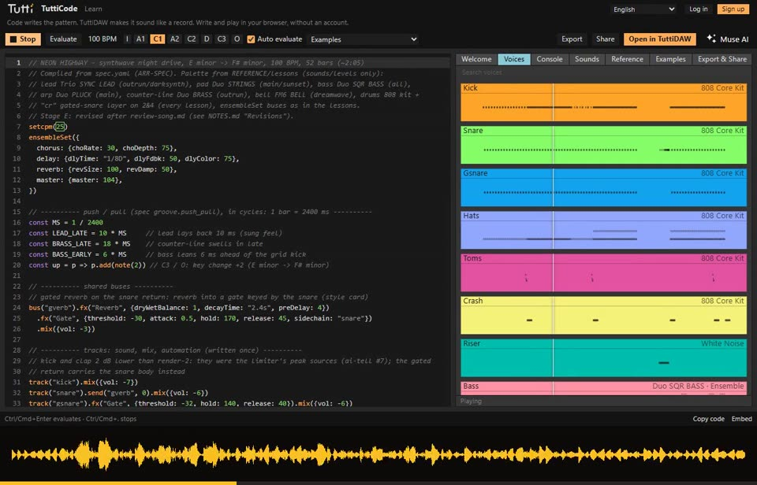

# Neon Highway

Synthwave · 100 BPM · 2:05

- [Watch](https://assets.tuttidaw.com/showcase/neon-highway/neon-highway-hq.mp4) (TuttiDAW playing the program) · [MP3](https://assets.tuttidaw.com/showcase/neon-highway/neon-highway.mp3)
- [▶ Open in TuttiCode](https://tuttidaw.com/code#Ly8gTkVPTiBISUdIV0FZIC0gc3ludGh3YXZlIG5pZ2h0IGRyaXZlLCBFIG1pbm9yIC0%2BIEYjIG1pbm9yLCAxMDAgQlBNLCA1MiBiYXJzICh%2BMjowNSkKLy8gQ29tcGlsZWQgZnJvbSBzcGVjLnlhbWwgKEFSUi1TUEVDKS4gUGFsZXR0ZSBmcm9tIFJFRkVSRU5DRS9sZXNzb25zIChzb3VuZHMvbGV2ZWxzIG9ubHkpOgovLyBsZWFkIFRyaW8gU1lOQyBMRUFEIChvdXRydW4vZGFya3N5bnRoKSwgcGFkIER1byBTVFJJTkdTIChtYWluL3N1bnNldCksIGJhc3MgRHVvIFNRUiBCQVNTIChhbGwpLAovLyBhcnAgRHVvIFBMVUNLIChtYWluKSwgY291bnRlci1saW5lIER1byBCUkFTUyAob3V0cnVuKSwgYmVsbCBGTTYgQkVMTCAoZHJlYW13YXZlKSwgZHJ1bXMgODA4IGtpdCArCi8vICJjciIgZ2F0ZWQtc25hcmUgbGF5ZXIgb24gMiY0IChldmVyeSBsZXNzb24pLCBlbnNlbWJsZVNldCBidXNlcyBhcyBpbiB0aGUgbGVzc29ucy4KLy8gU3RhZ2UgRTogcmV2aXNlZCBhZnRlciByZXZpZXctc29uZy5tZCAoc2VlIE5PVEVTLm1kICJSZXZpc2lvbnMiKS4Kc2V0Y3BtKDI1KQplbnNlbWJsZVNldCh7CiAgY2hvcnVzOiB7Y2hvUmF0ZTogMzAsIGNob0RlcHRoOiA3NX0sCiAgZGVsYXk6IHtkbHlUaW1lOiAiMS84RCIsIGRseUZkYms6IDUwLCBkbHlDb2xvcjogNzV9LAogIHJldmVyYjoge3JldlNpemU6IDEwMCwgcmV2RGFtcDogNTB9LAogIG1hc3Rlcjoge21hc3RlcjogMTA0fSwKfSkKCi8vIC0tLS0tLS0tLS0gcHVzaCAvIHB1bGwgKHNwZWMgZ3Jvb3ZlLnB1c2hfcHVsbCksIGluIGN5Y2xlczogMSBiYXIgPSAyNDAwIG1zIC0tLS0tLS0tLS0KY29uc3QgTVMgPSAxIC8gMjQwMApjb25zdCBMRUFEX0xBVEUgPSAxMCAqIE1TICAgICAvLyBsZWFkIGxheXMgYmFjayAxMCBtcyAoc3VuZyBmZWVsKQpjb25zdCBCUkFTU19MQVRFID0gMTggKiBNUyAgICAvLyBjb3VudGVyLWxpbmUgc3dlbGxzIGluIGxhdGUKY29uc3QgQkFTU19FQVJMWSA9IDYgKiBNUyAgICAgLy8gYmFzcyBsZWFucyA2IG1zIGFoZWFkIG9mIHRoZSBncmlkIGtpY2sKY29uc3QgdXAgPSBwID0%2BIHAuYWRkKG5vdGUoMikpIC8vIEMzIC8gTzoga2V5IGNoYW5nZSArMiAoRSBtaW5vciAtPiBGIyBtaW5vcikKCi8vIC0tLS0tLS0tLS0gc2hhcmVkIGJ1c2VzIC0tLS0tLS0tLS0KLy8gZ2F0ZWQgcmV2ZXJiIG9uIHRoZSBzbmFyZSByZXR1cm46IHJldmVyYiBpbnRvIGEgZ2F0ZSBrZXllZCBieSB0aGUgc25hcmUgKHN0eWxlIGNhcmQpCmJ1cygiZ3ZlcmIiKS5meCgiUmV2ZXJiIiwge2RyeVdldEJhbGFuY2U6IDEsIGRlY2F5VGltZTogIjIuNHMiLCBwcmVEZWxheTogNH0pCiAgLmZ4KCJHYXRlIiwge3RocmVzaG9sZDogLTMwLCBhdHRhY2s6IDAuNSwgaG9sZDogMTcwLCByZWxlYXNlOiA0NSwgc2lkZWNoYWluOiAic25hcmUifSkKICAubWl4KHt2b2w6IC0zfSkKCi8vIC0tLS0tLS0tLS0gdHJhY2tzOiBzb3VuZCwgbWl4LCBhdXRvbWF0aW9uICh3cml0dGVuIG9uY2UpIC0tLS0tLS0tLS0KLy8ga2ljayBhbmQgY2xhcCAyIGRCIGxvd2VyIHRoYW4gcmVuZGVyLTI6IHRoZXkgd2VyZSB0aGUgbGltaXRlcidzIHBlYWsgc291cmNlcyAoYWktdGVsbCAjNyk7IHRoZSBnYXRlZAovLyByZXR1cm4gY2FycmllcyB0aGUgc25hcmUgYm9keSBpbnN0ZWFkCnRyYWNrKCJraWNrIikubWl4KHt2b2w6IC03fSkKdHJhY2soInNuYXJlIikuc2VuZCgiZ3ZlcmIiLCAwKS5taXgoe3ZvbDogLTZ9KQp0cmFjaygiZ3NuYXJlIikuZngoIkdhdGUiLCB7dGhyZXNob2xkOiAtMzIsIGhvbGQ6IDE0MCwgcmVsZWFzZTogNDB9KS5taXgoe3ZvbDogLTZ9KQp0cmFjaygiaGF0cyIpLm1peCh7dm9sOiAtOSwgcGFuOiAwLjN9KQp0cmFjaygidG9tcyIpLm1peCh7dm9sOiAtOSwgcGFuOiAtMC4yfSkKdHJhY2soImNyYXNoIikubWl4KHt2b2w6IC0xMCwgcGFuOiAtMC4xNX0pCi8vIHJpc2VyOiBub2lzZSB0aHJvdWdoIGEgbG93LXBhc3MgdGhhdCBzd2VlcHMgb3BlbiBvdmVyIHRoZSBicmVha2Rvd24ncyBsYXN0IDIgYmFycyAoc29uZyBiYXJzIDM3LTM4KQp0cmFjaygicmlzZXIiKS5meCgiQXV0byBGaWx0ZXIiLCB7ZmlsdGVyVHlwZUluZGV4OiAiTG93LXBhc3MiLCBmcmVxdWVuY3k6IGVudigiMDozMDAgMzY6MzAwIDM4OjEyMDAwIF8zODozMDAiLCA1Mil9KQogIC5taXgoe3ZvbDogLTN9KQoKdHJhY2soImJhc3MiKS5pbnN0KCJNdWx0aS1FbmdpbmUgU3ludGg6RHVvIFNRUiBCQVNTIiwgewogICAgc3VzOiA0NSwgcmVsOiAxNSwgZGlzdDogMCwgZGx5OiAwLCByZXY6IDAsIGUwOiAwLCBlNDogNDgsIGU1OiA0MCwgZTY6IDMwLCB2b2ljZTogMQogIH0pCiAgLmZ4KCJDb21wcmVzc29yIiwge3RocmVzaG9sZDogLTI2LCByYXRpbzogMywgYXR0YWNrOiAyLCByZWxlYXNlOiAxNjAsIHNpZGVjaGFpbjogImtpY2siLCBzaWRlY2hhaW5GaWx0ZXI6ICIxNTBIeiJ9KQogIC5taXgoe3ZvbDogLTl9KQoKdHJhY2soInBhZCIpLmluc3QoIk11bHRpLUVuZ2luZSBTeW50aDpEdW8gU1RSSU5HUyIsIHsKICAgIGxldmVsOiAxMTIsIGF0azogMzAsIGxyYXRlOiA0MCwgbGRGbHQ6IDYsIGRseTogMTAsIHJldjogNzUsIGUxOiAxNCwgZTI6IDQ4LCBlNDogNjQsIGx3YXZlOiAxLAogICAgY2hvcjogZW52KCIwOjcwIF80OjI1IF8xMjo3MCBfMzI6OTAgXzM4OjgwIF80ODo1MCIsIDUyKSAgIC8vIHdpZHRoX21hcDogbmFycm93IHZlcnNlLCB3aWRlIGNob3J1cy9icmVhawogIH0pCiAgLmZ4KCJDb21wcmVzc29yIiwge3RocmVzaG9sZDogLTI4LCByYXRpbzogMywgYXR0YWNrOiAyLCByZWxlYXNlOiAxNjAsIHNpZGVjaGFpbjogImtpY2siLCBzaWRlY2hhaW5GaWx0ZXI6ICIxNTBIeiJ9KQogIC5taXgoe3ZvbDogLTEwfSkKCnRyYWNrKCJhcnAiKS5pbnN0KCJNdWx0aS1FbmdpbmUgU3ludGg6RHVvIFBMVUNLIiwgewogICAgbGV2ZWw6IDExMiwgZGVjOiA3MCwgcmVsOiA0MCwgZWRGbHQ6IDUwLCBkbHk6IDU1LCByZXY6IDM1LCBlMTogNiwgZTI6IDQwLCBlNDogMzQsCiAgICBjaG9yOiBlbnYoIjA6MzAgXzEyOjQwIF8yMDowIF8yNDo3MCBfMzI6NDAgXzM4OjYwIF80ODozMCIsIDUyKSAgIC8vIEMyIHdpZGUgd2l0aG91dCB0aGUgcGFkCiAgfSkKICAvLyBmaWx0ZXI6IG9wZW4gZWFybHkgaW4gdGhlIGludHJvIChob29rIGF1ZGlibGUgYnkgMDowNSksIGRhcmsgd2hlbiBpdCBqb2lucyB0aGUgdmVyc2UgYXQgYmFyIDksCiAgLy8gZGFyayBhZ2FpbiBpbiB0aGUgQTIgdHVubmVsLCB3aWRlc3QgaW4gQzMsIGNsb3NpbmcgaW4gdGhlIG91dHJvCiAgLmZ4KCJBdXRvIEZpbHRlciIsIHtmaWx0ZXJUeXBlSW5kZXg6ICJMb3ctcGFzcyIsCiAgICBmcmVxdWVuY3k6IGVudigiMDoxODAwIDQ6NjAwMCBfODoyMjAwIF8xMjo5MDAwIF8yMDoyMjAwIF8yNDo5MDAwIF8zODoxNDAwMCBfNDg6NjAwMCA1Mjo3MDAiLCA1Mil9KQogIC5taXgoe3ZvbDogLTl9KQoKdHJhY2soImxlYWQiKS5pbnN0KCJNdWx0aS1FbmdpbmUgU3ludGg6VHJpbyBTWU5DIExFQUQiLCB7CiAgICBsZXZlbDogOTQsIHJldjogMzAsIGRseTogMzAsIHZvaWNlOiAiTU9OTyIsCiAgICBnbGlkZTogZW52KCIwOjEyIF80OjggXzEyOjE4IF8yMDo4IF8yNDoxOCBfMzg6MTggXzQ4OjEyIiwgNTIpLCAgLy8gMTEtMTYgYnkgZWFyOiBzbGlkZXMgc2hvcnQgKHdhcyB1cCB0byA1NSkKICAgIGxkUGl0OiAxLCBscmF0ZTogOTAsIGxmYWRlOiA0MCAgIC8vIDExLTE2IGJ5IGVhcjogfjMwIGNlbnRzIGF0IDYgSHogKGxkUGl0IDQgYXQgbHJhdGUgNDUgd2FuZGVyZWQgMTQyIGNlbnRzIGF0IDwxIEh6KQogIH0pCiAgLmZ4KCJBdXRvIEZpbHRlciIsIHtmaWx0ZXJUeXBlSW5kZXg6ICJMb3ctcGFzcyIsIGZyZXF1ZW5jeTogZW52KCIwOjI1MDAgMjo5MDAwIF80OjE4MDAwIF80ODoyNjAwIiwgNTIpfSkKICAubWl4KHt2b2w6IDB9KQoKdHJhY2soImJyYXNzIikuaW5zdCgiTXVsdGktRW5naW5lIFN5bnRoOkR1byBCUkFTUyIsIHtsZXZlbDogOTIsIGF0azogNiwgcmVsOiAzMCwgY2hvcjogMzAsIGRseTogMTV9KQogIC5taXgoe3ZvbDogLTQsIHBhbjogLTAuNH0pCgp0cmFjaygiYmVsbCIpLmluc3QoIk11bHRpLUVuZ2luZSBTeW50aDpGTTYgQkVMTCIsIHtsZXZlbDogMTIwLCBkbHk6IDM1fSkKICAubWl4KHt2b2w6IC02LCBwYW46IDAuNH0pCgptYXN0ZXIuZngoIkxpbWl0ZXIiLCB7Y2VpbGluZzogLTF9KQoKLy8gLS0tLS0tLS0tLSB0aGUgbWVsb2R5IChjYW5kaWRhdGUgQywgZml4ZWQ6IGNhbmRpZGF0ZXMvQy5tZCksIHdlaWdodHMgaW4gZWlnaHRocyAtLS0tLS0tLS0tCmNvbnN0IFZFUlNFMTIgPSBgfkAyIGYjNCBmIzQgYTQgYjRAMyAgYTRAMiBnNEAyIGU0QDRgCmNvbnN0IFZFUlNFMzYgPSBgfkAyIGU0IGU0IGc0IGE0QDMgIGI0QDIgYTRAMiBnNEA0ICB%2BIGc0IGc0IGI0IGM1QDQgIGI0QDIgYTRAMiBlNEA0YApjb25zdCBWRVJTRTc4ID0gYH5AMiBhNCBhNCBjNSBlNUAyIGYjNSAgZTVANCBkIzVAMiBiNEAyYApjb25zdCBDQUxMID0gYH4gZDUgZTUgZzVANWAKY29uc3QgQ0gxNCA9IGAke0NBTEx9ICBmIzVAMiBlNUAyIGQ1QDIgYTRAMiAgJHtDQUxMfSAgfkAyIGYjNSBlNSBkNSBiNEAzYApjb25zdCBDSDU4ID0gYH4gZDUgZTUgZzUgYTVANiBmIzVAMiBlNUAyIGQ1QDIgIH4gZDUgZTUgZzUgZiM1QDMgZCM1ICBlNUA2IH5AMmAKY29uc3QgVEFHID0gYH4gZDUgZTUgZzUgYTUgYjVAMyAgZzVAMiBmIzUgZCM1IGU1QDRgICAgLy8gQzMgdGFnOiB0aGUgY2FsbCBleHRlbmRzIEctQS1CIG9uY2U6IHRoZSBsZWFkJ3MgaGlnaGVzdCBub3RlCmNvbnN0IEhFQURfSSA9IGB%2BQDE2ICAke0NBTEx9ICBmIzVAMiBlNUAyIGQ1QDIgYTRAMmAgLy8gaW50cm86IHRoZSBmdWxsIGNhbGwgKyBhbnN3ZXIgYnkgMDowNQpjb25zdCBIRUFEX08gPSBgfkAxNiAgJHtDQUxMfSAgfkA4YCAgICAgICAgICAgICAgICAgICAgIC8vIG91dHJvOiB0aGUgaGVhZCBhbG9uZSwgZmlsdGVyIGNsb3NpbmcgKG1pcnJvcikKLy8gcGVyLWVpZ2h0aCB2ZWxvY2l0eSBzaGFwZXM6IHRoZSBoZWxkIGhvb2sgbm90ZSAoMiYpIGFuZCB0aGUgZG93bmJlYXQgb2YgMyBzdHJvbmdlc3QKY29uc3QgVl9WRVJTRSA9ICJbMC43IDAuNjYgMC42NiAwLjcgMC43NCAwLjggMC43IDAuNjRdIgpjb25zdCBWX0NIT1JVUyA9ICJbMC44IDAuOCAwLjg0IDAuOTQgMC45IDAuODIgMC44IDAuNzZdIgpjb25zdCBWX0ZJTkFMID0gIlswLjg0IDAuODQgMC44OCAwLjk4IDAuOTQgMC44NiAwLjg0IDAuOF0iCmNvbnN0IGxlYWQgPSAocywgYmFycywgdmVsKSA9PiBub3RlKHMpLnNsb3coYmFycykudmVsb2NpdHkodmVsKS5sYXRlKExFQURfTEFURSkKCi8vIC0tLS0tLS0tLS0gaGFybW9ueTogcGFkIHZvaWNpbmdzIChjb21tb24gdG9uZXMgaGVsZCwgc3RlcHMgb25seSkgLS0tLS0tLS0tLQovLyBpbnRybyBhbmQgY2hvcnVzZXM6IHBhZCBrZXB0IGF0IG9yIGJlbG93IEQ0IHNvIHRoZSBhcnAgKEU0LUM1KSBzaXRzIGFib3ZlIGl0CmNvbnN0IFBBRF9JID0gYDxbZzMsYjMsZDRdITIgW2UzLGczLGM0XSBbZiMzLGEzLGQ0XT5gCmNvbnN0IFBBRF9BMSA9IGA8W2czLGIzLGQ0LGU0XSEyIFtnMyxiMyxjNCxlNF0hMiBbZzMsYTMsYzQsZTRdITIgW2YjMyxhMyxjNCxlNF0gW1tmIzMsYTMsYjMsZTRdIFtmIzMsYTMsYjMsZCM0XV0%2BYApjb25zdCBQQURfQzggPSBgW2UzLGczLGM0XSBbZiMzLGEzLGQ0XSBbZzMsYjMsZDRdITIgW2UzLGczLGM0XSBbZiMzLGEzLGQ0XSBbW2czLGEzLGM0XSBbZiMzLGEzLGIzXV1gCmNvbnN0IFBBRF9EID0gYDxbZzMsYjMsYzQsZTRdIFthMyxjIzQsZTRdIFthMyxjIzQsZDQsZiM0XSBbYTMsYjMsZDQsZiM0XSBbZyMzLGIzLGMjNCxmIzRdIFtbZyMzLGIzLGMjNCxmNF1ANyB%2BXT5gCgovLyAtLS0tLS0tLS0tIGFycCAodGhlIGFycmFuZ2VtZW50IGhvb2spIC0tLS0tLS0tLS0KLy8gY2hvcnVzL2ludHJvL291dHJvIHJlZ2lzdGVyIEU0LUM1IChhYm92ZSB0aGUgcGFkLCBiZWxvdyB0aGUgbGVhZCdzIEQ1IHBpY2t1cHMpLCB3aXRoIGdhcHMgc28gZWFjaAovLyBhY2NlbnRlZCBub3RlJ3MgZG90dGVkLWVpZ2h0aCBlY2hvIHNvdW5kcyBpbiBhIGhvbGU6IGwgbSBoIH4gfCBtIHQgaCB%2BIHwgbCBtIGggYSB8IH4gdCBoIH4KLy8gKEVtJ3MgY29sb3VyIHNsb3QgaXMgdGhlIDd0aCBENCwgbm90IEYjNDogRiM0IHNhdCBhIG1pbm9yIDl0aCB1bmRlciB0aGUgaGVsZCBHNSBob29rIG5vdGU7Ci8vICBDIGhhcyBubyBCOiBjaG9ydXMgYlZJIGlzIEM2LCBzbyB0aGUgcmFpc2VkIGJyYXNzIGluIEMzIGFuZCB0aGUgcGFkIG5ldmVyIHJ1YiBhIG1hajcgc2VtaXRvbmUpCmNvbnN0IENIQyA9IHtFbTogWzY0LCA3MSwgNjcsIDYyLCA2OV0sIEM6IFs2NCwgNzIsIDY3LCA2OSwgNjRdLCBEOiBbNjIsIDY5LCA2NiwgNjQsIDcxXSwKICBBbTogWzY0LCA3MiwgNjksIDY3LCA3MV0sIEI3OiBbNjYsIDcxLCA2OSwgNjMsIDY0XSwgQnM6IFs2NiwgNzEsIDY5LCA2NCwgNjRdfQpjb25zdCBnMSA9IGMgPT4geyBjb25zdCBbbCwgbSwgaCwgdF0gPSBDSENbY107IHJldHVybiBgJHtsfSAke219ICR7aH0gfiAke219ICR7dH0gJHtofSB%2BYCB9CmNvbnN0IGcyID0gYyA9PiB7IGNvbnN0IFtsLCBtLCBoLCB0XSA9IENIQ1tjXTsgcmV0dXJuIGAke2x9ICR7bX0gJHtofSAke3R9IH4gJHttfSAke2h9IH5gIH0KLy8gIkNeNjIiOiBvdmVycmlkZSB0aGUgYWNjZW50ZWQgc2xvdCAoc3RlcCAxMiwgdmVsb2NpdHkgMC43NCkgc28gdGhlIGFycCBxdW90ZXMgdGhlIGhvb2sgRC1FLUcKY29uc3QgZ2Z1bGwgPSB4ID0%2BIHsgY29uc3QgW2MsIG92XSA9IHguc3BsaXQoIl4iKTsgY29uc3QgW2wsIG0sIGgsIHQsIGEwXSA9IENIQ1tjXTsgY29uc3QgYSA9IG92IHx8IGEwCiAgcmV0dXJuIGBbJHtsfSAke219ICR7aH0gfiAke219ICR7dH0gJHtofSB%2BICR7bH0gJHttfSAke2h9ICR7YX0gfiAke3R9ICR7aH0gfl1gIH0KY29uc3QgYXJwID0gbGlzdCA9PiBub3RlKGA8JHtsaXN0Lm1hcCh4ID0%2BIEFycmF5LmlzQXJyYXkoeCkgPyBgWyR7ZzEoeFswXSl9ICR7ZzIoeFsxXSl9XWAgOiBnZnVsbCh4KSkuam9pbigiICIpfT5gKQogIC52ZWxvY2l0eSgiWzAuODIgMC41IDAuNjIgMCAwLjUgMC43IDAuNjIgMCAwLjgyIDAuNSAwLjYyIDAuNzQgMCAwLjcgMC42MiAwXSIpCi8vIHZlcnNlIHJlZ2lzdGVyIChBMSBzZWNvbmQgaGFsZiwgQTIpOiB0aGUgb2xkIGxvdyBnYXBsZXNzIGNlbGxzLCBkYXJrIGFuZCBxdWlldCwgdW5kZXIgdGhlIHZlcnNlIGxlYWQKY29uc3QgQ0hMID0ge0VtOiBbNTIsIDU5LCA2NCwgNjYsIDY3XSwgQzogWzQ4LCA1NSwgNjAsIDYyLCA2NF0sIEFtOiBbNTcsIDY0LCA2OSwgNjcsIDcyXSwKICBCNzogWzU5LCA2NiwgNzEsIDY5LCA2M10sIEJzOiBbNTksIDY2LCA3MSwgNjksIDY0XSwgRmg6IFs1NCwgNjAsIDY2LCA2OSwgNjRdfQpjb25zdCBsZnVsbCA9IGMgPT4geyBjb25zdCBbbCwgbSwgaCwgdCwgYV0gPSBDSExbY107IHJldHVybiBgWyR7bH0gJHttfSAke2h9ICR7bX0gJHt0fSAke219ICR7aH0gJHttfSAke2x9ICR7bX0gJHtofSAke219ICR7YX0gJHt0fSAke2h9ICR7bX1dYCB9CmNvbnN0IGxoYWxmID0gYyA9PiB7IGNvbnN0IFtsLCBtLCBoLCB0XSA9IENITFtjXTsgcmV0dXJuIGBbJHtsfSAke219ICR7aH0gJHttfSAke3R9ICR7bX0gJHtofSAke219XWAgfQpjb25zdCBhcnBMb3cgPSAobGlzdCwgdmVsKSA9PiBub3RlKGA8JHtsaXN0Lm1hcCh4ID0%2BIEFycmF5LmlzQXJyYXkoeCkgPyBgWyR7bGhhbGYoeFswXSl9ICR7bGhhbGYoeFsxXSl9XWAgOiBsZnVsbCh4KSkuam9pbigiICIpfT5gKQogIC52ZWxvY2l0eSh2ZWwpCi8vIGNob3J1czogdGhlIGFjY2VudGVkIHNsb3Qgc3BlbGxzIEQ0LUU0LUc0LUU0IHwgRDQtRTQtKGhhbGYgYmFycyktRzQ6IHRoZSBob29rIGhlYWQgaW5zaWRlIHRoZSBlbmdpbmUKY29uc3QgQVJQX0M4ID0gWyJDXjYyIiwgIkReNjQiLCAiRW1eNjciLCAiRW1eNjQiLCAiQ142MiIsICJEXjY0IiwgWyJBbSIsICJCNyJdXQoKLy8gLS0tLS0tLS0tLSBiYXNzOiBwdWxzZSAoOHRocykgaW4gaW50cm8vdmVyc2VzLCAxNnRoIG9jdGF2ZSBzZXF1ZW5jZSBpbiBjaG9ydXNlcyAtLS0tLS0tLS0tCmNvbnN0IGNlbGwgPSByID0%2BIGBbJHtyfSAke3J9ICR7ciArIDEyfSAke3J9XWAKY29uc3Qgc2VxQmFyID0geCA9PiBBcnJheS5pc0FycmF5KHgpID8gYFske2NlbGwoeFswXSl9KjIgJHtjZWxsKHhbMV0pfSoyXWAgOiBgJHtjZWxsKHgpfSo0YApjb25zdCBwdWxzZUJhciA9IHIgPT4gYFske3J9ICR7cn0gJHtyICsgMTJ9ICR7cn0gJHtyfSAke3J9ICR7ciArIDEyfSAke3J9XWAKY29uc3QgYmFzcyA9IChmLCBsaXN0LCB2KSA9PiBub3RlKGA8JHtsaXN0Lm1hcChmKS5qb2luKCIgIil9PmApLnZlbG9jaXR5KHYpLmVhcmx5KEJBU1NfRUFSTFkpCmNvbnN0IEJBU1NfQzggPSBbMzYsIDM4LCA0MCwgMzgsIDM2LCAzOCwgWzMzLCAzNV1dCgovLyAtLS0tLS0tLS0tIGNvdW50ZXItbGluZSAobWMtY291bnRlcnBvaW50OiBzbG93LCBjaG9yYWxlLWxpa2UsIHBlYWtzIHdoZXJlIHRoZSBsZWFkIHJlc3RzKSAtLS0tLS0tLS0tCmNvbnN0IENPVU5URVI4ID0gYGczIGEzIFtiMyBkNF0gZTQgYzQgYTMgW2M0IGIzXSBiM2AKLy8gQzI6IHRoZSBicmFzcyBhbHNvIHRha2VzIHRoZSBBTlNXRVJTIChiYXJzIDIgYW5kIDQpOiBjYWxsIGFuZCByZXNwb25zZSBiZXR3ZWVuIHR3byBpbnN0cnVtZW50cwpjb25zdCBDT1VOVEVSX0MyID0gYGczIFtmIzVAMiBlNUAyIGQ1QDIgYTRAMl0gW2IzIGQ0XSBbfkAyIGYjNSBlNSBkNSBiNEAzXSBjNCBhMyBbYzQgYjNdIGIzYApjb25zdCBicmFzcyA9IHMgPT4gbm90ZShgPCR7c30%2BYCkudmVsb2NpdHkoIjwwLjU2IDAuNz4iKS5sYXRlKEJSQVNTX0xBVEUpICAgLy8gc3dlbGwgYWNyb3NzIGVhY2ggMi1iYXIgcGhyYXNlCi8vIEMyOiB0aGUgYW5zd2VycyAoYmFycyAyLCA0KSBhdCB0aGUgbGVhZCdzIHdlaWdodCwgdGhlIGNvdW50ZXItbGluZSBub3RlcyBhcyBiZWZvcmUKY29uc3QgYnJhc3NDMiA9IG5vdGUoYDwke0NPVU5URVJfQzJ9PmApLnZlbG9jaXR5KCI8MC41NiAwLjkyIDAuNiAwLjkyIDAuNTYgMC43IDAuNTYgMC43PiIpLmxhdGUoQlJBU1NfTEFURSkKCi8vIC0tLS0tLS0tLS0gZHJ1bXMgLS0tLS0tLS0tLQpjb25zdCBHUyA9IHMoIn4gY3IgfiBjciIpLnZlbG9jaXR5KDAuOTQpCmNvbnN0IFNOID0gcygifiBjcCB%2BIGNwIikudmVsb2NpdHkoMC42OCkKY29uc3QgSEFUU19WID0gcygiW34gaGhdKjQiKS52ZWxvY2l0eSgwLjQ1KQpjb25zdCBIQVRTX0MgPSBzKCJbfiBoaCBoaCBoaF0qNCIpLnZlbG9jaXR5KCJbMCAwLjMxIDAuNjUgMC4zMV0qNCIpCmNvbnN0IEhBVFNfQklHID0gcygiW2hoIGhoIG9oIGhoXSo0IikudmVsb2NpdHkoIlswLjM2IDAuMjggMC41NSAwLjI4XSo0IikKY29uc3QgRklMTCA9ICJbfiEzIFtodCBtdCBsdCBsdF1dIgoKLy8gLS0tLS0tLS0tLSBzZWN0aW9ucyAtLS0tLS0tLS0tCnNlY3Rpb24oIkkiLCA0LCB7CiAgcGFkOiBub3RlKFBBRF9JKS52ZWxvY2l0eSgwLjYyKSwKICBhcnA6IGFycChbIkVtIiwgIkVtIiwgIkMiLCAiRCJdKSwKICBiYXNzOiBiYXNzKHB1bHNlQmFyLCBbNDAsIDQwLCAzNiwgMzhdLCAwLjYyKS5tYXNrKCI8MCAwIDEgMT4iKSwgICAvLyB0aGUgcHVsc2UgYXJyaXZlcyB3aXRoIHRoZSBob29rCiAgbGVhZDogbGVhZChIRUFEX0ksIDQsIFZfQ0hPUlVTKSwKfSkKc2VjdGlvbigiQTEiLCA4LCB7CiAga2ljazogcygiYmQgfiBiZCB%2BIikudmVsb2NpdHkoMC44NiksCiAgc25hcmU6IFNOLCBnc25hcmU6IEdTLCBoYXRzOiBIQVRTX1YsCiAgdG9tczogcyhgPH4hNyAke0ZJTEx9PmApLnZlbG9jaXR5KDAuOCksCiAgYmFzczogYmFzcyhwdWxzZUJhciwgWzQwLCAzOCwgMzYsIDM2LCAzMywgMzEsIDMwLCAzNV0sIDAuNzQpLAogIHBhZDogbm90ZShQQURfQTEpLnZlbG9jaXR5KDAuNTYpLAogIGFycDogYXJwTG93KFsiRW0iLCAiRW0iLCAiQyIsICJDIiwgIkFtIiwgIkFtIiwgIkZoIiwgWyJCcyIsICJCNyJdXSwgIlswLjYyIDAuNDQgMC41MiAwLjQ0XSo0IikubWFzaygiPDAhNCAxITQ%2BIiksCiAgbGVhZDogbGVhZChgJHtWRVJTRTEyfSAke1ZFUlNFMzZ9ICR7VkVSU0U3OH1gLCA4LCBWX1ZFUlNFKSwKfSkKc2VjdGlvbigiQzEiLCA4LCB7CiAga2ljazogcygiYmQqNCIpLnZlbG9jaXR5KDAuODgpLAogIHNuYXJlOiBTTiwgZ3NuYXJlOiBHUywgaGF0czogSEFUU19DLAogIGNyYXNoOiBzKCI8Y3IgfiE3PiIpLnZlbG9jaXR5KDAuOCksCiAgYmFzczogYmFzcyhzZXFCYXIsIFsuLi5CQVNTX0M4LCA0MF0sICJbMC44IDAuNl0qOCIpLAogIGFycDogYXJwKFsuLi5BUlBfQzgsICJFbSJdKSwKICBwYWQ6IG5vdGUoYDwke1BBRF9DOH0gW2UzLGczLGIzXT5gKS52ZWxvY2l0eSgwLjYyKSwKICBsZWFkOiBsZWFkKGAke0NIMTR9ICR7Q0g1OH1gLCA4LCBWX0NIT1JVUyksCn0pCnNlY3Rpb24oIkEyIiwgNCwgewogIGtpY2s6IHMoImJkIH4gW34gYmRdIH4iKS52ZWxvY2l0eSgwLjg0KSwKICBzbmFyZTogU04sIGdzbmFyZTogR1MsIGhhdHM6IEhBVFNfViwKICB0b21zOiBzKGA8fiEzICR7RklMTH0%2BYCkudmVsb2NpdHkoMC44KSwKICBiYXNzOiBiYXNzKHIgPT4gYCR7cn0qOGAsIFs0MCwgMzgsIDMwLCAzNV0sIDAuNyksCiAgYXJwOiBhcnBMb3coWyJFbSIsICJFbSIsICJGaCIsIFsiQnMiLCAiQjciXV0sICJbMC42MiAwLjQ1IDAuNTIgMC40NV0qNCIpLAogIGxlYWQ6IGxlYWQoYCR7VkVSU0UxMn0gJHtWRVJTRTc4fWAsIDQsIFZfVkVSU0UpLAp9KQpzZWN0aW9uKCJDMiIsIDgsIHsKICBraWNrOiBzKCJiZCo0IikudmVsb2NpdHkoMC45KSwKICBzbmFyZTogU04sIGdzbmFyZTogR1MsIGhhdHM6IEhBVFNfQklHLAogIGNyYXNoOiBzKCI8Y3IgfiE3PiIpLnZlbG9jaXR5KDAuODUpLAogIC8vIGxhc3QgYmFyIG9uIEQgKGJWSUkpIGluc3RlYWQgb2YgcmVzb2x2aW5nOiBCNyAtPiBEIGlzIHRoZSBzZWFtIGludG8gdGhlIGJyZWFrZG93bidzIENtYWo3CiAgYmFzczogYmFzcyhzZXFCYXIsIFsuLi5CQVNTX0M4LCAzOF0sICJbMC44MiAwLjZdKjgiKSwKICBhcnA6IGFycChbLi4uQVJQX0M4LCAiRCJdKSwKICBicmFzczogYnJhc3NDMiwKICBsZWFkOiBsZWFkKGAke0NBTEx9IH5AOCAke0NBTEx9IH5AOCAke0NINTh9YCwgOCwgVl9DSE9SVVMpLCAgIC8vIHRoZSBsZWFkIGtlZXBzIHRoZSBjYWxscywgdGhlIGJyYXNzIGFuc3dlcnMKfSkKc2VjdGlvbigiRCIsIDYsIHsKICBwYWQ6IG5vdGUoUEFEX0QpLnZlbG9jaXR5KDAuNzIpLAogIGJlbGw6IG5vdGUoIjxbZDUgZTUgZzVAMl0gZTUgW2U1IGYjNSBhNUAyXSBmIzUgfiB%2BPiIpLnZlbG9jaXR5KDAuNyksCiAgLy8gYnVpbGQ6IGEgZ2F0ZWQgY2xhcCByb2xsIG92ZXIgdGhlIGxhc3QgMiBiYXJzLCB0aGUgbGFzdCBlaWdodGggc3RpbGwgc2lsZW50CiAgc25hcmU6IHMoIjx%2BITQgW34gY3AgfiBjcF0qMiBbY3AqOCBbY3AhMTIgfiE0XV0%2BIikudmVsb2NpdHkoIjwwITQgMC40MiBbMC41OCAwLjhdPiIpLAogIHJpc2VyOiBzKCI8fiE0IHdoaXRlIFt3aGl0ZUA3IH5dPiIpLmdhaW4oMSksCn0pCnNlY3Rpb24oIkMzIiwgMTAsIHsKICBraWNrOiBzKCJiZCo0IikudmVsb2NpdHkoMC45MiksCiAgc25hcmU6IFNOLCBnc25hcmU6IEdTLCBoYXRzOiBIQVRTX0JJRywKICBjcmFzaDogcygiPGNyIH4hNyBjciB%2BPiIpLnZlbG9jaXR5KDAuODgpLAogIHRvbXM6IHMoYDx%2BITcgJHtGSUxMfSB%2BIH4%2BYCkudmVsb2NpdHkoMC44NSksCiAgYmFzczogdXAoYmFzcyhzZXFCYXIsIFsuLi5CQVNTX0M4LCA0MCwgWzM2LCAzNV0sIDQwXSwgIlswLjg0IDAuNjJdKjgiKSksCiAgYXJwOiB1cChhcnAoWy4uLkFSUF9DOCwgIkVtIiwgWyJDIiwgIkJzIl0sICJFbSJdKSksCiAgLy8gdGhlIHBhZCB3YWl0cyB1bnRpbCBDMyBiYXIgNTogYSBzZWNvbmQtaGFsZiBsaWZ0IGluc2lkZSB0aGUgZmluYWwgY2hvcnVzCiAgcGFkOiB1cChub3RlKGA8JHtQQURfQzh9IFtlMyxnMyxiM10gW1tlMyxnMyxjNF0gW2YjMyxhMyxiM11dIFtlMyxnMyxiM10%2BYCkudmVsb2NpdHkoMC42KSkubWFzaygiPDAhNCAxITY%2BIiksCiAgLy8gY291bnRlci1saW5lIGFuIG9jdGF2ZSB1cDogaXQgZmlsbHMgdGhlIGJhbmQgYmV0d2VlbiB0aGUgYXJwJ3MgdG9wIGFuZCB0aGUgbGVhZAogIGJyYXNzOiB1cChicmFzcyhgJHtDT1VOVEVSOH0gW2M0IGEzXSBnM2ApKS5hZGQobm90ZSgxMikpLAogIC8vIHRoZSBicmVha2Rvd24ncyBiZWxsIHJldHVybnMgT04gVE9QIGluIHRoZSBzZWNvbmQgaGFsZjogdGhlIGhpZ2ggY291bnRlcmxpbmUgKHN0eWxlIGNhcmQpCiAgYmVsbDogdXAobm90ZSgiPH4hNCBbZDYgZTYgZzZAMl0gZTYgW2U2IGYjNiBhNkAyXSBmIzYgfiB%2BPiIpKS52ZWxvY2l0eSgwLjMyKSwgICAvLyBiYWNrZ3JvdW5kLCBub3QgYSBzZWNvbmQgbGVhZAogIGxlYWQ6IHVwKGxlYWQoYCR7Q0gxNH0gJHtDSDU4fSAke1RBR31gLCAxMCwgVl9GSU5BTCkpLAp9KQpzZWN0aW9uKCJPIiwgNCwgewogIGNyYXNoOiBzKCI8Y3IgfiEzPiIpLnZlbG9jaXR5KDAuNyksCiAgcGFkOiB1cChub3RlKCI8W2czLGIzLGQ0XSEyIFtlMyxnMyxjNF0gfj4iKS52ZWxvY2l0eSgwLjYpKSwKICBhcnA6IHVwKGFycChbIkVtIiwgIkVtIiwgIkMiLCAiQyJdKSksCiAgbGVhZDogdXAobGVhZChIRUFEX08sIDQsIFZfVkVSU0UpKSwKfSkKZm9ybSgiSSBBMSBDMSBBMiBDMiBEIEMzIE8iKQo%3D): play it, change it, open it in TuttiDAW
- [`song.tc`](song.tc): the program · [`NOTES.md`](NOTES.md): the agent's own notes (plan, lead sheet, sounds, revisions, audits)

Render it yourself: `npx tutticode render song.tc -o neon-highway.wav --lufs -14 --limit --tail 3`

How it was made: [../README.md](../README.md).
