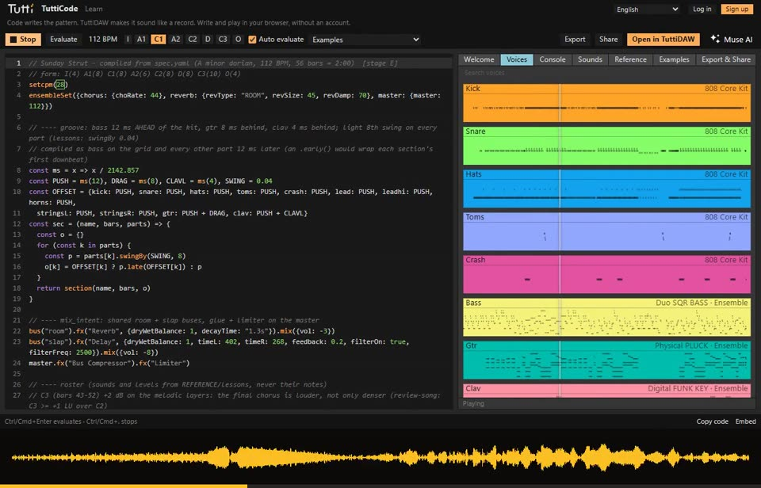

# Sunday Strut

Funk / disco · 112 BPM · 2:00

- [Watch](https://assets.tuttidaw.com/showcase/sunday-strut/sunday-strut-hq.mp4) (TuttiDAW playing the program) · [MP3](https://assets.tuttidaw.com/showcase/sunday-strut/sunday-strut.mp3)
- [▶ Open in TuttiCode](https://tuttidaw.com/code#Ly8gU3VuZGF5IFN0cnV0IC0gY29tcGlsZWQgZnJvbSBzcGVjLnlhbWwgKEEgbWlub3IgZG9yaWFuLCAxMTIgQlBNLCA1NiBiYXJzID0gMjowMCkgIFtzdGFnZSBFXQovLyBmb3JtOiBJKDQpIEExKDgpIEMxKDgpIEEyKDYpIEMyKDgpIEQoOCkgQzMoMTApIE8oNCkKc2V0Y3BtKDI4KQplbnNlbWJsZVNldCh7Y2hvcnVzOiB7Y2hvUmF0ZTogNDR9LCByZXZlcmI6IHtyZXZUeXBlOiAiUk9PTSIsIHJldlNpemU6IDQ1LCByZXZEYW1wOiA3MH0sIG1hc3Rlcjoge21hc3RlcjogMTEyfX0pCgovLyAtLS0tIGdyb292ZTogYmFzcyAxMiBtcyBBSEVBRCBvZiB0aGUga2l0LCBndHIgOCBtcyBiZWhpbmQsIGNsYXYgNCBtcyBiZWhpbmQ7IGxpZ2h0IDh0aCBzd2luZyBvbiBldmVyeSBwYXJ0IChsZXNzb25zOiBzd2luZ0J5IDAuMDQpCi8vIGNvbXBpbGVkIGFzIGJhc3Mgb24gdGhlIGdyaWQgYW5kIGV2ZXJ5IG90aGVyIHBhcnQgMTIgbXMgbGF0ZXIgKGFuIC5lYXJseSgpIHdvdWxkIHdyYXAgZWFjaCBzZWN0aW9uJ3MgZmlyc3QgZG93bmJlYXQpCmNvbnN0IG1zID0geCA9PiB4IC8gMjE0Mi44NTcKY29uc3QgUFVTSCA9IG1zKDEyKSwgRFJBRyA9IG1zKDgpLCBDTEFWTCA9IG1zKDQpLCBTV0lORyA9IDAuMDQKY29uc3QgT0ZGU0VUID0ge2tpY2s6IFBVU0gsIHNuYXJlOiBQVVNILCBoYXRzOiBQVVNILCB0b21zOiBQVVNILCBjcmFzaDogUFVTSCwgbGVhZDogUFVTSCwgbGVhZGhpOiBQVVNILCBob3JuczogUFVTSCwKICBzdHJpbmdzTDogUFVTSCwgc3RyaW5nc1I6IFBVU0gsIGd0cjogUFVTSCArIERSQUcsIGNsYXY6IFBVU0ggKyBDTEFWTH0KY29uc3Qgc2VjID0gKG5hbWUsIGJhcnMsIHBhcnRzKSA9PiB7CiAgY29uc3QgbyA9IHt9CiAgZm9yIChjb25zdCBrIGluIHBhcnRzKSB7CiAgICBjb25zdCBwID0gcGFydHNba10uc3dpbmdCeShTV0lORywgOCkKICAgIG9ba10gPSBPRkZTRVRba10gPyBwLmxhdGUoT0ZGU0VUW2tdKSA6IHAKICB9CiAgcmV0dXJuIHNlY3Rpb24obmFtZSwgYmFycywgbykKfQoKLy8gLS0tLSBtaXhfaW50ZW50OiBzaGFyZWQgcm9vbSArIHNsYXAgYnVzZXMsIGdsdWUgKyBsaW1pdGVyIG9uIHRoZSBtYXN0ZXIKYnVzKCJyb29tIikuZngoIlJldmVyYiIsIHtkcnlXZXRCYWxhbmNlOiAxLCBkZWNheVRpbWU6ICIxLjNzIn0pLm1peCh7dm9sOiAtM30pCmJ1cygic2xhcCIpLmZ4KCJEZWxheSIsIHtkcnlXZXRCYWxhbmNlOiAxLCB0aW1lTDogNDAyLCB0aW1lUjogMjY4LCBmZWVkYmFjazogMC4yLCBmaWx0ZXJPbjogdHJ1ZSwgZmlsdGVyRnJlcTogMjUwMH0pLm1peCh7dm9sOiAtOH0pCm1hc3Rlci5meCgiQnVzIENvbXByZXNzb3IiKS5meCgiTGltaXRlciIpCgovLyAtLS0tIHJvc3RlciAoc291bmRzIGFuZCBsZXZlbHMgZnJvbSBSRUZFUkVOQ0UvbGVzc29ucywgbmV2ZXIgdGhlaXIgbm90ZXMpCi8vIEMzIChiYXJzIDQzLTUyKSArMiBkQiBvbiB0aGUgbWVsb2RpYyBsYXllcnM6IHRoZSBmaW5hbCBjaG9ydXMgaXMgbG91ZGVyLCBub3Qgb25seSBkZW5zZXIgKHJldmlldy1zb25nOiBDMyA%2BPSArMSBMVSBvdmVyIEMyKQpjb25zdCBDM1VQID0gIjwwITQyIDIhMTAgMCE0PiIKZ3JvdXAoImRydW1zIikubWl4KHt2b2w6IDF9KQp0cmFjaygia2ljayIpLmdyb3VwKCJkcnVtcyIpLm1peCh7dm9sOiAwfSkKdHJhY2soInNuYXJlIikuZ3JvdXAoImRydW1zIikubWl4KHt2b2w6IC0yfSkuc2VuZCgicm9vbSIsIC0xNCkKdHJhY2soImhhdHMiKS5ncm91cCgiZHJ1bXMiKS5taXgoe3ZvbDogLTMsIHBhbjogMC4yNX0pCnRyYWNrKCJ0b21zIikuZ3JvdXAoImRydW1zIikubWl4KHt2b2w6IC01LCBwYW46IC0wLjJ9KS5zZW5kKCJyb29tIiwgLTE2KQp0cmFjaygiY3Jhc2giKS5ncm91cCgiZHJ1bXMiKS5taXgoe3ZvbDogLTEyLCBwYW46IC0wLjE1fSkKdHJhY2soImJhc3MiKS5pbnN0KCJNdWx0aS1FbmdpbmUgU3ludGg6RHVvIFNRUiBCQVNTIiwge2xldmVsOiAxMTAsIGRlYzogNzYsIHN1czogMzgsIHJlbDogNTEsIGRpc3Q6IDAsIGRseTogMCwgcmV2OiAwLCBlMDogNiwgZTI6IDY0LCBlNDogNjYsIGU1OiAxNSwgZTY6IDI1LCB2b2ljZTogMX0pCiAgLmZ4KCJDb21wcmVzc29yIiwge3RocmVzaG9sZDogLTI2LCByYXRpbzogMS41LCBhdHRhY2s6IDEsIHJlbGVhc2U6IDYwLCBzaWRlY2hhaW46ICJraWNrIn0pLm1peCh7dm9sOiAwfSkKdHJhY2soImd0ciIpLmluc3QoIk11bHRpLUVuZ2luZSBTeW50aDpQaHlzaWNhbCBQTFVDSyIsIHtsZXZlbDogMTIwLCBjaG9yOiAyNSwgZGx5OiAwLCByZXY6IDAsIGUxOiAzMiwgZTI6IDEwMCwgZTM6IDEyMCwgZTQ6IDIwLCBlNTogMTAwLCBlNzogMjB9KQogIC5taXgoe3ZvbDogLTIwLCBwYW46IC0wLjZ9KS5zZW5kKCJyb29tIiwgLTIyKQp0cmFjaygiY2xhdiIpLmluc3QoIk11bHRpLUVuZ2luZSBTeW50aDpEaWdpdGFsIEZVTksgS0VZIiwge2xldmVsOiAxMTAsIGRseTogMCwgcmV2OiAwfSkuZngoIkNob3J1cyIpLm1peCh7dm9sOiAtNSwgcGFuOiAwLjZ9KS5zZW5kKCJyb29tIiwgLTIwKQp0cmFjaygiaG9ybnMiKS5pbnN0KCJNdWx0aS1FbmdpbmUgU3ludGg6RHVvIEJSQVNTIiwge2xldmVsOiAxMDAsIHJlbDogMzAsIGNob3I6IDMwLCBkbHk6IDAsIHJldjogMH0pLm1peCh7dm9sOiBDM1VQLCBwYW46IDAuM30pLnNlbmQoInJvb20iLCAtMTIpLnNlbmQoInNsYXAiLCAtMjQpCnRyYWNrKCJzdHJpbmdzTCIpLmluc3QoIk11bHRpLUVuZ2luZSBTeW50aDpEdW8gU1RSSU5HUyIsIHtsZXZlbDogMTAwLCBhdGs6IDUwLCBzdXM6IDEyNywgcmVsOiA4MCwgY2hvcjogNjAsIGRseTogMCwgcmV2OiAwLCBlMTogMTAsIGU0OiA5M30pLmZ4KCJDaG9ydXMiKS5taXgoe3ZvbDogQzNVUCwgcGFuOiAtMC42fSkuc2VuZCgicm9vbSIsIC0xMCkKdHJhY2soInN0cmluZ3NSIikuaW5zdCgiTXVsdGktRW5naW5lIFN5bnRoOkR1byBTVFJJTkdTIiwge2xldmVsOiAxMDAsIGF0azogMzUsIHN1czogMTI3LCByZWw6IDcwLCBjaG9yOiA0MCwgZGx5OiAwLCByZXY6IDAsIGUxOiAxMCwgZTQ6IDkzfSkuZngoIkNob3J1cyIpLm1peCh7dm9sOiBDM1VQLCBwYW46IDAuNn0pLnNlbmQoInJvb20iLCAtMTApCnRyYWNrKCJsZWFkIikuaW5zdCgiTXVsdGktRW5naW5lIFN5bnRoOlZvaWNlIFZPWCBMRUFEIiwge2xldmVsOiAxMTAsIHJlbDogNTAsIGNob3I6IDE1LCBkbHk6IDAsIHJldjogMH0pLm1peCh7dm9sOiBDM1VQfSkuc2VuZCgicm9vbSIsIC0xNCkuc2VuZCgic2xhcCIsIC0yMCkKdHJhY2soImxlYWRoaSIpLmluc3QoIk11bHRpLUVuZ2luZSBTeW50aDpEdW8gU0FXIExFQUQiLCB7bGV2ZWw6IDkwLCByZWw6IDMwLCBjaG9yOiAwLCBkbHk6IDAsIHJldjogMCwgdm9pY2U6IDF9KS5taXgoe3ZvbDogLTYsIHBhbjogLTAuMTV9KS5zZW5kKCJyb29tIiwgLTEyKQoKLy8gLS0tLSBhY2NlbnRzIChtYy1haS10ZWxsLWF1ZGl0ICM4LyMxMDogbm8gZmxhdCB2ZWxvY2l0eSkKY29uc3QgYWNjID0gKGFyciwgZykgPT4gYFske2Fyci5tYXAodiA9PiAodiAqIGcpLnRvRml4ZWQoMikpLmpvaW4oIiAiKX1dYApjb25zdCBCQUNDID0gWzAuOTUsIDAuNywgMC41NSwgMC44NSwgMC42LCAwLjYsIDAuOSwgMC43NSwgMC44LCAwLjYsIDAuNiwgMC42LCAwLjcsIDAuNzUsIDAuODUsIDAuOV0KY29uc3QgREFDQyA9IFswLjk1LCAwLjk1LCAwLjI1LCAwLjg1LCAwLjMsIDAuMjUsIDAuOSwgMC43NSwgMC44NSwgMC44NSwgMC4yNSwgMC4zLCAwLjYsIDAuNzUsIDAuOCwgMC45XSAgLy8gZGVhZCBub3RlcyBhdCAwLjI1CmNvbnN0IExBQ0MgPSBbMSwgMC44LCAwLjg4LCAwLjhdCgovLyAtLS0tIG1hdGVyaWFsOiB0aGUgYmFzcyByaWZmIChzcGVjIG1hdGVyaWFsLm1vdGlmKSwgb25lIGJhciwgTUlESSBudW1iZXJzCmNvbnN0IHJpZmYgPSAociwgYjcsIGMpID0%2BIGBbJHtyfUAyIH4gJHtyfSB%2BIH4gJHtyICsgMTJ9ICR7Yjd9ICR7ciArIDd9QDIgfiB%2BIH4gJHtjWzBdfSAke2NbMV19ICR7Y1syXX1dYApjb25zdCByaWZmRCA9IChyLCBiNywgYykgPT4gYFske3J9QDIgJHtyfSAke3J9IH4gJHtyfSAke3IgKyAxMn0gJHtiN30gJHtyICsgN31AMiAke3J9IH4gJHtyICsgMTJ9ICR7Y1swXX0gJHtjWzFdfSAke2NbMl19XWAgLy8gd2l0aCBkZWFkIG5vdGVzCmNvbnN0IFJBID0gcmlmZigzMywgNDMsIFszNiwgMzgsIDQwXSkgICAgICAgICAgICAvLyBBbTk6IEEgQSBhJyBnIGUgLiAuIC4gYyBkIGUKY29uc3QgUkEyID0gIlszM0AyIH4gMzMgfiB%2BIDQ1IDQzIDQwQDIgfiB%2BIDQ1IDQzIDQwIH5dIiAvLyBjaGFuZ2VkIHBpY2t1cCAoZmFsbHMpCmNvbnN0IFJEID0gcmlmZigzOCwgNDgsIFs0MiwgNDMsIDQ1XSkgICAgICAgICAgICAvLyBEOSAoZG9yaWFuIEYjKQpjb25zdCBSRDIgPSAiWzM4QDIgfiAzOCB%2BIH4gNTAgNDggNDVAMiB%2BIH4gNTAgNDggNDUgfl0iCmNvbnN0IFJGID0gcmlmZigyOSwgNDAsIFszMywgMzUsIDM2XSkgICAgICAgICAgICAvLyBGbWFqNyAtPiBsYW5kcyBhIDR0aCBvbiBHCmNvbnN0IFJHID0gcmlmZigzMSwgNDAsIFszNSwgMzYsIDM4XSkgICAgICAgICAgICAvLyBHNiAtPiBEIHVwIGEgc3RlcCB0byBFCmNvbnN0IFJFQSA9ICJbMjhAMiB%2BIDI4IH4gfiA0MCAzOCAzM0AyIH4gfiB%2BIDMzIDM1IDM3XSIgLy8gRW03IHwgQTcgLT4gQyMgdXAgYSBzdGVwIHRvIEQKY29uc3QgUkRtID0gcmlmZigzOCwgNDgsIFs0MSwgNDMsIDQ1XSkgICAgICAgICAgIC8vIERtOQpjb25zdCBSRSA9IHJpZmYoMjgsIDM4LCBbMzIsIDMzLCAzNV0pICAgICAgICAgICAgLy8gRTdzdXM0fEU3OiBjbGltYiBHIy1BLUIKY29uc3QgUkZHID0gIlsyOUAyIH4gMjkgfiB%2BIDQxIDQwIDMxQDIgfiB%2BIH4gMzUgMzYgMzhdIiAvLyB0YWcgRiB8IEcKLy8gQzEgb25seTogZGlzY28gb2N0YXZlIHB1bXAgKHRoZSByaWZmJ3MgcmV0dXJuIHVuZGVyIEMyL0MzIGlzIHRoZW4gZWFybmVkKQpjb25zdCBjYiA9IChhLCBiKSA9PiBgWyR7YX1AMiAke2EgKyAxMn1AMiB%2BICR7YX0gJHthICsgMTJ9QDIgJHtifUAyICR7YiArIDEyfUAyIH4gJHtiICsgN30gJHtiICsgMTJ9ICR7YiArIDd9XWAKY29uc3QgQ0hCID0gW2NiKDI5LCAyOSksIGNiKDMxLCAzMSksIGNiKDI4LCAzMyksIGNiKDM4LCAzOCksIGNiKDI5LCAyOSksIGNiKDMxLCAzMSksIGNiKDI4LCAyOCksIGNiKDMzLCAzMyldCmNvbnN0IENIUiA9IFtSRiwgUkcsIFJFQSwgUkRtLCBSRiwgUkcsIFJFLCBSQV0gICAvLyBDMiwgQzM6IHRoZSByaWZmIG9uIHRoZSBjaG9ydXMgcm9vdHMKY29uc3QgYmFzcyA9IChiYXJzLCBnLCBhKSA9PiBub3RlKGA8JHtiYXJzLmpvaW4oIiAiKX0%2BYCkudmVsb2NpdHkoYWNjKGEgfHwgQkFDQywgZykpCgovLyAtLS0tIGhhcm1vbnk6IHJvb3RsZXNzIHNoZWxscy4gR3VpdGFyIEYzLUI0OyBjbGF2IGFuIGludmVyc2lvbiB1cCAoaW50ZXJsb2NrcyBpbiByZWdpc3RlciB0b28pCmNvbnN0IFMgPSB7QW06ICJbYzQsZTQsZzRdIiwgRDk6ICJbYzQsZTQsZiM0XSIsIEY6ICJbZjMsYTMsYzRdIiwgRzY6ICJbZDQsZTQsYjRdIiwgRW06ICJbZDQsZzQsYjRdIiwgQTc6ICJbYyM0LGU0LGc0XSIsCiAgRG06ICJbZjMsYTMsYzRdIiwgRXM6ICJbZDQsZTQsYTRdIiwgRTc6ICJbZDQsZTQsZyM0XSJ9CmNvbnN0IEsgPSB7QW06ICJbZTQsZzQsYzVdIiwgRDk6ICJbZTQsZiM0LGM1XSIsIEY6ICJbYzQsZjQsYTRdIiwgRzY6ICJbZTQsZzQsYjRdIiwgRW06ICJbZTQsZzQsYjRdIiwgQTc6ICJbZTQsZzQsYyM1XSIsCiAgRG06ICJbZDQsZjQsYTRdIiwgRXM6ICJbZTQsYTQsZDVdIiwgRTc6ICJbZTQsZyM0LGQ1XSJ9CmNvbnN0IGd2ID0gKHgsIHkpID0%2BIGBbfkA3ICR7U1t4XX0gfkAyICR7U1t5IHx8IHhdfSB%2BICR7U1t5IHx8IHhdfSAke1NbeSB8fCB4XX0gfiAke1NbeSB8fCB4XX1dYCAvLyB2ZXJzZTogYW5zd2VycyBvbiBiZWF0cyAzLTQKY29uc3QgZ2MgPSAoeCwgeSkgPT4gYFtbfiAke1NbeF19IH4gJHtTW3hdfV0hMiBbfiAke1NbeSB8fCB4XX0gfiAke1NbeSB8fCB4XX1dITJdYCAgICAgICAgICAgLy8gY2hvcnVzOiAxNnRoIHNjcmF0Y2gKY29uc3QgY2wgPSAoeCwgeSkgPT4gYFt%2BQDIgJHtLW3hdfSB%2BQDMgJHtLW3hdfSB%2BQDMgJHtLW3kgfHwgeF19IH5AMyAke0tbeSB8fCB4XX0gfl1gICAgICAgICAgICAvLyBjbGF2OiB0aGUgJiBvZiBlYWNoIGJlYXQKY29uc3QgQ0ggPSBbWyJGIl0sIFsiRzYiXSwgWyJFbSIsICJBNyJdLCBbIkRtIl0sIFsiRiJdLCBbIkc2Il0sIFsiRXMiLCAiRTciXSwgWyJBbSJdXQpjb25zdCBndHJWID0gYmFycyA9PiBub3RlKGA8JHtiYXJzLm1hcChiID0%2BIHR5cGVvZiBiID09PSAic3RyaW5nIiA%2FIGIgOiBndiguLi5iKSkuam9pbigiICIpfT5gKS52ZWxvY2l0eSgiWzAuNiAwLjUgMC41NSAwLjc1XSo0IikKY29uc3QgZ3RyQyA9IGJhcnMgPT4gbm90ZShgPCR7YmFycy5tYXAoYiA9PiBnYyguLi5iKSkuam9pbigiICIpfT5gKS52ZWxvY2l0eSgiWzAuMyAwLjQyIDAuMyAwLjYyXSo0IikKY29uc3QgY2xhdiA9IGJhcnMgPT4gbm90ZShgPCR7YmFycy5tYXAoYiA9PiBjbCguLi5iKSkuam9pbigiICIpfT5gKS52ZWxvY2l0eSgiWzAuNTUgMC41IDAuNyAwLjVdKjQiKQoKLy8gLS0tLSBkcnVtcyAoa2l0ID0gdGhlIHJlZmVyZW5jZSBncmlkIGZvciB0aGUgcHVzaCkKY29uc3QgVksgPSAiPFtiZCB%2BIH4gfiB%2BIH4gYmQgfiB%2BIH4gYmQgfiB%2BIH4gfiB%2BXSBbYmQgfiB%2BIGJkIH4gfiBiZCB%2BIH4gfiBiZCB%2BIH4gfiB%2BIH5dPiIgLy8gZnVuayBwb2NrZXQKY29uc3QgVlMgPSAiW34gfiB%2BIH4gc2QgfiB%2BIHNkIH4gc2QgfiB%2BIHNkIH4gfiBzZF0iLCBWU1YgPSAiWzAgMCAwIDAgMC44NSAwIDAgMC4yMiAwIDAuMiAwIDAgMC44NSAwIDAgMC4yNl0iCmNvbnN0IFZTRiA9ICJbfiB%2BIH4gfiBzZCB%2BIH4gc2QgfiBzZCB%2BIH4gfiB%2BIH4gfl0iCmNvbnN0IFZTUCA9ICJbfiB%2BIH4gfiBzZCB%2BIH4gc2QgfiBzZCB%2BIH4gc2Qgc2Qgc2Qgc2RdIiwgVlNQViA9ICJbMCAwIDAgMCAwLjg1IDAgMCAwLjIyIDAgMC4yIDAgMCAwLjMgMC41IDAuNyAwLjk1XSIgLy8gZnVuayBjYXJkIHBpY2t1cCAiZ294WCIKY29uc3QgVEYgPSAiW35AMTIgaHQgaHQgbXQgbHRdIiwgVEZSID0gIlt%2BQDEyIGx0IG10IGh0IGh0XSIKY29uc3QgVkggPSAiPGhoKjE2IFtoaCExNCBvaCBoaF0%2BIiwgVkhWID0gIlswLjUgMC4yMiAwLjM2IDAuMjJdKjQiCmNvbnN0IENTID0gIlt%2BIH4gfiB%2BIFtzZCxjcF0gfiB%2BIHNkIH4gfiB%2BIH4gW3NkLGNwXSB%2BIH4gc2RdIiwgQ1NWID0gIlswIDAgMCAwIDAuODUgMCAwIDAuMiAwIDAgMCAwIDAuODUgMCAwIDAuMjRdIgpjb25zdCBDU0YgPSAiW34gfiB%2BIH4gW3NkLGNwXSB%2BIH4gc2QgfiB%2BIH4gfiB%2BIH4gfiB%2BXSIKY29uc3QgQ0gxID0gIltoaCExNCBvaCBoaF0iLCBDSDFWID0gIlswLjQ1IDAuMjIgMC4zMiAwLjIyXSo0IiAvLyBDMS9DMjogY2xvc2VkIDE2dGhzLCBvbmUgb3BlbiBoYXQgYXQgdGhlIGJhciBlZGdlCmNvbnN0IENISCA9ICJbaGggaGggb2ggaGhdKjQiLCBDSFYgPSAiWzAuNDIgMC4yMiAwLjU4IDAuMjJdKjQiIC8vIEMzOiBvcGVuIG9uIGV2ZXJ5ICYKY29uc3QgcmVwID0gKHgsIG4pID0%2BIEFycmF5KG4pLmZpbGwoeCkuam9pbigiICIpCgovLyAtLS0tIHRoZSBtZWxvZHkgKEMtZml4ZWQsIHRoZW4gcmV2aWV3LXNvbmcgZml4ZXM6IGNob3J1cyBvcGVucyBvbiB0aGUgc2hvdXQtYmFjayBSOyB2ZXJzZSBiYXJzIDMvNyBzdGFydCBvbiB0aGUgJjEpCmNvbnN0IFZFUlNFID0gWyJbfiBlNCBnNCBhNCBiNEAzIH5AOV0iLCAiW34gYzUgYjQgZzQgYTRAMyB%2BQDldIiwgIlt%2BQDIgZiM0IGE0IGI0IGM1QDMgfkA4XSIsICJbfkA4IGQ1IH4gZDUgYzUgYTRAMiB%2BQDJdIiwKICAiW34gZTQgZzQgYTQgYjQgfiBkNUAzIH5AN10iLCAiW34gZTUgZDUgYjQgYzVAMiBiNCBnNCBhNEA0IH5ANF0iLCAiW35AMiBhNCBjNSBlNUA0IH5AOF0iLCAiW34gZDUgYjQgYTRAMiB%2BQDMgZyM0QDQgfkA0XSJdCmNvbnN0IEgxID0gIltlNUAyIH4gZTUgZDUgYzVAMiB%2BQDIgYzUgZDUgZTUgZjVAMyB%2BXSIgICAgICAvLyBSIG9uIHRoZSBPbmUsIHRoZW4gdGhlIGNhbGwKY29uc3QgSDIgPSAiW2U1QDIgfiBlNSBkNSBiNEAyIH5AMiBkNSBmIzUgZzVANCB%2BXSIgICAgICAgLy8gUiwgY2FsbCBzY29vcGVkIGludG8gYSBoZWxkIEc1CmNvbnN0IEgzID0gIlt%2BIGI0IGQ1IGU1IGQ1QDMgfiBlNSB%2BIGU1IGMjNSBhNEAyIH5AMl0iCmNvbnN0IEg0ID0gIltlNUAyIH5AMiBlNUAyIGQ1QDIgYzVANCB%2BQDRdIiAgICAgICAgICAgICAgIC8vIFIgYXVnbWVudGVkCmNvbnN0IEg2ID0gIlt%2BIGI0IGQ1IGU1IGc1QDIgZyM1IGE1QDUgfkA0XSIgICAgICAgICAgICAgICAvLyBwZWFrIEE1IChzY29vcGVkIGZyb20gRyMpLCBSIHdpdGhoZWxkCmNvbnN0IEg3ID0gIlt%2BQDIgZTUgfiBlNSBkNSBiNEAyIH5AMiBnIzRANCB%2BQDJdIiAgICAgICAgIC8vIFIgbGF0ZQpjb25zdCBIOCA9ICJbZTUgfiBlNSBkNSBjNUAyIGI0QDIgYTRANiB%2BQDJdIiAgICAgICAgICAgICAvLyBSIGV4dGVuZGVkIHRvIHRoZSB0b25pYwpjb25zdCBDSE9SVVMgPSBbSDEsIEgyLCBIMywgSDQsIEgxLCBINiwgSDcsIEg4XQpjb25zdCBDM0xFQUQgPSBbSDEsIEgyLCBIMywgIltlNUAyIH5AMiBlNUAyIGQ1QDIgYzVANCBlNSBnNSBhNUAyXSIsIEgxLCAgICAgICAgIC8vIGJhciA0OiBhZC1saWIgcGlja3VwIEUtRy1BCiAgIlt%2BIGI0IGQ1IGU1IGc1QDIgZyM1IGE1QDUgZzUgYTUgYjVAMl0iLCBINywgSDgsICAgICAgICAgICAgICAgICAgICAgICAgICAgICAgICAvLyBiYXIgNjogYSBuZXcgYW5zd2VyIGNsaW1icyB0byBCNQogICJbZTVAMiB%2BIGU1IGQ1IGM1QDIgfkAyIGI0IGQ1IGU1IGc1QDMgfl0iLCBIN10gICAgICAgICAgICAgICAgICAgICAgICAgICAgICAgICAgIC8vIHRhZyBGfEcsIEU3c3VzNHxFNwpjb25zdCBtZWwgPSAoYmFycywgZykgPT4gbm90ZShgPCR7YmFycy5qb2luKCIgIil9PmApLnZlbG9jaXR5KGAke2FjYyhMQUNDLCBnKX0qNGApCi8vIGNvdW50ZXItbGluZSAobWMtY291bnRlcnBvaW50KSwgbm93IEFCT1ZFIHRoZSBsZWFkIChkaXNjbzogc3RyaW5ncyBhYm92ZSB0aGUgZ3VpdGFyKTogbGVmdCA9IHRoZSBsaW5lIHR3byBvY3RhdmVzIHVwCi8vIChBNS1ENiksIHJpZ2h0ID0gdGhlIGxpbmUgYSBkaWF0b25pYyB0aGlyZCBoaWdoZXIgKEM2LUY2KSAtIHBhcmFsbGVsIHRoaXJkcyBzcGxpdCB3aWRlCmNvbnN0IENPVU5URVIgPSBbImEzIiwgImIzIiwgIltiMyBjIzRdIiwgImQ0IiwgImM0IiwgIltiMyBhM10iLCAiW2EzIGcjM10iLCAiYTMiXQpjb25zdCBDT1VOVEVSMyA9IFsiYzQiLCAiZDQiLCAiW2Q0IGU0XSIsICJmNCIsICJlNCIsICJbZDQgYzRdIiwgIltlNCBkNF0iLCAiYzQiXSAvLyBiYXIgNzogRS1ELCBub3QgQyBvdmVyIEU3c3VzNApjb25zdCBzdHJIaSA9IGJhcnMgPT4gbm90ZShgPCR7YmFycy5qb2luKCIgIil9PmApLmFkZChub3RlKDI0KSkKCi8vID09PT09PT09PT09PT09PT09IFNFQ1RJT05TID09PT09PT09PT09PT09PT09CnNlYygiSSIsIDQsIHsgICAvLyBiYXNzIHJpZmYgYWxvbmU7IGtpdCBpbiBhdCBiYXIgMzsgYmFyIDQ6IGhvcm5zIGFubm91bmNlIHRoZSBzaG91dC1iYWNrIFIKICBiYXNzOiBiYXNzKFtSQSwgUkEsIFJBLCBSQTJdLCAwLjkpLAogIGtpY2s6IHMoYDx%2BIH4gJHtWS30%2BYCkudmVsb2NpdHkoMC44OCksCiAgaGF0czogcyhgPH4gfiBoaCoxNiBbaGghMTQgb2ggaGhdPmApLnZlbG9jaXR5KFZIViksCiAgc25hcmU6IHMoYDx%2BIH4gfiAke1ZTRn0%2BYCkudmVsb2NpdHkoVlNWKSwKICBob3Juczogbm90ZSgiPH4gfiB%2BIFt%2BQDggW2U0LGU1XSB%2BIFtlNCxlNV0gW2Q0LGQ1XSBbYzQsYzVdQDIgfkAyXT4iKS52ZWxvY2l0eSgiWzAuOCAwLjcgMC43NSAwLjddKjQiKSwKfSkKc2VjKCJBMSIsIDgsIHsgLy8gbGVhZCBjYWxscyBvbiBiZWF0cyAxLTIsIGd1aXRhciArIGJhc3MgY2xpbWIgYW5zd2VyIG9uIDMtNDsgc25hcmUgcGlja3VwIGZpbGwgYmFyIDEyCiAgYmFzczogYmFzcyhbUkEsIFJBMiwgUkQsIFJEMiwgUkEsIFJBMiwgUkYsIFJFXSwgMC44OCksCiAga2ljazogcyhWSykudmVsb2NpdHkoMC44OCksCiAgc25hcmU6IHMoYDwke3JlcChWUywgNyl9ICR7VlNQfT5gKS52ZWxvY2l0eShgPCR7cmVwKFZTViwgNyl9ICR7VlNQVn0%2BYCksCiAgaGF0czogcyhWSCkudmVsb2NpdHkoVkhWKSwKICBndHI6IGd0clYoW1siQW0iXSwgWyJBbSJdLCBbIkQ5Il0sIFsiRDkiXSwgWyJBbSJdLCBbIkFtIl0sIFsiRiJdLCBbIkVzIiwgIkU3Il1dKSwKICBsZWFkOiBtZWwoVkVSU0UsIDAuNzQpLAp9KQpzZWMoIkMxIiwgOCwgeyAvLyBjaG9ydXMgMTogZGlzY28gNC1mbG9vciwgb2N0YXZlLXB1bXAgYmFzcywgY2xhdiBjb2xvdXI7IHRvbSBmaWxsIGJhciAxNgogIGJhc3M6IGJhc3MoQ0hCLCAwLjkyKSwKICBraWNrOiBzKCJiZCo0IikudmVsb2NpdHkoMC45KSwKICBzbmFyZTogcyhgPCR7cmVwKENTLCAzKX0gJHtDU0Z9ICR7cmVwKENTLCA0KX0%2BYCkudmVsb2NpdHkoQ1NWKSwKICB0b21zOiBzKGA8fiEzICR7VEZ9IH4hND5gKS52ZWxvY2l0eSgwLjcyKSwKICBoYXRzOiBzKENIMSkudmVsb2NpdHkoQ0gxViksCiAgY3Jhc2g6IHMoIjxjciB%2BITc%2BIikudmVsb2NpdHkoMC43KSwKICBndHI6IGd0ckMoQ0gpLAogIGNsYXY6IGNsYXYoQ0gpLAogIGxlYWQ6IG1lbChDSE9SVVMsIDAuODYpLAp9KQpzZWMoIkEyIiwgNiwgeyAvLyB2ZXJzZSAyIGNvbnRyYWN0ZWQ7IGxlYWQgY2FsbHMsIEhPUk5TIGFuc3dlcjsgY2xhdiBvdXQ7IHRoaW4gaGF0czsgYmFyIDI2OiB3aG9sZSBiYW5kIGRyb3BzIG91dCBvbiBiZWF0IDQKICBiYXNzOiBiYXNzKFtSRCwgUkQyLCBSQSwgUkEyLCBSRiwgIlsyOEAyIH4gMjggfiB%2BIDQwIDM4IDM1QDIgfkA2XSJdLCAwLjg4KSwKICBraWNrOiBzKFZLKS52ZWxvY2l0eSgwLjg2KSwKICBzbmFyZTogcyhgPCR7cmVwKFZTLCA1KX0gJHtWU0Z9PmApLnZlbG9jaXR5KFZTViksCiAgaGF0czogcygiPGhoKjghNSBbaGghNiB%2BIH5dPiIpLnZlbG9jaXR5KCJbMC41IDAuMzJdKjQiKSwKICBndHI6IGd0clYoW1siRDkiXSwgWyJEOSJdLCBbIkFtIl0sIFsiQW0iXSwgWyJGIl0sIGBbfkA3ICR7Uy5Fc30gfkAyICR7Uy5FN30gfkA1XWBdKSwKICBsZWFkOiBtZWwoWyJbfkAyIGYjNCBhNCBiNCBjNUAzIH5AOF0iLCAifiIsIFZFUlNFWzRdLCBWRVJTRVs1XSwgVkVSU0VbNl0sICJ%2BIl0sIDAuNzIpLAogIGhvcm5zOiBub3RlKGA8fiBbfkA4IFtkNCxkNV0gfiBbZDQsZDVdIFtjNCxjNV0gW2EzLGE0XUAyIH5AMl0gfiB%2BIH4gW34gW2Q0LGQ1XSBbYjMsYjRdIFthMyxhNF1AMiB%2BQDMgW2cjMyxnIzRdQDQgfkA0XT5gKS52ZWxvY2l0eSgiWzAuOCAwLjcgMC43NSAwLjddKjQiKSwKfSkKc2VjKCJDMiIsIDgsIHsgLy8gY2hvcnVzIDI6IHRoZSBSSUZGIHJldHVybnMgdW5kZXIgdGhlIGhvb2s7IHN0cmluZ3MgY291bnRlci1saW5lIGhpZ2ggJiB3aWRlOyBob3JuIHN0YWJzIGFib3ZlIHRoZSBzaGVsbHMKICBiYXNzOiBiYXNzKENIUiwgMC45MiksCiAga2ljazogcygiYmQqNCIpLnZlbG9jaXR5KDAuOSksCiAgc25hcmU6IHMoQ1MpLnZlbG9jaXR5KENTViksCiAgaGF0czogcyhDSDEpLnZlbG9jaXR5KENIMVYpLAogIGNyYXNoOiBzKCI8Y3IgfiEzIGNyIH4hMz4iKS52ZWxvY2l0eSgwLjY2KSwKICBndHI6IGd0ckMoQ0gpLAogIHN0cmluZ3NMOiBzdHJIaShDT1VOVEVSKS52ZWxvY2l0eSgwLjYpLAogIHN0cmluZ3NSOiBzdHJIaShDT1VOVEVSMykudmVsb2NpdHkoMC41NSksCiAgaG9ybnM6IG5vdGUoIjxbW2U0LGE0LGM1XUAyIH5AMTRdIFtbZDQsZzQsYjRdQDIgfkAxNF0gfiB%2BIFtbZTQsYTQsYzVdQDIgfkAxNF0gfiB%2BIFtbZTQsYTQsYzVdQDIgfkAxNF0%2BIikudmVsb2NpdHkoMC44KSwKICBsZWFkOiBtZWwoW0gxLCBIMiwgSDMsICJbZTVAMiB%2BQDIgZTVAMiBkNUAyIGM1QDhdIiwgSDEsIEg2LCBINywgSDhdLCAwLjg4KSwKfSkKc2VjKCJEIiwgOCwgeyAvLyBicmVha2Rvd24gPSBiYXNzIGZlYXR1cmU6IGZ1bGwgcmlmZiB3aXRoIG5ldyBwaWNrdXBzICsgZGVhZCBub3Rlcywgc3RvcC10aW1lIGRpYWxvZ3VlIHdpdGggdGhlIGtpdCwgYnVpbGQsIGhvbGUKICBiYXNzOiBiYXNzKFtyaWZmRCgzMywgNDMsIFszNiwgMzgsIDQwXSksICJbMzNAMiAzMyAzMyB%2BIDMzIDQ1IDQzIDQwQDIgNDUgfiA0MyA0NSA0NyA0NV0iLCAiWzMzQDIgMzMgMzMgfiAzMyA0NSB%2BIDQzQDIgNDAgfiAzNiAzOCAzOSA0MF0iLAogICAgIlszM0AyIDMzIDMzIH4gMzMgNDUgNDMgNDBAMiAzMyB%2BIDQ1IDMzIH4gMzFdIiwgIlsyOUAyIH4gMjkgfiB%2BIDQxIDQwIH5AOF0iLCAiW35AOCA0MSA0MCAzNiAzMyB%2BIDM1IDM2IDM4XSIsCiAgICByaWZmRCgyOCwgMzgsIFszMiwgMzMsIDM1XSksICJbMjhAMiB%2BQDYgMzYgMzcgMzggMzkgNDAgNDEgfiB%2BXSJdLCAxLCBEQUNDKSwKICBraWNrOiBzKCI8W2JkIH4gfiB%2BIH4gfiBiZCB%2BIH4gfiB%2BIH4gfiB%2BIH4gfl0hNCBbYmQgfkAxNV0gW35AOCBiZCB%2BQDddIGJkKjQgW2JkIH4gfiB%2BIGJkIH4gfiB%2BIGJkIH4gfiB%2BIGJkIH4gfiB%2BXT4iKS52ZWxvY2l0eSgwLjg2KSwKICBzbmFyZTogcygiPFt%2BIH4gfiB%2BIHJpbSB%2BIH4gcmltIH4gfiB%2BIH4gcmltIH4gfiB%2BXSE0IFt%2BQDggc2QgfiBzZCBzZCB%2BIHNkIHNkIHNkXSBbc2QgfiBzZCB%2BIHNkIHNkIH4gfiB%2BQDhdIHNkKjggW3NkITE0IH4gfl0%2BIikKICAgIC52ZWxvY2l0eSgiPFswIDAgMCAwIDAuNyAwIDAgMC4yIDAgMCAwIDAgMC43IDAgMCAwXSE0IFswIDAgMCAwIDAgMCAwIDAgMC44IDAgMC41IDAuNiAwIDAuNiAwLjcgMC45XSBbMC44IDAgMC41IDAgMC42IDAuOSAwIDAgMCAwIDAgMCAwIDAgMCAwXSBbMC4zIDAuMzYgMC40MiAwLjQ4IDAuNTQgMC42IDAuNjYgMC43Ml0gWzAuMyAwLjM0IDAuMzggMC40MiAwLjQ2IDAuNSAwLjU1IDAuNiAwLjY1IDAuNyAwLjc1IDAuOCAwLjg2IDAuOTQgMCAwXT4iKSwKICB0b21zOiBzKGA8fiE0ICR7VEZ9IH4gfiB%2BPmApLnZlbG9jaXR5KDAuNzUpLAogIGhhdHM6IHMoIjxbaGggfiB%2BIH4gb2ggfiB%2BIH4gaGggfiB%2BIH4gb2ggfiB%2BIH5dITQgfiB%2BIGhoKjE2IFtoaCExNCB%2BIH5dPiIpLnZlbG9jaXR5KCI8WzAuNSAwIDAgMCAwLjQ1IDAgMCAwIDAuNSAwIDAgMCAwLjQ1IDAgMCAwXSE0IDAgMCBbMC41IDAuMjIgMC4zNiAwLjIyXSo0IFswLjUgMC4yMiAwLjM2IDAuMjJdKjQ%2BIiksCn0pCnNlYygiQzMiLCAxMCwgeyAvLyBmaW5hbCBjaG9ydXM6IHJpZmYsIGhvcm5zIGluIHVuaXNvbiB3aXRoIHRoZSBsZWFkLCBzdHJpbmdzIGhpZ2ggKyBvY3RhdmUtdXAgUiwgc2F3IG9jdGF2ZSBkb3VibGUsIG5ldyBCNSBhbnN3ZXIsIHRhZwogIGJhc3M6IGJhc3MoWy4uLkNIUiwgUkZHLCBSRV0sIDAuOTYpLAogIGtpY2s6IHMoImJkKjQiKS52ZWxvY2l0eSgwLjkyKSwKICBzbmFyZTogcyhgPCR7cmVwKENTLCA5KX0gJHtDU0Z9PmApLnZlbG9jaXR5KENTViksCiAgdG9tczogcyhgPH4hOSAke1RGUn0%2BYCkudmVsb2NpdHkoMC44KSwKICBoYXRzOiBzKENISCkudmVsb2NpdHkoQ0hWKSwKICBjcmFzaDogcygiPGNyIH4hNCBjciB%2BITQ%2BIikudmVsb2NpdHkoMC43MiksCiAgZ3RyOiBndHJDKFsuLi5DSCwgWyJGIiwgIkc2Il0sIFsiRXMiLCAiRTciXV0pLAogIGNsYXY6IGNsYXYoWy4uLkNILCBbIkYiLCAiRzYiXSwgWyJFcyIsICJFNyJdXSksCiAgc3RyaW5nc0w6IHN0ckhpKFsuLi5DT1VOVEVSLCAiW2M0IGIzXSIsICJbYTMgZyMzXSJdKS52ZWxvY2l0eSgwLjYyKSwKICBzdHJpbmdzUjogc3RhY2soc3RySGkoWy4uLkNPVU5URVIzLCAiW2U0IGQ0XSIsICJbZTQgZDRdIl0pLnZlbG9jaXR5KDAuNTUpLAogICAgbm90ZSgiPFtlNkAyIH4gZTYgZDYgYzZAMiB%2BQDldIH4gfiB%2BIFtlNkAyIH4gZTYgZDYgYzZAMiB%2BQDldIFt%2BQDYgYTZANiB%2BQDRdIH4gfiB%2BIH4%2BIikudmVsb2NpdHkoMC40MikpLAogIGhvcm5zOiBtZWwoQzNMRUFELCAwLjY2KSwKICBsZWFkOiBtZWwoQzNMRUFELCAwLjkyKSwKICBsZWFkaGk6IG1lbChbLi4uQzNMRUFELnNsaWNlKDAsIDgpLCAifiIsICJ%2BIl0sIDAuNSkuYWRkKG5vdGUoMTIpKSwKfSkKY29uc3QgT1VUSCA9ICI8W2U1QDIgfiBlNSBkNSBjNUAyIH5AMiBjNSBkNSBlNSBhNUAzIH5dIFtlNUAyIH4gZTUgZDUgYzVAMiB%2BQDIgYjQgZDUgZTUgZzVAMyB%2BXSBbZTRAMiB%2BIGU0IH4gfiBlNSBkNSBiNEAyIH4gfiB%2BIGcjNCBhNCBiNF0gW1thNCxjNSxlNSxnNV1AMiB%2BQDE0XT4iCnNlYygiTyIsIDQsIHsgLy8gZnVsbC1iYW5kIGVuZGluZzogbGFzdCBzaG91dCBhdCBjaG9ydXMgaGVpZ2h0IChob3JucyArIGxlYWQpLCByaWZmIGluIHVuaXNvbiwgc3RvcCBvbiB0aGUgT25lIG9mIGJhciA1NgogIGJhc3M6IGJhc3MoW1JBLCBjYigyOSwgMzEpLCBSRSwgIlszM0AyIH5AMTRdIl0sIDAuOTcpLAogIGtpY2s6IHMoIjxiZCo0IGJkKjQgW2JkIH4gfiBiZCB%2BIH4gYmQgfiBiZCB%2BIH4gfiB%2BIH4gfiB%2BXSBbYmQgfkAxNV0%2BIikudmVsb2NpdHkoMC45MiksCiAgc25hcmU6IHMoYDwke0NTfSAke0NTfSBbfkAxMyBzZCBzZCBzZF0gfj5gKS52ZWxvY2l0eSgiPFswIDAgMCAwIDAuODUgMCAwIDAuMiAwIDAgMCAwIDAuODUgMCAwIDAuMjRdITIgWzAgMCAwIDAgMCAwIDAgMCAwIDAgMCAwIDAgMC43IDAuOCAwLjldIDA%2BIiksCiAgaGF0czogcyhgPCR7Q0hIfSAke0NISH0gfiB%2BPmApLnZlbG9jaXR5KENIViksCiAgY3Jhc2g6IHMoIjxjciB%2BIH4gW2NyIH5AMTVdPiIpLnZlbG9jaXR5KDAuOCksCiAgZ3RyOiBub3RlKGA8JHtnYygiQW0iKX0gJHtnYygiRiIsICJHNiIpfSBbJHtTLkU3fUAyIH4gJHtTLkU3fSB%2BIH4gJHtTLkU3fSAke1MuRTd9ICR7Uy5FN31AMiB%2BIH4gfiAke1MuRTd9ICR7Uy5FN30gJHtTLkU3fV0gWyR7Uy5BbX1AMiB%2BQDE0XT5gKS52ZWxvY2l0eSgwLjcpLAogIGNsYXY6IG5vdGUoYDwke2NsKCJBbSIpfSAke2NsKCJGIiwgIkc2Iil9IH4gWyR7Sy5BbX1AMiB%2BQDE0XT5gKS52ZWxvY2l0eSgwLjY2KSwKICBob3Juczogbm90ZShPVVRIKS52ZWxvY2l0eSgwLjg2KSwKICBsZWFkOiBub3RlKCI8W2U1QDIgfiBlNSBkNSBjNUAyIH5AMiBjNSBkNSBlNSBhNUAzIH5dIFtlNUAyIH4gZTUgZDUgYzVAMiB%2BQDIgYjQgZDUgZTUgZzVAMyB%2BXSB%2BIH4%2BIikudmVsb2NpdHkoYCR7YWNjKExBQ0MsIDAuOTIpfSo0YCksCiAgc3RyaW5nc0w6IG5vdGUoT1VUSCkuYWRkKG5vdGUoMTIpKS52ZWxvY2l0eSgwLjUpLAogIHN0cmluZ3NSOiBub3RlKCI8fiB%2BIFtlNUAyIH4gZTUgfiB%2BIGU2IGQ2IGI1QDIgfiB%2BIH4gZyM1IGE1IGI1XSBbW2E1LGM2LGU2XUAyIH5AMTRdPiIpLnZlbG9jaXR5KDAuNSksCn0pCmZvcm0oIkkgQTEgQzEgQTIgQzIgRCBDMyBPIikK): play it, change it, open it in TuttiDAW
- [`song.tc`](song.tc): the program · [`NOTES.md`](NOTES.md): the agent's own notes (plan, lead sheet, sounds, revisions, audits)

Render it yourself: `npx tutticode render song.tc -o sunday-strut.wav --lufs -14 --limit --tail 3`

How it was made: [../README.md](../README.md).
